# Lab 1 – The OS as a Resource Manager

Course: Operating Systems, FCIM / FAF, UTM, 2026-2027. Track A: the real OS, from the outside (Linux).

This page explains what was done in the lab, step by step: every command, what it printed, and why. The figure numbers are the same as in the Word report, so the two can be read side by side.

## What is in this folder

| File | What it is |
|---|---|
| `Lab1_EftodeAndrei_FAF-242.docx` | The report: title page, 17 screenshots, the answers to every Observe box and the conclusion |
| `report.md` | The answers as I typed them in the virtual machine during the lab (the only file the sheet asks for) |
| `screenshots/` | The terminal screenshots shown on this page (`fig-1-1.png` is Figure 1.1, and so on) |

## The idea of the lab

An operating system is the manager between programs and the hardware. It manages four resources: **files**, **processes**, **memory** and **devices**. A program never touches the disk or the RAM itself; it asks the kernel, and the kernel decides. The lab looks at each of the four from the terminal of a Linux machine.

Where it was done: Ubuntu 26.04.1 LTS in VirtualBox on my Windows laptop, user `vboxuser`, computer name `os`, working folder `~/os-lab1` (`~` is my home folder, `/home/vboxuser`, like `C:\Users\eftod` on Windows).

## Preparation

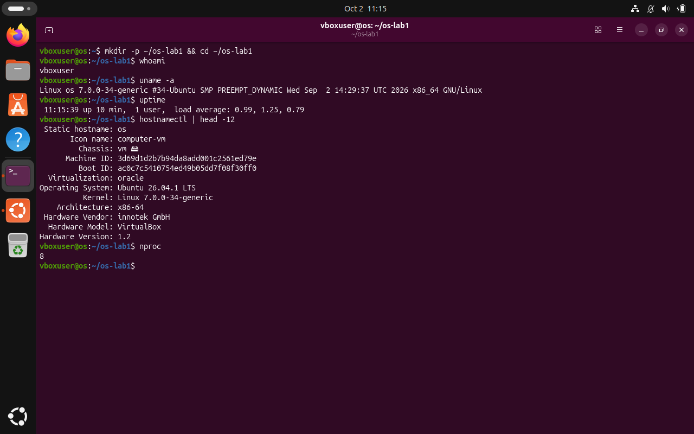

`mkdir -p ~/os-lab1 && cd ~/os-lab1` makes the work folder and goes into it. `whoami` prints my user name, `uname -a` the kernel that manages the machine (Linux 7.0.0-34-generic), `uptime` how long the system has been running. `hostnamectl` and `nproc` add that it is a VirtualBox virtual machine with 8 processors.

## Part 1. Files and directories

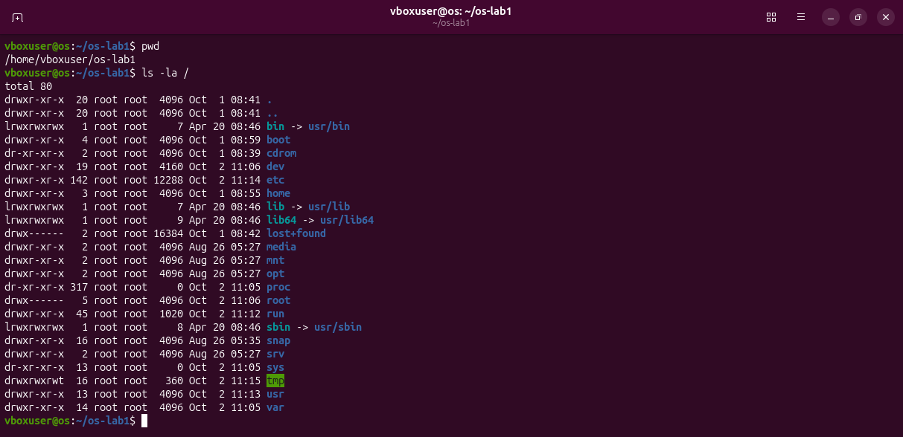

`pwd` prints the folder I am in. `ls -la /` lists the root of the whole tree: on Linux there are no drive letters, everything hangs under `/`. `-l` gives one line per entry with its details, `-a` also shows the hidden names that start with a dot.

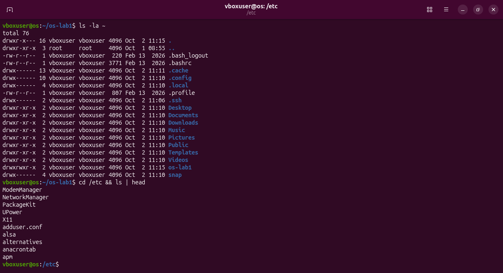

`ls -la ~` lists my home folder. `cd /etc && ls | head` goes into `/etc` and shows the first ten names; `|` (a pipe) sends the output of `ls` into `head`.

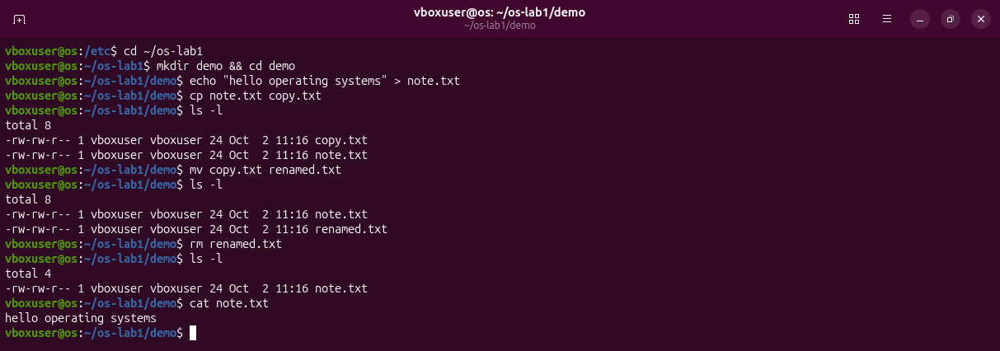

`echo "..." > note.txt` writes a line into a new file. `cp` copies it, `mv` renames the copy, `rm` deletes it. `ls -l` after each step shows the tree changing.

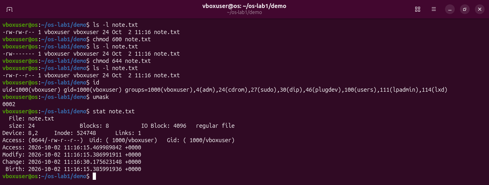

The ten characters at the start of `ls -l` are the type (`-` = ordinary file) and three groups of `rwx` (read, write, execute) for the owner, the group and everybody else. `chmod 600` leaves only `rw-` for the owner: `-rw-------`. `chmod 644` gives read back to the others: `-rw-r--r--`.

**Answers.** (1) The files belong to user `vboxuser` and group `vboxuser`. (2) `-rw-------`: a regular file that only its owner may read and write. (3) `/etc` holds the system configuration, `/home` the personal folders of the users.

## Part 2. Processes

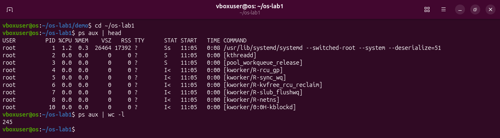

A process is a running program. `ps aux` lists all of them (`a` all users, `u` with the user and the memory, `x` also those without a terminal). `ps aux | wc -l` counts the lines: 245, one of them the header.

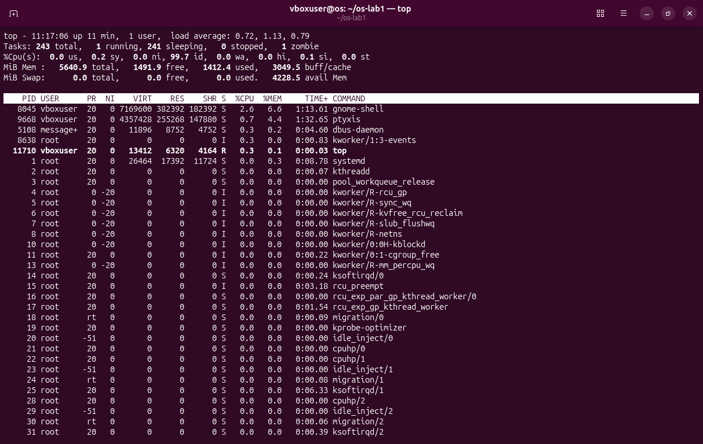

`top` is a live view, like the Windows Task Manager; `q` quits it. It shows 243 tasks.

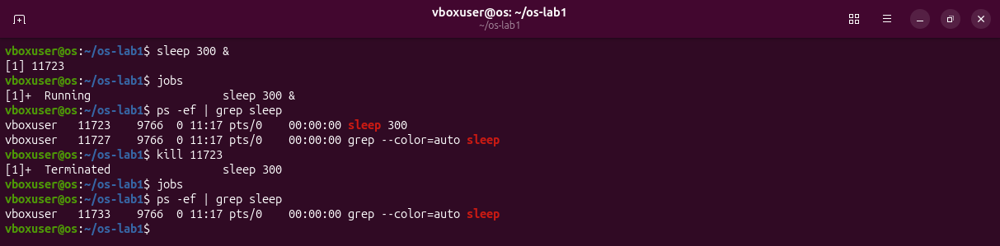

`sleep 300 &` starts a program that waits 300 seconds; `&` puts it in the background so the prompt comes back at once, and the shell prints its PID (process number), 11723. `jobs` lists the background jobs, `ps -ef | grep sleep` finds it among all processes, and `kill 11723` asks the kernel to end it.

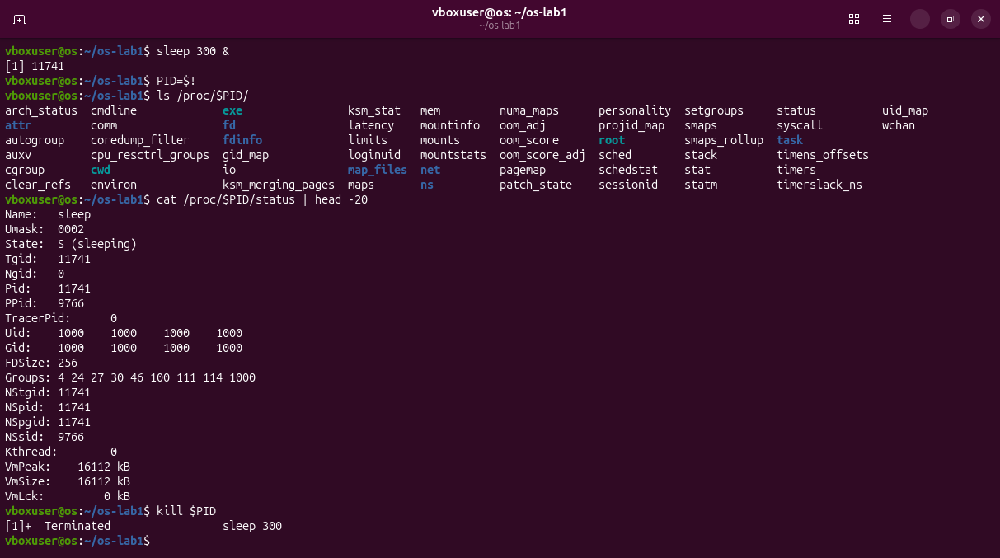

`/proc` is not on the disk: the kernel makes it up when it is read, one folder per process. `$!` is the PID of the last background job. `cat /proc/$PID/status` shows `State: S (sleeping)`.

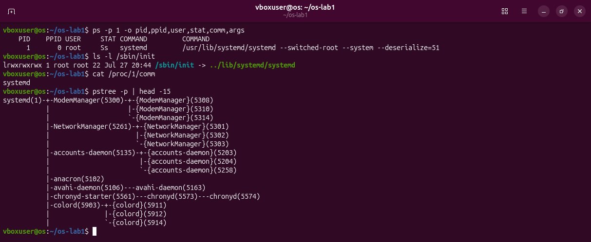

Process 1 is `systemd`: the kernel starts it first, and it starts everything else. `pstree` draws the family tree with `systemd(1)` at the top.

**Answers.** (1) PID 1 is `systemd`. (2) About 244 processes. (3) `State: S (sleeping)`: it waits for its timer and uses no processor time.

## Part 3. Memory

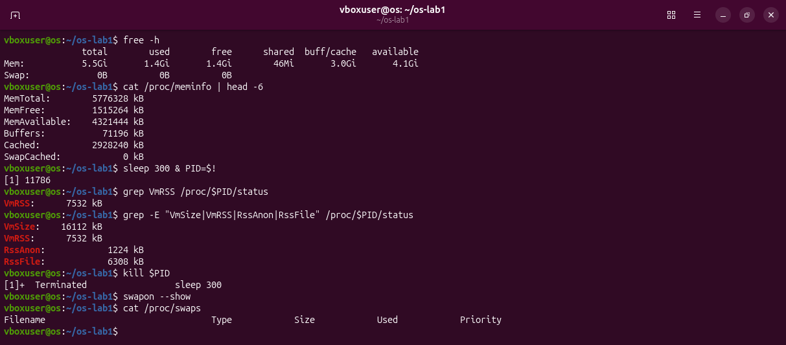

`free -h` shows the RAM in readable units: 5.5 GiB total, 1.4 GiB free, 4.1 GiB available. "Available" is bigger than "free" because Linux uses spare RAM as a cache and gives it back when a program needs it. `Swap: 0B` means there is no swap (disk space used as extra memory). `VmRSS` is the RAM a process really uses: 7532 kB for `sleep`, of which 6308 kB (`RssFile`) are the program and its libraries, shared with other processes.

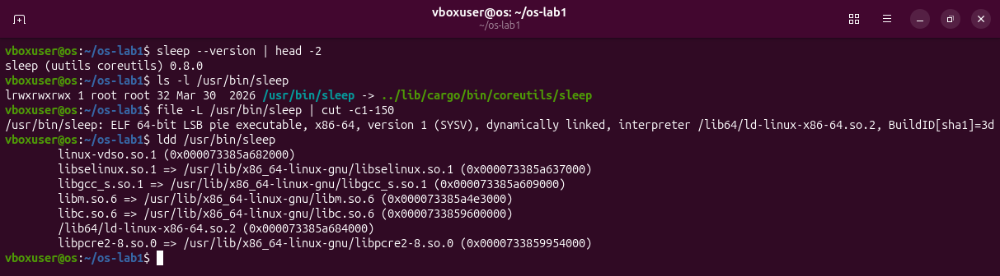

On this Ubuntu `sleep` is part of the Rust "uutils" coreutils, and `ldd` lists the shared libraries it loads. That explains why even a program that only waits uses several MB.

**Answers.** (1) 5.5 GiB total, 1.4 GiB free. (2) Swap is disk space for memory pages that are not in use; none is configured. (3) 7532 kB; mostly shared library pages.

## Part 4. Devices and storage

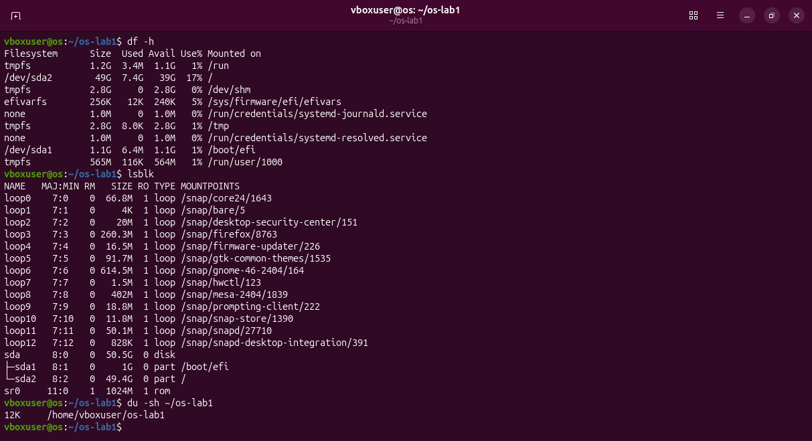

`df -h` lists the mounted file systems and their free space, `lsblk` the disks themselves (`sda`, with the partitions `sda1` and `sda2`; the `loop` devices are snap packages), `du -sh` the size of my work folder.

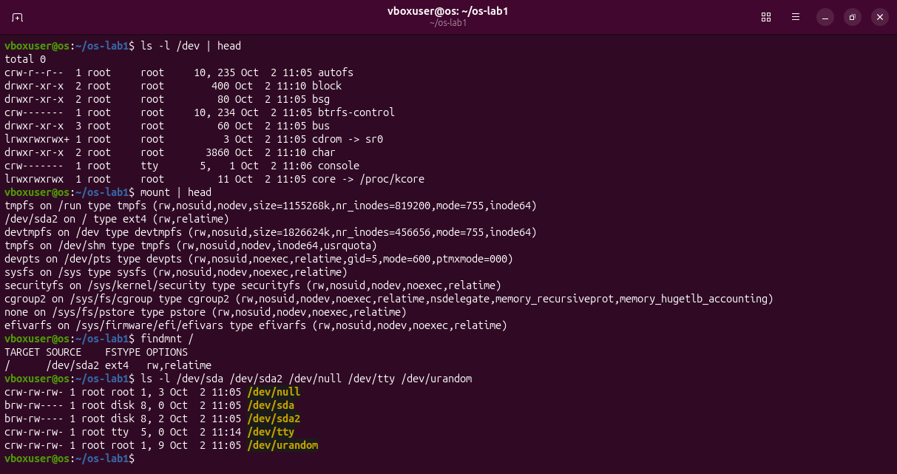

`/dev` shows devices as files: `c` = character device, `b` = block device. `mount` and `findmnt /` show that `/` comes from `/dev/sda2`, an ext4 file system.

**Answers.** (1) `/` is on `/dev/sda2`. (2) `/dev/sda` is the whole disk; `/dev/null` throws away whatever is written to it. (3) "Everything is a file": disks, terminals and the kernel's data about processes are all names in the same tree, read and written with the same calls as ordinary files.

## Optional: htop and strace

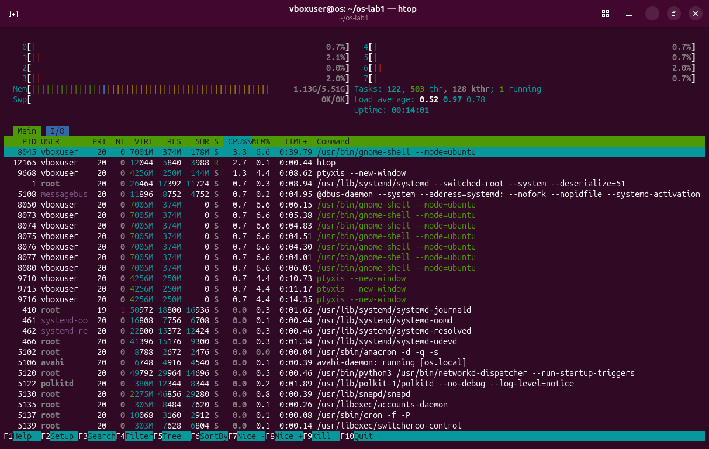

`htop` is a friendlier `top`, with a bar for each processor and for the memory.

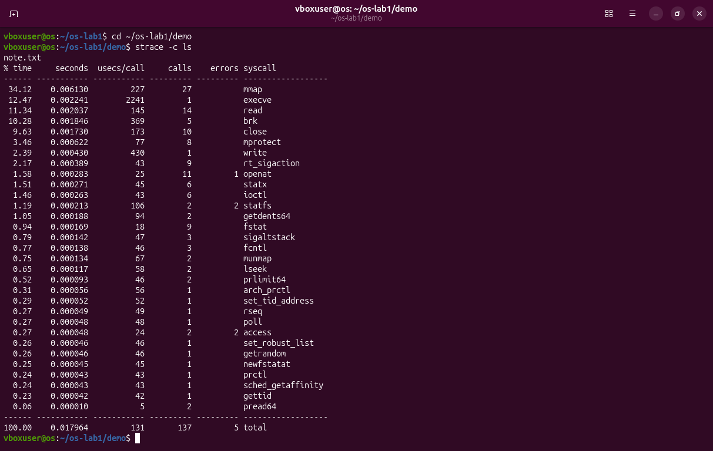

`strace -c ls` counts the system calls `ls` makes: 137 calls of 31 kinds just to list a folder with one file. Every one of them is a request to the kernel.

## Deliverable and conclusion

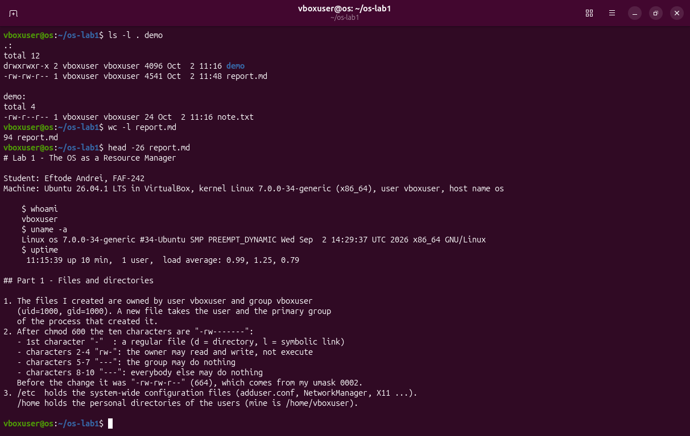

`report.md` holds the answers. The four resources and one command for each: files with `ls -l`, processes with `ps aux`, memory with `free -h`, devices with `lsblk`. In every case the program only asked, and the kernel decided.
