# Lab 2 – Meet the OS You Will Build

Course: Operating Systems, FCIM / FAF, UTM, 2026-2027. Track B: build your own small OS (xv6).

This page explains what was done in the lab, step by step: every command, what it printed, and why. The figure numbers are the same as in the Word report, so the two can be read side by side.

## What is in this folder

| File | What it is |
|---|---|
| `Lab2_EftodeAndrei_FAF-242.docx` | The report: title page, 25 screenshots, the answers to every Observe box, the optional part and the conclusion |
| `sleep.c` | My first xv6 program. It calls `pause()`, the current name of the system call. In xv6 it lives in `user/sleep.c` |
| `pingpong.c` | Optional part: a parent and its child pass one byte through two pipes. In xv6: `user/pingpong.c` |
| `Makefile` | The Makefile of the current xv6 with my two lines in `UPROGS`: `$U/_sleep\` and `$U/_pingpong\` |
| `notes.md` | The answers the sheet asks to write "in notes.md" |
| `screenshots/` | The terminal screenshots shown on this page (`fig-1-1.png` is Figure 1.1, and so on) |

**Why this lab was redone.** I first did Lab 2 in September on the last xv6 revision before the system call `sleep()` was renamed to `pause()` (upstream, August 2025). The teacher builds the programs on the current xv6, where `sleep()` no longer exists, so I did the whole lab again on a fresh clone of the current xv6 (revision `f780d78`). Figure 4.3 shows the sheet's `sleep()` version failing there, and Figure 4.4 the fix.

## How to run it

```bash
git clone https://github.com/mit-pdos/xv6-riscv ~/xv6-lab2
cp sleep.c pingpong.c ~/xv6-lab2/user/
cp Makefile ~/xv6-lab2/
cd ~/xv6-lab2 && make qemu
# at the xv6 prompt:
#   sleep 10        sleep        pingpong
# leave xv6: press Ctrl-A, release, then press X
```

## Words used on this page

- **xv6**: a very small Unix written at MIT for teaching, about 9,000 lines of C. It runs on a RISC-V processor.
- **QEMU**: a program that pretends to be a RISC-V computer, so xv6 can run inside my Ubuntu virtual machine.
- **Cross-compiler** (`riscv64-linux-gnu-gcc`): a C compiler that runs on my x86 machine but produces RISC-V code.
- **Two prompts.** `vboxuser@os:~/xv6-lab2$` is bash on Linux. A lonely `$` is the xv6 shell.
- **System call**: a request from a program to the kernel (read a file, create a process, wait some time).
- **`UPROGS`**: a list in the xv6 Makefile. Only the programs named there are built and put on the xv6 disk.

## Preparation

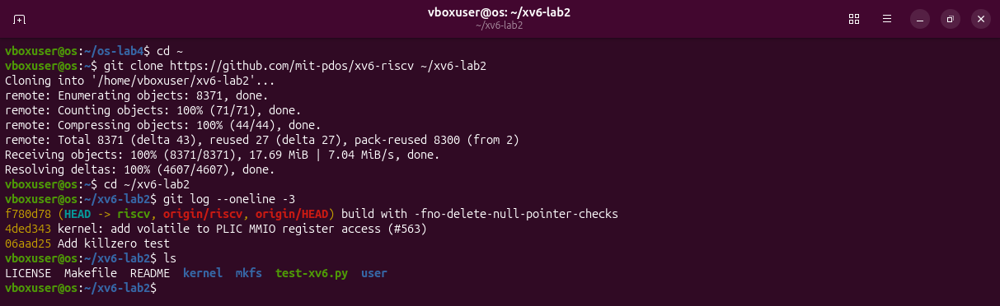

`git clone` downloads the xv6 source from GitHub into `~/xv6-lab2`. `git log --oneline -3` shows the newest commits: the top one, `f780d78`, is the current revision. `ls` shows the two main folders, `kernel/` and `user/`, and the `Makefile`.

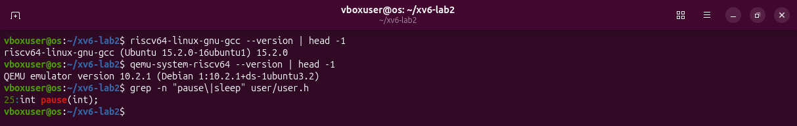

The cross-compiler is version 15.2.0 and QEMU 10.2.1. `grep -n "pause\|sleep" user/user.h` searches the list of system calls for either word: only `int pause(int);` is there, on line 25. There is no `sleep`.

## Part 1. Build it and boot it

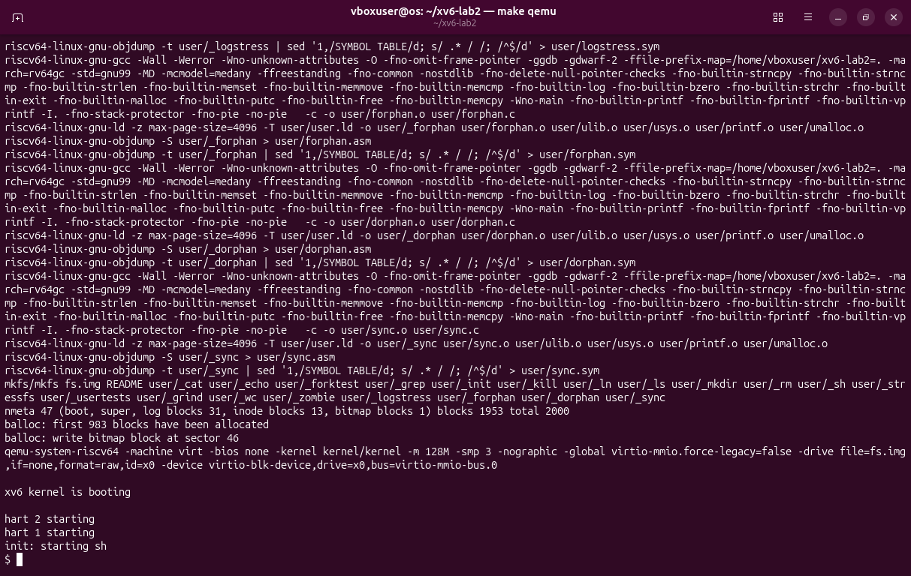

`make qemu` compiles the kernel and every user program, then `mkfs` builds the disk image `fs.img` with the programs on it, and QEMU starts. The kernel prints `xv6 kernel is booting`, the other two processors (`hart 1`, `hart 2`) start, and `init` starts the shell, which shows `$`.

## Part 2. Use xv6 as the Unix it is

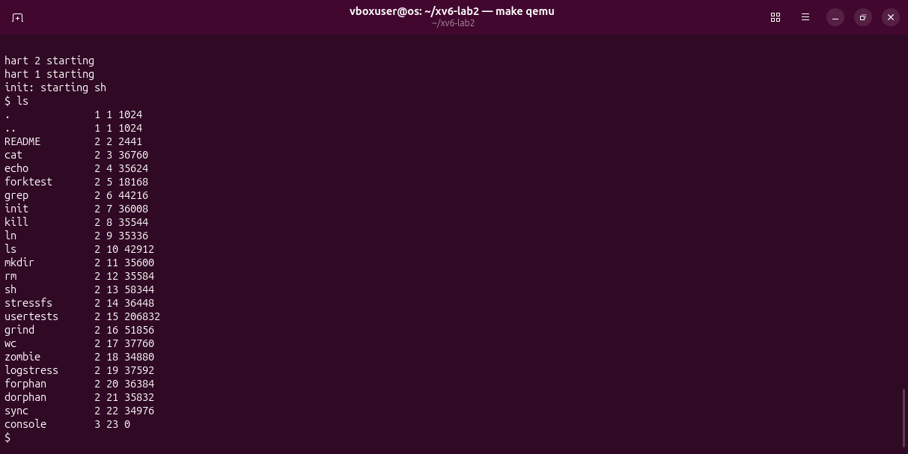

`ls` lists the root folder of the xv6 disk: `README` and the programs. The three numbers are the type (1 folder, 2 file, 3 device), the inode number and the size in bytes.

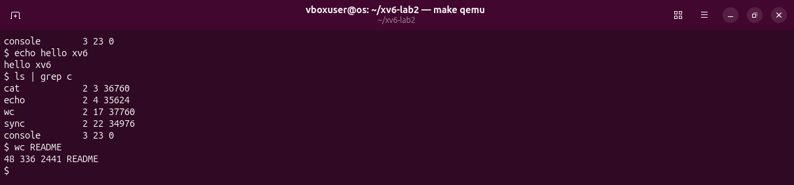

`echo hello xv6` prints its arguments. `ls | grep c` sends the listing of `ls` through a pipe into `grep`, which keeps the lines that contain a `c`. `wc README` counts lines, words and bytes: 48, 336, 2441.

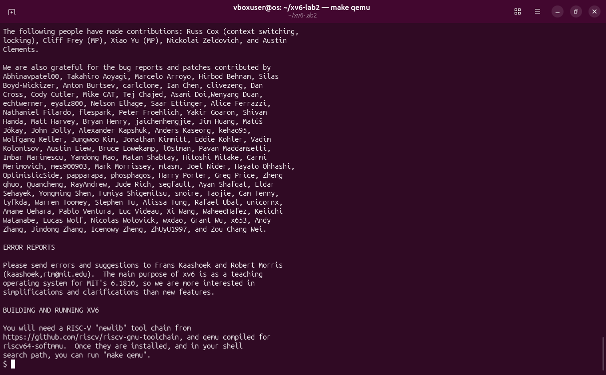

`cat README` prints the file; the screen shows its end.

**Answers.** (1) `ls`, `cat`, `echo`. (2) A pipe needs **processes** (the shell runs `ls` and `grep` as two processes at the same time) and **communication** between them (the kernel's pipe, a buffer with a write end and a read end). (3) It has the same idea as bash (commands, pipes, redirection) but is much smaller: no history, no Tab completion, no variables, no job control.

The sheet's optional `usertests -q` was started too; the tests were passing, but the VirtualBox machine froze under the load, so it is left out of the report.

## Part 3. Read the source

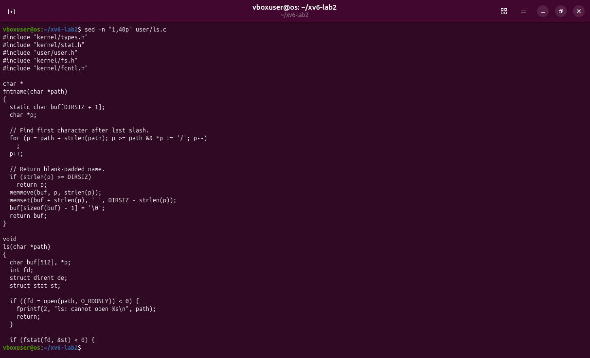

`sed -n "1,40p" user/ls.c` prints lines 1 to 40 of the `ls` program. It looks like an ordinary C program, but it includes `user/user.h` instead of `<stdio.h>`.

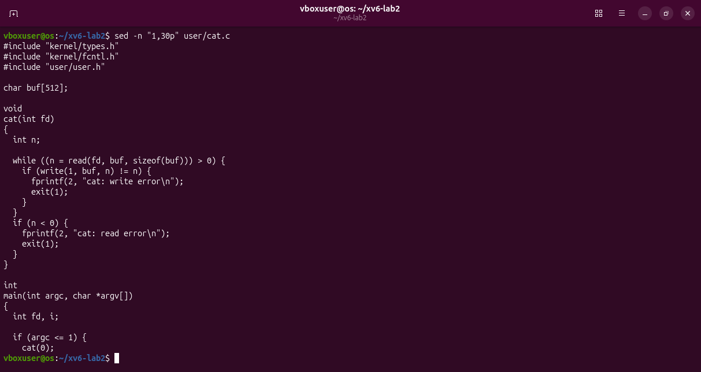

The first 30 lines of `cat.c`: a loop that calls `read` into a 512-byte buffer and `write` to descriptor 1 (the screen) until the file ends.

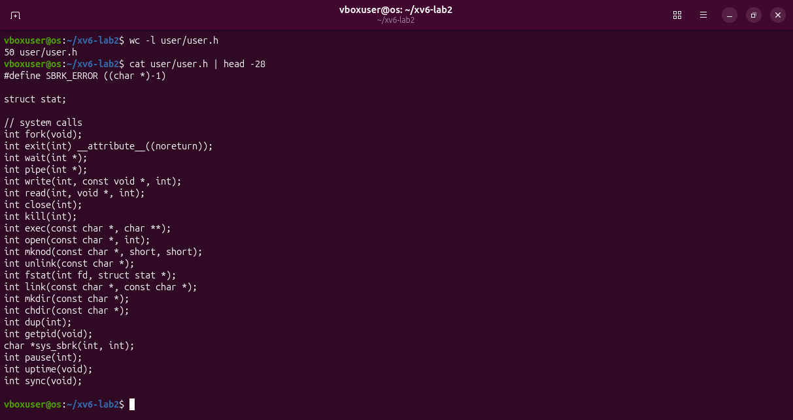

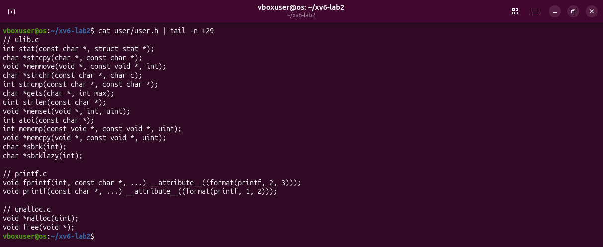

`user/user.h` is the list of everything a user program may call: first the system calls (`fork`, `exit`, `wait`, `pipe`, `write`, `read`, ..., `pause`), then ordinary library functions that run inside the program (`strcpy`, `printf`, `malloc`...).

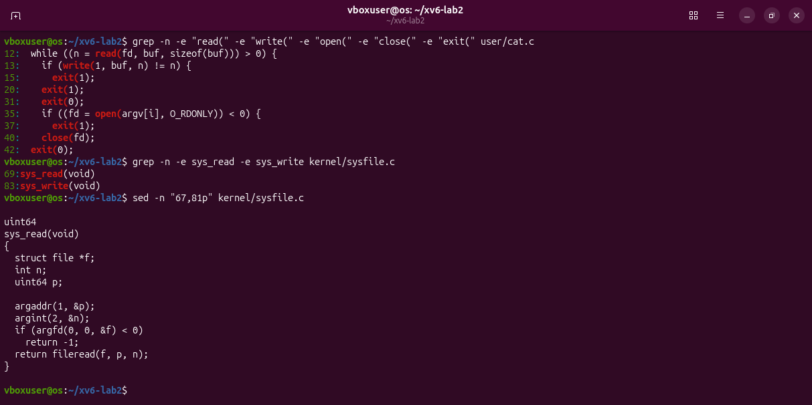

`grep -n -e "read(" -e "write(" ...` finds the lines of `cat.c` that use the system calls. `grep -n -e sys_read -e sys_write kernel/sysfile.c` finds the kernel functions that answer them: `sys_read` on line 69, `sys_write` on line 83. `sed -n "67,81p"` prints `sys_read`: it takes the arguments (descriptor, buffer address, count) and calls `fileread`.

**Answers.** (1) `read` copies bytes from an open file into a buffer, `write` sends bytes to a descriptor, `open` turns a file name into a descriptor, `close` gives it back, `exit` ends the process. (2) `kernel/sysfile.c`, line 69. (3) `kernel/` is the operating system itself and runs privileged; `user/` holds ordinary programs that can only ask the kernel through system calls.

## Part 4. Write your first xv6 program

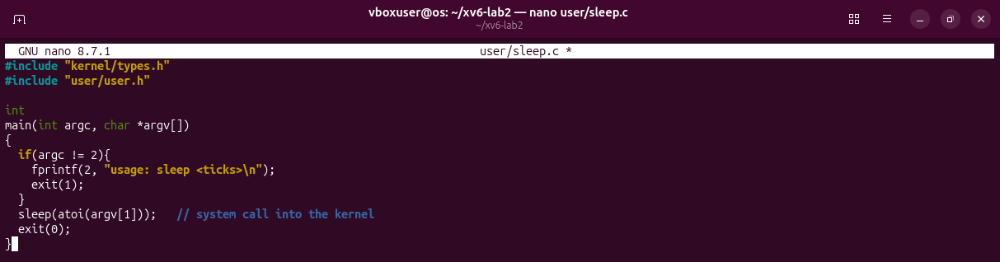

`nano user/sleep.c` opens the editor; the code is typed exactly as the sheet gives it. `argc != 2` means "not exactly one argument after the program name": then it prints the usage message to descriptor 2 (errors) and exits with 1. Otherwise `atoi` turns the text `"10"` into the number 10 and the system call waits that many ticks.

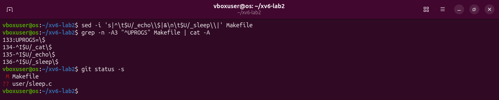

`sed -i 's|...|...|' Makefile` adds the line `$U/_sleep\` right after `$U/_echo\`. `cat -A` makes invisible characters visible: `^I` is the TAB at the start (the Makefile needs a TAB, not spaces) and `$` is the end of the line, so nothing follows the backslash. `git status -s` shows the changed `Makefile` and the new `user/sleep.c`.

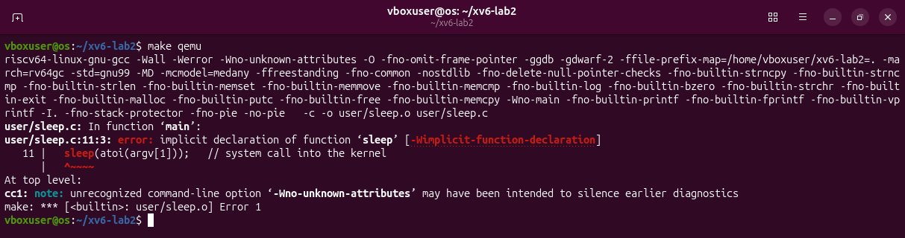

`make qemu` stops: `implicit declaration of function 'sleep'`. The compiler has never heard of `sleep`, because `user/user.h` no longer declares it, so it refuses to compile the call.

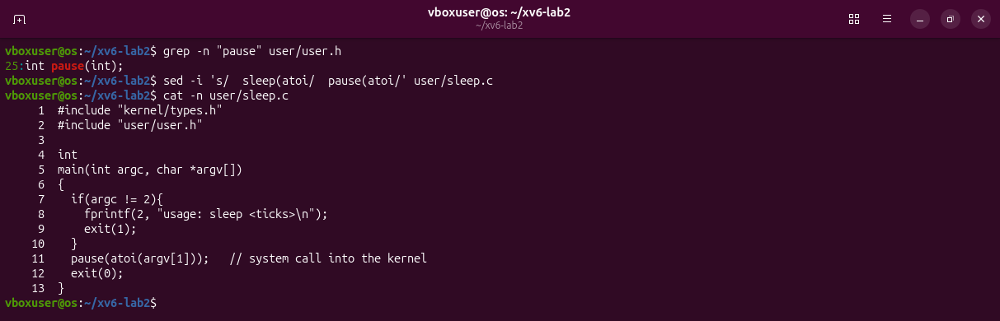

`grep` confirms that the system call is now `pause`. `sed -i 's/  sleep(atoi/  pause(atoi/'` changes the one call on line 11, and `cat -n` shows the final file.

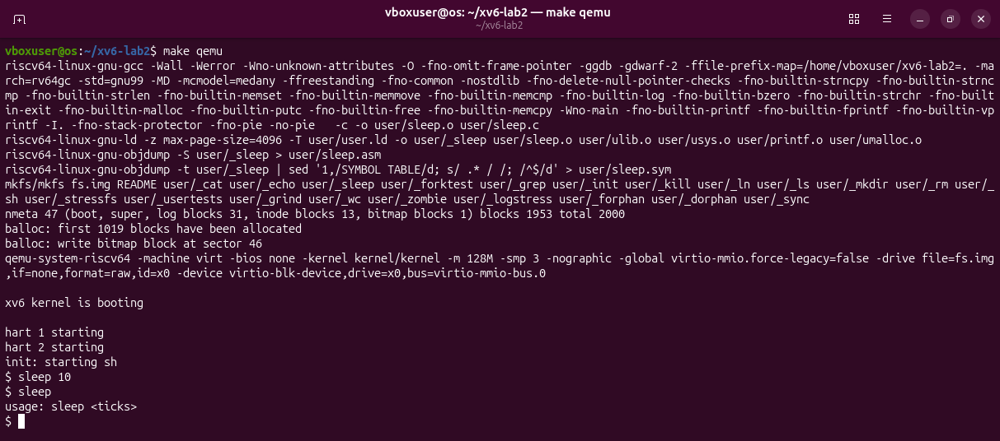

Now `make qemu` compiles `user/sleep.c`, puts `_sleep` on the disk and boots. `sleep 10` waits about one second and the prompt comes back; `sleep` with no argument prints `usage: sleep <ticks>`.

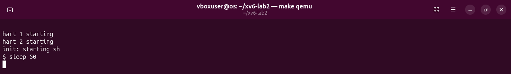

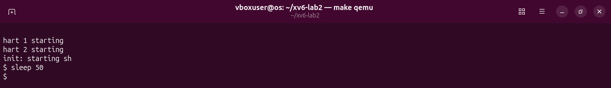

`sleep 50`: two seconds after Enter there is no prompt yet; a few seconds later it is back.

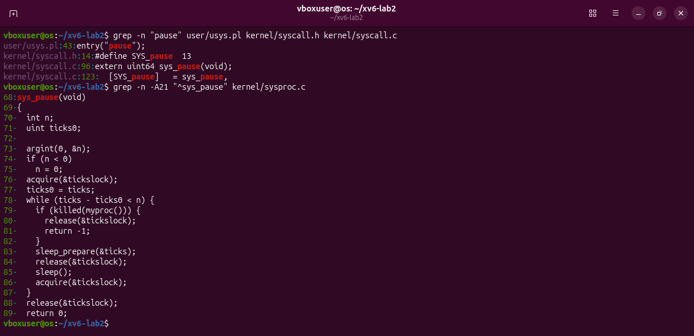

How the call reaches the kernel: `user/usys.pl` generates the stub `pause`, `kernel/syscall.h` gives it the number 13, and `kernel/syscall.c` maps number 13 to `sys_pause`. `sys_pause` (`kernel/sysproc.c`, line 68) reads the argument n, remembers the tick counter and sleeps until it has grown by n. One tick is about a tenth of a second.

## Optional: pingpong

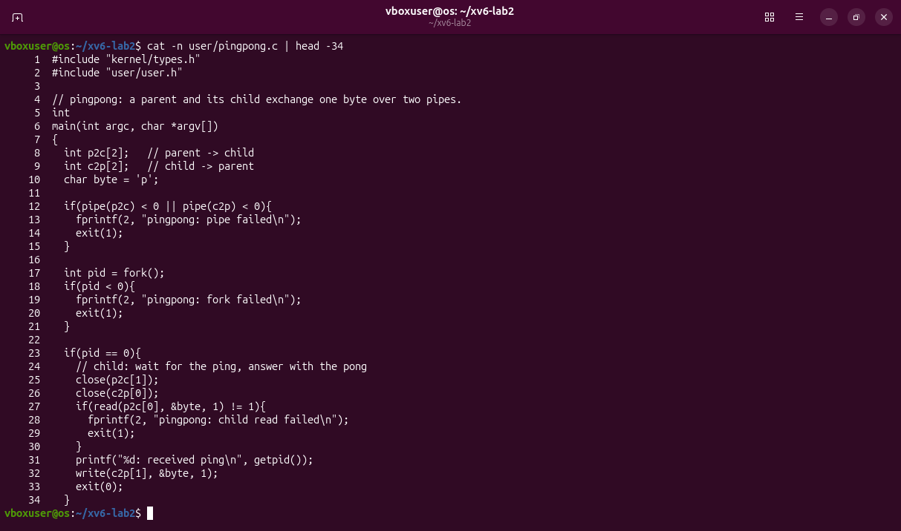

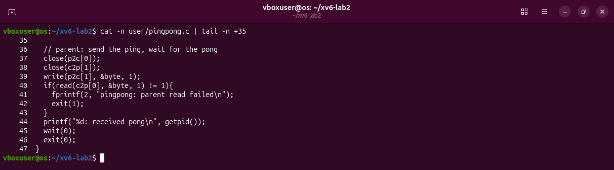

Two pipes, because a pipe goes one way only: `p2c` from parent to child and `c2p` from child to parent. After `fork()` there are two processes. The child closes the ends it does not use, waits in `read` for the byte, prints `received ping` and writes the byte back. The parent writes the byte, waits in `read` for the answer, prints `received pong` and `wait`s for the child.

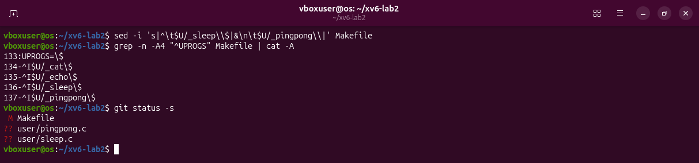

The line `$U/_pingpong\` is added after `$U/_sleep\` in the same way.

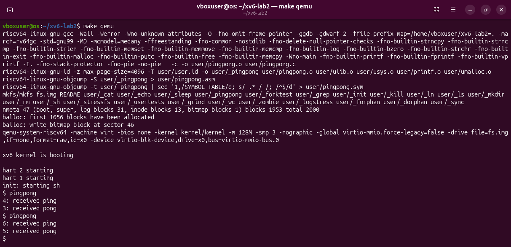

`4: received ping` comes from the child (PID 4), `3: received pong` from the parent (PID 3). The order is always ping first, because the parent's `read` blocks until the child has answered.

## Deliverables and conclusion

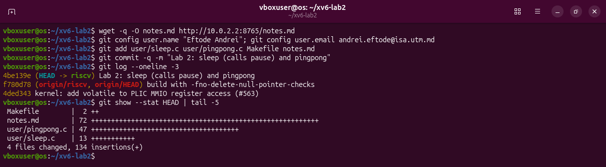

`notes.md` was written on the Windows side and copied into the virtual machine with `wget` (10.0.2.2 is how the virtual machine reaches Windows). `git commit` saves the four changed files as one commit on top of `f780d78`.

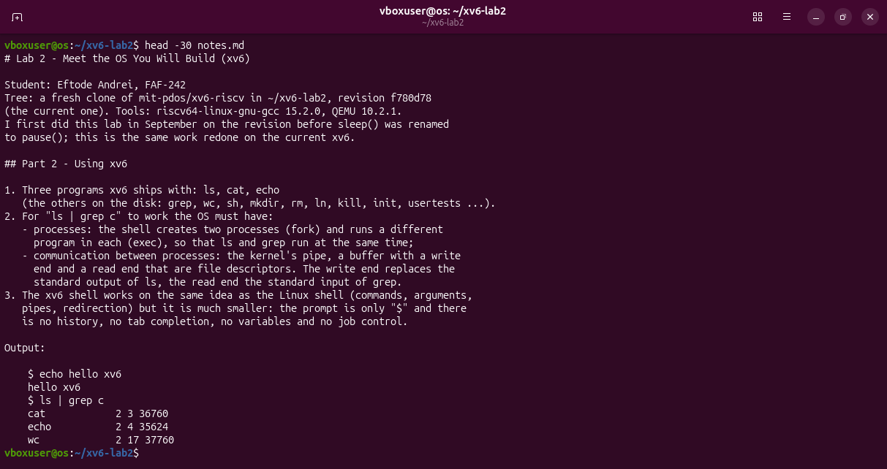

I built a real operating system from source, booted it and followed a system call from the program that asks (`user/`) to the kernel code that answers (`kernel/`). My `sleep` is a few lines of C; the waiting is done by the kernel.
