# Lab 5 – The File System with Your Own Hands

Course: Operating Systems, FCIM / FAF, UTM, 2026-2027. Track A: warm-up on Linux.

This page explains everything that was done in the lab, step by step: every command, what it printed, and why. The figure numbers are the same as in the Word report, so the two can be read side by side.

## What is in this folder

| File | What it is |
|---|---|
| `Lab5_EftodeAndrei_FAF-242.docx` | The report: title page, 29 screenshots, the answers to every Observe box and to the four stretch tasks |
| `report.md` | The answers the sheet asks to write "in report.md", with the outputs that support them |
| `full_explanations.md` | The slow version of this page: every command taken apart, the ideas behind it, worked examples, and a self-test |
| `screenshots/` | The terminal screenshots shown on this page (`fig-1-1.png` is Figure 1.1, and so on) |

There is no program in this lab: the sheet says "no programming today", only commands and observation.

## Where it was done

The sheet says "your own Linux laptop". My laptop runs Windows 11, so the lab was done in the Linux virtual machine used for all the labs: **Ubuntu 26.04.1 LTS** in VirtualBox, user `vboxuser`, computer name `os`. A virtual machine is a whole computer simulated inside a program, with its own (virtual) disk, processors and memory. That is why the answers about cores, RAM and disks in Part 4 describe the virtual machine, not the real laptop.

## Words used on this page

- **File system**: the way the disk is organised so that files can be found by name. The Ubuntu disk uses **ext4**, the usual Linux file system. Windows uses NTFS for the same job.
- **Directory**: the Linux word for a folder.
- **Path**: the address of a file, like `/home/vboxuser/os-lab5/notes.txt`. Linux uses `/` where Windows uses `\`, and there are no drive letters: everything hangs from one root, `/`.
- **Inode** ("index node"): the record that *is* the file. It holds the type, the size, the owner, the permissions, the times and the list of disk blocks with the content. It does **not** hold the name.
- **Directory entry**: one line in a directory, "this name → that inode number". A directory is just a table of such lines.
- **Hard link**: one more directory entry pointing to the same inode, so one file with two names.
- **Symbolic link** (symlink, soft link): a tiny file whose content is a path to another file. Windows shortcuts are similar.
- **Block**: the unit in which the disk gives out space. Here a block is 4096 bytes (4 KiB).
- **Permissions**: who may read (`r`), write (`w`) or execute (`x`) a file: its owner (`u`), its group (`g`) and everybody else (`o`).
- **root**: the administrator account on Linux. Root skips almost every permission check, which is why the sheet says not to work as root: the experiments would not show anything.
- **`/dev` and `/proc`**: folders that are not on the disk. The kernel makes them up: `/dev` shows the devices as files, `/proc` shows the running processes and the kernel's own numbers as files.

## Before the lab

```bash
whoami                 # must not print root
mkdir -p ~/os-lab5 && cd ~/os-lab5
```


- `whoami` prints the name of the user running the shell: `vboxuser`, not `root`. Good.
- `id` (my extra) shows the user number (`uid=1000`) and the groups. Being in the group `sudo` means I *may* ask for root rights with `sudo`, but I am not root by default.
- `mkdir -p ~/os-lab5` creates the folder `os-lab5` in my home folder (`~` means `/home/vboxuser`). `-p` means "no error if it already exists". `&& cd ~/os-lab5` goes into it, only if `mkdir` succeeded.
- `pwd ; ls -la` prints where I am and lists the folder: it is empty, only `.` (the folder itself) and `..` (its parent).

## Part 1 – The tree and the file types

### The root and five paths

```bash
ls /
ls -ld /etc /etc/passwd /bin /dev/null /tmp
```

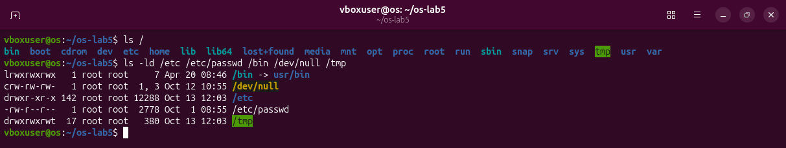

`ls /` lists the top of the tree. `ls -ld` shows details (`-l`, long format) of the paths themselves, not of what is inside them (`-d`). In the long format the **first letter** is the type:

| Letter | Type | Here |
|---|---|---|
| `-` | regular file | `/etc/passwd`, the list of user accounts |
| `d` | directory | `/etc` (system settings), `/tmp` (temporary files) |
| `l` | symbolic link | `/bin -> usr/bin` |
| `c` | character device | `/dev/null`, the "black hole": everything written to it disappears |
| `b` | block device | none in this list; see Figure 1.4 |

The next nine letters are the permissions (Part 3), then the number of links (Part 2), the owner, the group, the size, the date and the name. For devices there is no size: `1, 3` are the device numbers (major 1, minor 3), which tell the kernel which driver handles it.

### The first entries of /dev

```bash
ls -l /dev | head
```

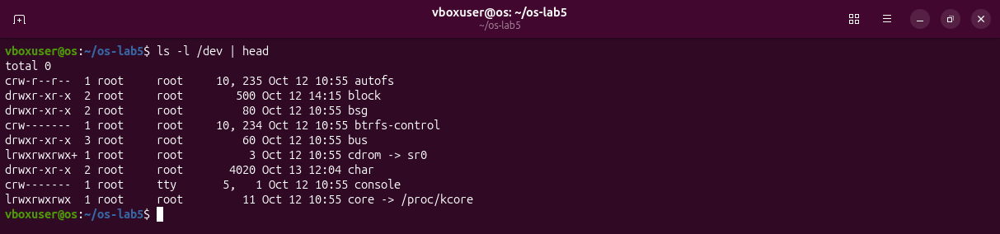

The `|` (pipe) sends the output of `ls` into `head`, which keeps only the first 10 lines. `/dev` mixes character devices (`c`: `autofs`, `console`), directories (`d`: `block`, `bus`) and links (`l`: `cdrom -> sr0`, `core -> /proc/kcore`).

### file and du

```bash
file /usr/bin/ls /etc/passwd /bin
du -sh /var/log 2>/dev/null ; du -sh /usr 2>/dev/null
```

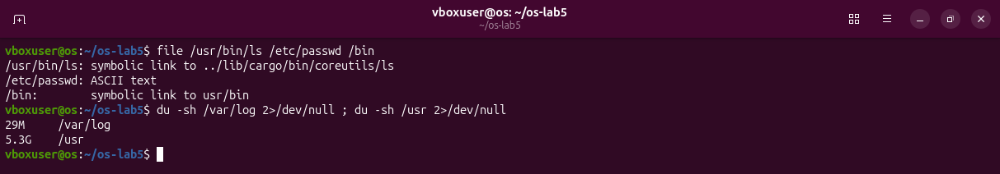

- `file` looks at a file and says what it is. `/etc/passwd` is "ASCII text". `/bin` is "symbolic link to usr/bin". A surprise: `/usr/bin/ls` is also a symbolic link, to `../lib/cargo/bin/coreutils/ls`. Ubuntu 26.04 replaced the classic GNU tools with a rewrite in the Rust language (see Figure 1.5).
- `du -sh` ("disk usage", summary, human-readable sizes) adds up the space used by everything under a folder. `/var/log` (log files) uses **29M**, `/usr` (installed programs and libraries) uses **5.3G**: about 190 times more.
- `2>/dev/null` sends the error messages (stream number 2) into the black hole. As a normal user `du` cannot open some folders and would print "Permission denied" for each of them; the number it prints counts only what it could read.

### Block devices and more character devices (extra)

```bash
ls -l /dev | grep '^b'
ls -l /dev/tty /dev/zero /dev/random
```

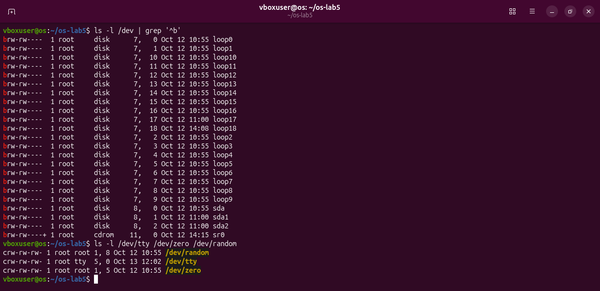

`grep '^b'` keeps only the lines that start (`^`) with `b`: the block devices. They are `sda` (the whole virtual disk, major 8 minor 0), `sda1` and `sda2` (its two partitions), `sr0` (the CD drive), and `loop0` to `loop18`. A **loop device** makes a file look like a disk; Ubuntu uses them to mount its snap packages. A block device is read in blocks and can be jumped around in (a disk); a character device is a stream of bytes (a terminal, `/dev/null`, `/dev/zero`, `/dev/random`).

### Where /bin and ls really are (extra)

```bash
readlink /bin ; ls -ld /bin /sbin /lib /usr/bin
file -L /usr/bin/ls /bin
ls -l /usr/bin/ls /usr/lib/cargo/bin/coreutils/ls
```

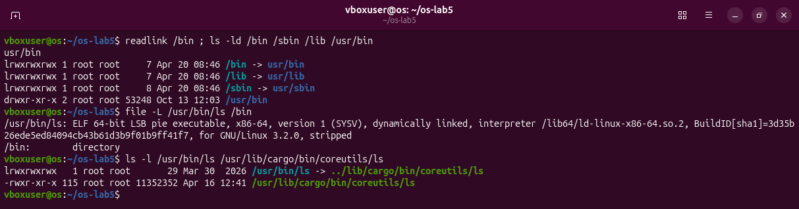

- `readlink /bin` prints what the link contains: `usr/bin`. Modern Linux keeps all programs in `/usr/bin`, and `/bin`, `/sbin`, `/lib` are only links, kept so that old paths still work.
- `file -L` follows the links before looking: `/usr/bin/ls` is in the end an "ELF 64-bit LSB pie executable", a Linux program.
- The real program `/usr/lib/cargo/bin/coreutils/ls` is 11 MB and has **115** links. It is one program with 115 names (`ls`, `cat`, `cp`, `mv`...); it looks at the name it was started with to know what to do. This is a real use of hard links (Part 2).

### Answers

1. `/etc` directory, `/etc/passwd` regular file, `/bin` symbolic link, `/dev/null` character device, `/tmp` directory (with the sticky bit `t`).
2. `/bin` is a symbolic link to `usr/bin`, that is `/usr/bin`.
3. Character device: `/dev/null` (1, 3). Block device: `/dev/sda` (8, 0), the disk.
4. `/usr` (5.3G) is bigger than `/var/log` (29M), by about 5.3 GB, roughly 190 times.

## Part 2 – Inodes and links

### An inode, and a name that is not part of it

```bash
echo hello > notes.txt
stat notes.txt
ls -li notes.txt
```

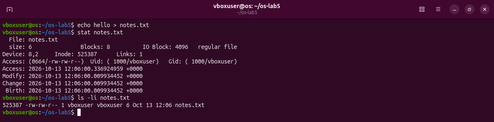

`echo hello > notes.txt` creates a file with the text `hello` and an end-of-line: 6 bytes. `stat` prints the inode of the file:

- `Inode: 525387`: the inode number, the real identity of the file.
- `Links: 1`: how many names (directory entries) point to this inode.
- `size: 6`: the size in bytes. `Blocks: 8`: the space used, counted in 512-byte units, so 4096 bytes. `IO Block: 4096`: the block size.
- `Access: (0664/-rw-rw-r--)`, `Uid`, `Gid`: the permissions and the owner.
- `Access`, `Modify`, `Change`, `Birth`: the times of last read, last change of the content, last change of the inode, and creation.

The name `notes.txt` is not in this list. It is stored in the directory `os-lab5`, as "notes.txt → 525387". `ls -li` shows the inode number in the first column and the link count after the permissions.

### A hard link, then remove the "original"

```bash
ln notes.txt hard.txt
ls -li notes.txt hard.txt
rm notes.txt
cat hard.txt ; ls -li hard.txt
```

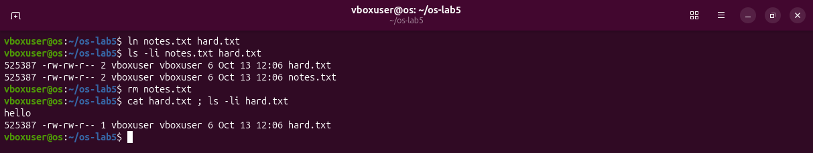

`ln` (without `-s`) makes a hard link: a second directory entry, `hard.txt → 525387`. Both names show the **same inode number** and a link count of **2**. Nothing was copied; there is still one file with two names, and neither name is the "original".

`rm notes.txt` removes the entry `notes.txt` and lowers the count to 1. `cat hard.txt` still prints `hello`: the inode and its data are untouched. This is what `rm` really does: it removes a **name**. The kernel frees the inode and its blocks only when the count reaches 0 and no program has the file open. (The system call behind `rm` is even called `unlink`.)

### A symbolic link, then remove its target

```bash
ln -s hard.txt soft.txt
ls -li hard.txt soft.txt
cat soft.txt
rm hard.txt
cat soft.txt ; ls -l soft.txt
readlink soft.txt ; echo -n hard.txt | wc -c
```

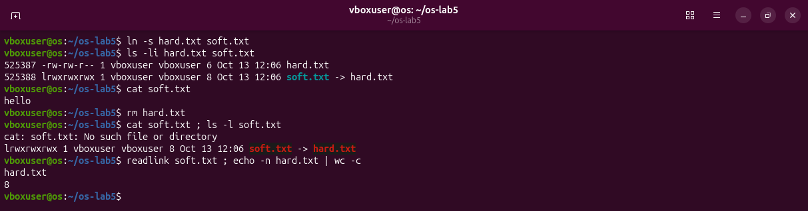

- `ln -s` makes a symbolic link. It has its **own** inode, 525388, its type is `l`, and `ls` shows where it points: `soft.txt -> hard.txt`.
- `cat soft.txt` prints `hello`: the kernel reads the path inside the link and follows it.
- After `rm hard.txt`, the link is still there, but the name it contains does not exist any more. `cat` answers "No such file or directory", and `ls` paints the link red: a **dangling** link.
- The size of `soft.txt` is **8** bytes. `readlink` shows its content, `hard.txt`, and `wc -c` counts it: 8 characters. A symbolic link stores exactly the path, nothing more.

### Directories have links too

The sheet asks to predict first. **My prediction:** a new directory has 2 links, and 4 after two subdirectories.

```bash
mkdir d ; ls -ld d
mkdir d/x d/y ; ls -ld d
ls -lai d
ls -ldi d d/. d/x/.. d/y/..
```

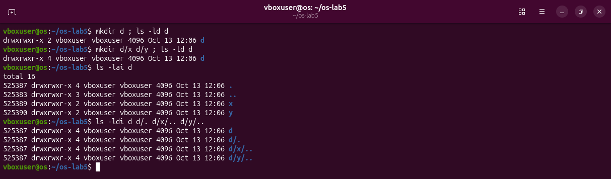

The prediction was right: 2, then 4. The last two commands (my extra) show where the links come from. `ls -lai d` lists `d` with its hidden entries and inode numbers. `ls -ldi` on four different paths shows the same inode **525387** four times:

1. `d`: the entry "d" in `os-lab5`;
2. `d/.`: the entry "." inside `d`, which points to `d` itself;
3. `d/x/..`: the entry ".." inside `x`, which points to its parent `d`;
4. `d/y/..`: the same inside `y`.

So a directory always has 2 links plus one per subdirectory. (Look at the number: 525387 was the inode of `notes.txt`/`hard.txt`. When `rm hard.txt` freed it, the file system gave the number to `d`.)

### Size is not space

```bash
echo x > one.txt ; ls -l one.txt ; du -h one.txt
truncate -s 1G big.img ; ls -lh big.img ; du -h big.img
rm big.img
```

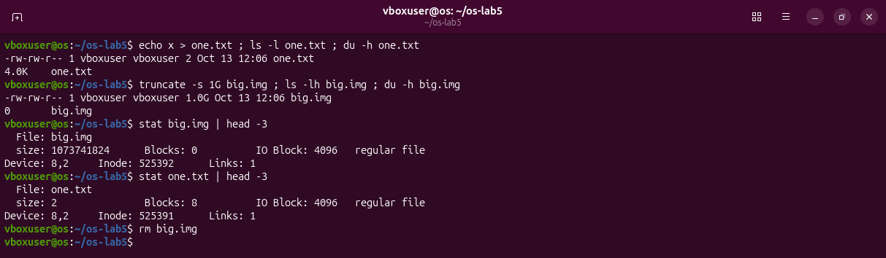

`ls` shows the **size** (how many bytes the file says it has), `du` shows the **space** (how many blocks it really occupies).

- `one.txt` has 2 bytes (`x` and an end-of-line), but `du` says 4.0K: the smallest piece of disk a file can get is one 4096-byte block. `stat` confirms `Blocks: 8` (8 × 512 = 4096).
- `truncate -s 1G` only writes "size = 1 GiB" into the inode. No data is written and no block is given (`Blocks: 0`). Such a file is called **sparse**: reading it returns zeros that are not stored anywhere. `du` says 0.

### Answers

1. `Inode: 525387` is the inode number; `Links: 1` is the number of names.
2. `ln` gave inode 525387 a second name. `rm` removes a name and lowers the link count; the data stays while another name (or an open descriptor) remains.
3. `soft.txt` holds only the path `hard.txt`, and that name is gone. It is 8 bytes because `hard.txt` has 8 characters.
4. The name `d`, the `.` inside `d`, and the `..` inside each of `x` and `y`.
5. Space is given in whole 4 KiB blocks; the 1 GB file is sparse and has no blocks.

## Part 3 – Permissions

### Files

```bash
echo secret > s.txt
chmod 600 s.txt ; ls -l s.txt
chmod 000 s.txt ; cat s.txt
chmod u+r s.txt ; cat s.txt
```

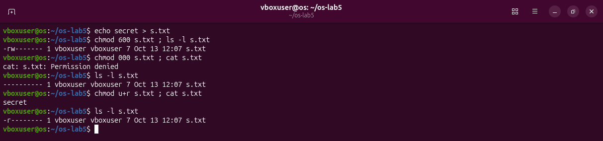

The permissions are 9 letters in three groups: owner, group, others. Each group is `r` (read, 4), `w` (write, 2), `x` (execute, 1), or `-` for "no". Adding the numbers gives one digit per group, so `600` = `rw-` `---` `---`.

- `chmod 600`: only I may read and write.
- `chmod 000`: nobody may do anything. `cat s.txt` fails with "Permission denied", although the file is mine.
- `chmod u+r`: add (`+`) read (`r`) for the user (`u`, the owner). `cat` works again; the mode is now `r--------`.

### The umask

```bash
umask ; touch new.txt ; mkdir newdir ; ls -ld new.txt newdir
umask -S
```

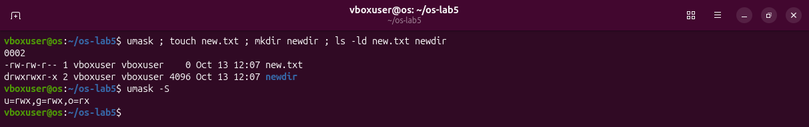

The **umask** is a mask of the rights that new files must *not* get. Mine is `0002`: take away `w` from "others". Programs create files with 666 (`rw-rw-rw-`) and directories with 777 (`rwxrwxrwx`), and the mask removes write for others:

```
file:       666  rw-rw-rw-   minus 002  →  664  rw-rw-r--   (new.txt)
directory:  777  rwxrwxrwx   minus 002  →  775  rwxrwxr-x   (newdir)
```

`umask -S` prints the same mask the other way round, as what is allowed: `u=rwx,g=rwx,o=rx`.

### The four modes of the first question (extra)

```bash
for m in 600 644 755 700; do echo x > p$m; chmod $m p$m; done
ls -l p600 p644 p755 p700
stat -c '%a  %A  %n' p600 p644 p755 p700
```

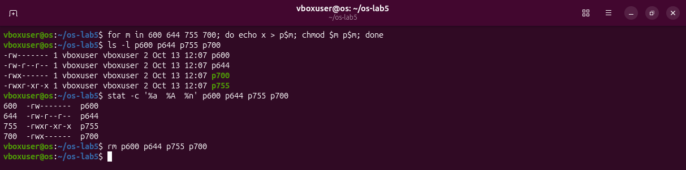

The `for` loop makes four files and gives each one the mode in its name. `stat -c` prints chosen fields: `%a` the mode as a number, `%A` as letters, `%n` the name. So the answer is printed by the system itself:

```
600  rw-------   private file: an SSH private key
644  rw-r--r--   normal file everyone may read: /etc/passwd
755  rwxr-xr-x   program or folder everyone may use: /usr/bin/ls, /etc
700  rwx------   private folder or script: ~/.ssh
```

### Directories: the box experiment

**My prediction:** with `r` only, `ls box` works and `cat box/f` fails; with `x` only, `ls box` fails and `cat box/f` works.

```bash
mkdir box ; echo hi > box/f
chmod u=r,go= box  ; ls box ; cat box/f     # read only
chmod u=x,go= box  ; ls box ; cat box/f     # execute only
chmod 755 box
```

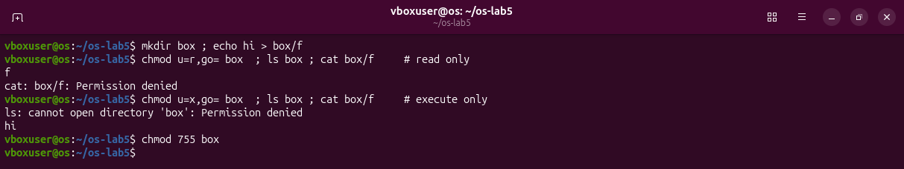

The prediction was right. `u=r,go=` means "owner: exactly `r`; group and others: nothing".

- **`r` only:** `ls box` prints `f`, but `cat box/f` is denied.
- **`x` only:** `ls box` is denied ("cannot open directory"), but `cat box/f` prints `hi`.

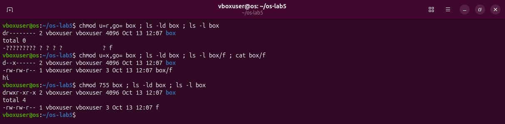

`ls -l` makes it clearer (my extra). With `r` only, `ls -l box` knows the name `f` but shows `-????????? ? ? ? ? ? f`: it can read the table of names, but cannot go *into* the directory to reach the inode of `f`. With `x` only, `ls -l box/f` shows all the details: if you already know the name, you can pass through.

So on a directory, `r` = read the list of names, `x` = pass through it to the files inside, `w` = change the list (create, delete, rename), which also needs `x`.

### Special bits and other people's files

```bash
ls -l /usr/bin/passwd ; ls -ld /tmp
cat /etc/shadow
ls -l /etc/shadow
stat -c '%a  %A  %U:%G  %n' /usr/bin/passwd /tmp /etc/shadow
```

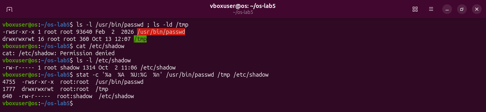

- `/usr/bin/passwd` is `rwsr-xr-x`, mode **4755**. The `s` in place of the owner's `x` is the **setuid** bit: whoever runs the program, it runs with the rights of the file's owner, root. `passwd` changes your password, and passwords are kept (as hashes) in `/etc/shadow`, which is `rw-r-----` root:shadow (640). A normal user cannot even read it (`cat` is denied), so `passwd` needs root's rights to write the new hash there.
- `/tmp` is `rwxrwxrwt`, mode **1777**. Everyone may create files there, and the `t` (**sticky** bit) adds one rule: a file in `/tmp` may be deleted or renamed only by its owner (or root). Without it, anyone could delete other people's temporary files.

### Answers

1. 600 `rw-------` (private key), 644 `rw-r--r--` (`/etc/passwd`), 755 `rwxr-xr-x` (programs), 700 `rwx------` (`~/.ssh`).
2. For the owner the kernel uses only the owner bits, and they were `---`. Owning a file grants no access, only the right to `chmod` it.
3. The umask `0002` removes write for others: files get 664, directories 775.
4. `r` lists the names; `x` lets you go through to a name you know.
5. `s` (setuid): `passwd` runs as root to write `/etc/shadow`. `t` (sticky): in `/tmp` only the owner may delete a file.

## Part 4 – Disks and the kernel as files

### lsblk

```bash
lsblk
```

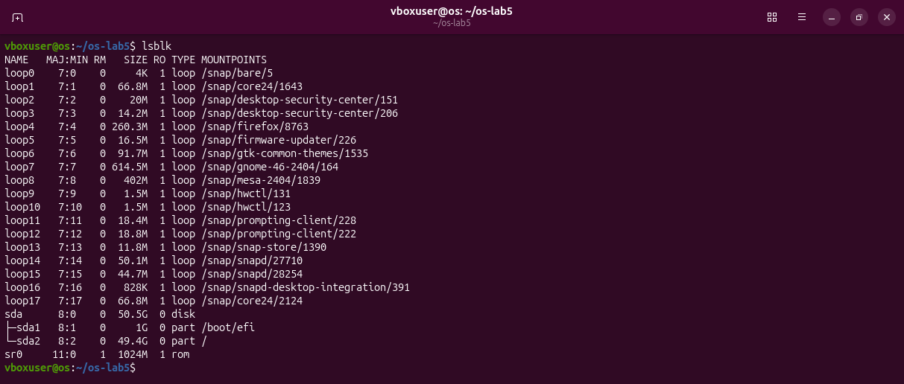

`lsblk` lists the block devices as a tree. The loop devices `loop0` to `loop17` are the snap packages (Firefox, the GNOME libraries...), each one a read-only image mounted under `/snap`. The real disk is at the bottom: `sda`, 50.5G, with `sda1` (1G, mounted at `/boot/efi`) and `sda2` (49.4G, mounted at `/`).

### df and mount

```bash
df -h
mount | grep " / "
```

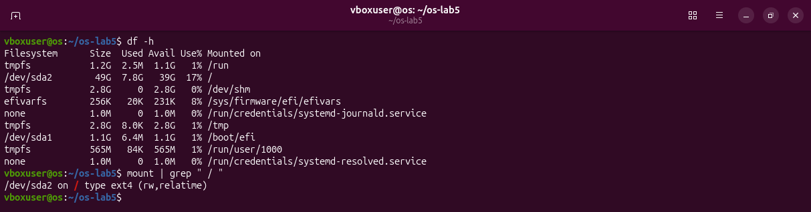

`df -h` shows how full every mounted file system is. Many lines are `tmpfs`, file systems that live in RAM. The real one is `/dev/sda2`, mounted on `/`: 49G, 7.8G used, 39G free, **17%**. `mount` lists every mount; `grep " / "` keeps the root: `/dev/sda2 on / type ext4 (rw,relatime)`, read-write, with `relatime` (the access time is updated only now and then, to save writes).

### The kernel as files

```bash
grep -c processor /proc/cpuinfo
head -3 /proc/meminfo
head -5 /proc/self/status
ls -l /proc/self/fd
```

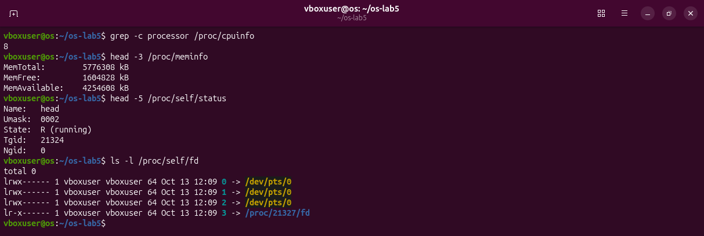

- `/proc/cpuinfo` has one block of text per processor, each starting with `processor : N`. `grep -c` counts the matching lines: **8**.
- `/proc/meminfo`: `MemTotal: 5776308 kB`, about **5.5 GiB**. The virtual machine was given 6403 MB; the firmware and the kernel keep the rest.
- `/proc/self/status` printed `Name: head`. `/proc/self` is a link that always points to the folder of the process that opens it, and here that process was `head`.
- `ls -l /proc/self/fd` lists the open files (file descriptors) of... `ls` itself: 0, 1 and 2 (input, output, errors) on the terminal `/dev/pts/0`, and 3, the folder `/proc/21327/fd` that `ls` opened to read this list.

### My disk, without the loop devices (extra)

```bash
lsblk -e7 -o NAME,SIZE,TYPE,FSTYPE,MOUNTPOINTS
df -h /
nproc ; free -h
grep "model name" /proc/cpuinfo | head -1
```

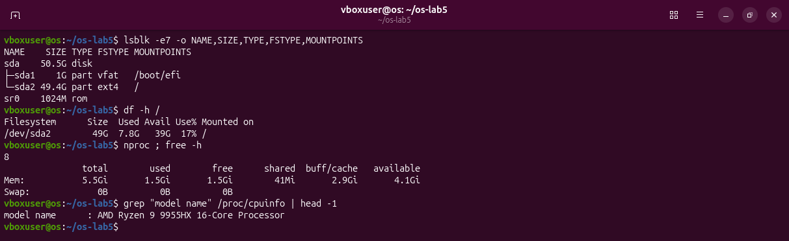

`-e7` excludes the devices with major number 7 (the loop devices), and `-o` chooses the columns, including `FSTYPE`, the file system type. The drawing of my disk:

```
/dev/sda   50.5G   the virtual disk
 ├── sda1   1G      vfat   mounted at /boot/efi   (the EFI boot partition)
 └── sda2   49.4G   ext4   mounted at /           (everything else)
sr0: the virtual CD drive, empty
```

`nproc` and `free -h` give the same answers as `/proc` (8 processors, 5.5Gi). The "model name" line shows the real processor under the virtual machine: **AMD Ryzen 9 9955HX 16-Core**.

### Who is "self"? (extra)

```bash
grep Name /proc/self/status
cat /proc/self/status | head -1
echo $$ ; grep -E "^(Name|Pid|PPid)" /proc/$$/status
```

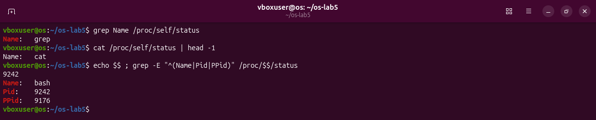

The same file says `grep` when `grep` reads it and `cat` when `cat` reads it. To see the shell itself, use its number: `$$` is the process number (PID) of bash, 9242, and `/proc/9242/status` says `Name: bash`.

### Answers

1. The drawing above: `sda` with `sda1` (vfat, `/boot/efi`) and `sda2` (ext4, `/`).
2. 17% full (7.8G of 49G).
3. 8 cores and about 5.5 GiB of RAM, as the virtual machine sees them.
4. `head`, because `/proc/self` always means the process that reads it.

## Part 5 – Stretch: all four

The sheet asks for any two; all four were done.

### (a) Magic numbers

```bash
gzip -c /etc/passwd > notes.txt ; file notes.txt ; xxd notes.txt | head -1
cp notes.txt photo.jpg ; file photo.jpg
xxd /usr/lib/cargo/bin/coreutils/ls | head -1 ; file -L /usr/bin/ls | cut -c1-60
xxd /etc/passwd | head -1 ; file /etc/passwd
```

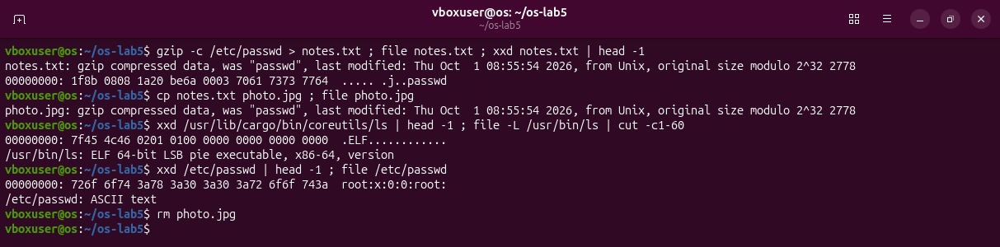

`gzip -c` compresses `/etc/passwd` and writes the result into a file with the misleading name `notes.txt`. `file` is not fooled: "gzip compressed data". `xxd` shows the bytes in hexadecimal: the file starts with **`1f 8b`**, the gzip magic number (then `08`, the deflate method). Even a copy named `photo.jpg` is gzip for `file`. A program starts with `7f 45 4c 46`, that is `.ELF`. `/etc/passwd` starts with `root:x:0:0:`, plain letters: text files have no magic number, and `file` guesses "ASCII text" from the characters.

### (b) Hunt for setuid programs

```bash
find / -xdev -perm -4000 -type f 2>/dev/null
ls -l /usr/bin/sudo /usr/lib/cargo/bin/sudo /usr/bin/sudo.ws
```

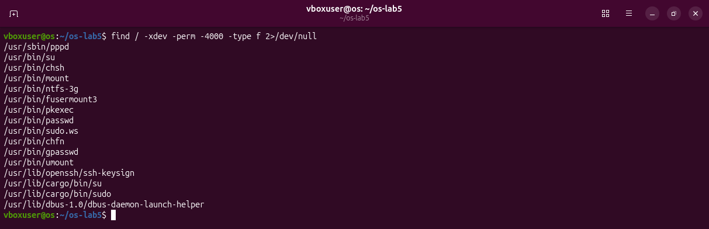

`find /` walks the whole tree; `-xdev` stays on the root file system; `-perm -4000` keeps files that have the setuid bit (4000) among their bits; `-type f` keeps regular files. It found 16. The classic ones are there: `passwd`, `su`, `sudo`, `mount`, `umount`, `chsh`, `chfn`, `gpasswd`. Less known: `pppd` (dial-up connections), `ntfs-3g` (mounting Windows disks), `fusermount3` (mounts made by users), `pkexec` (polkit), `ssh-keysign`, `dbus-daemon-launch-helper`.

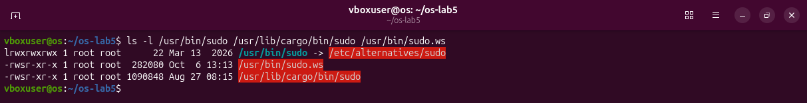

The most interesting finding: there are two `sudo` programs and two `su`. Ubuntu 26.04 switched to **sudo-rs**, a rewrite of `sudo` in Rust, in `/usr/lib/cargo/bin`. `/usr/bin/sudo` points to it through `/etc/alternatives`, and the old C version is still installed as `sudo.ws`.

### (c) Delete a file that is still open

```bash
fallocate -l 200M bigfile ; ls -lh bigfile ; df -m . | tail -1
exec 3< bigfile ; rm bigfile
ls -l /proc/$$/fd
df -m . | tail -1
exec 3<&-
ls -l /proc/$$/fd ; df -m . | tail -1
```

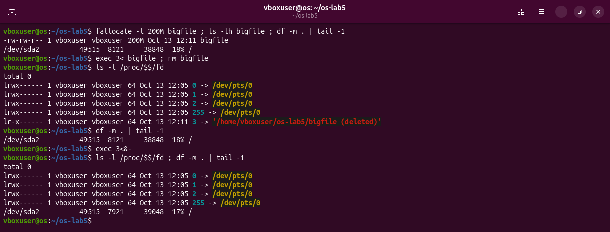

- `fallocate -l 200M` makes a file that really occupies 200 MB (unlike `truncate`, it reserves the blocks). `df -m` shows the used space in megabytes: 8121.
- `exec 3< bigfile` makes the shell itself open the file for reading as descriptor number 3, and keep it open.
- After `rm bigfile`, the shell's list of open files shows `3 -> '/home/vboxuser/os-lab5/bigfile (deleted)'`. The name is gone, but the inode is still held open, and `df` still shows 8121 MB used.
- `exec 3<&-` closes descriptor 3. Now nothing refers to the inode: the kernel frees it, and the used space drops to **7921 MB**, 200 MB less.

This is the rule from Part 2 seen from the other side: the space is freed when the last name **and** the last open descriptor are gone.

### (d) A file system inside a file

```bash
truncate -s 64M disk.img ; mkfs.ext4 disk.img
sudo mount -o loop disk.img /mnt ; df -h /mnt ; df -i /mnt
sudo umount /mnt
```

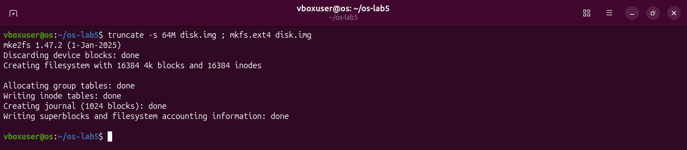

`truncate` makes an empty 64 MB file, and `mkfs.ext4` writes an empty ext4 file system into it, as if it were a disk: "Creating filesystem with 16384 4k blocks and **16384 inodes**", with a journal of 1024 blocks.

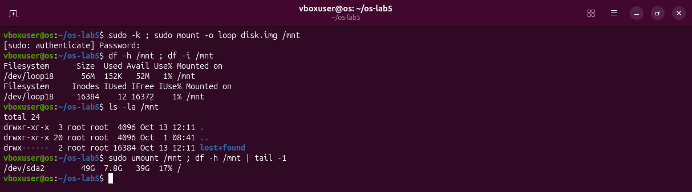

`sudo` runs one command as root (it asks for my password; `sudo -k` first only makes sure it asks). `mount -o loop` attaches the file to a free loop device, `/dev/loop18`, and shows its file system under `/mnt`. `df -h` gives 56M (the journal and the inode tables take the rest of the 64M). `df -i` counts inodes instead of bytes: **16384** in total, 12 used, 16372 free. The used ones are the reserved inodes, the root folder and `lost+found`, the only folder inside (where the repair tool `fsck` puts lost files). `umount` detaches it.

An ext4 file system has a fixed number of inodes, decided when it is created (here one per 4 KiB block). It can run out of inodes before it runs out of space, if it holds very many tiny files.

## The folder at the end

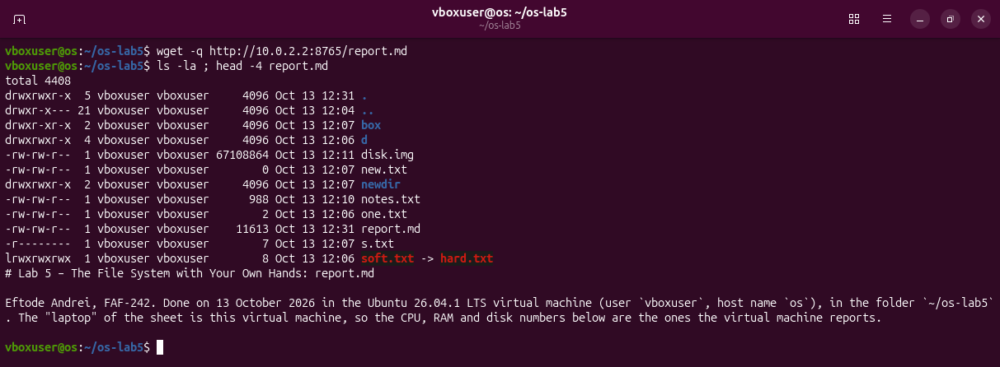

`report.md` (in this repository folder) was copied into `~/os-lab5`. The folder still holds everything the experiments made: `box`, `d`, `disk.img`, `new.txt`, `newdir`, `notes.txt` (the gzip one), `one.txt`, `s.txt` (still `r--------`) and the dangling link `soft.txt`.

## What I learned

- A name is not a file. The file is the inode; a directory is a table "name → inode number".
- A hard link is a second name for the same inode. `rm` removes a name; the data goes away only when no name and no open descriptor is left.
- A symbolic link is a small file that holds a path. It can point to nothing.
- Size and space are different: space comes in whole blocks, and a sparse file has size without space.
- `r`, `w`, `x` mean "read / change / run" on a file, but "list / change the list / pass through" on a directory. The owner gets only the owner bits. Setuid and sticky are two extra bits with very specific jobs.
- Disks, devices and processes are all visible as files, under `/dev` and `/proc`.
