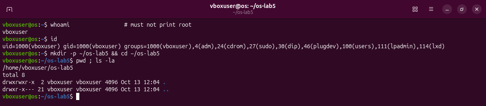

# Lab 5 – Full explanations

Course: Operating Systems, FCIM / FAF, UTM, 2026-2027. Lab 5: The File System with Your Own Hands.

[`README.md`](README.md) tells what was done in the lab. This file goes slower. It takes every command apart piece by piece, explains the ideas behind the outputs (inodes, links, blocks, permission bits, devices, `/proc`), works through examples by hand, and ends with a self-test. It is written for someone who has never used Linux. The figure numbers are the same as in the README and in the Word report.

Lab 6 ([`../lab6/full_explanations.md`](../lab6/full_explanations.md)) looks at the same ideas from the inside, in the source code of xv6.

## Contents

1. [Words you need first](#1-words-you-need-first)
2. [Before the lab](#2-before-the-lab)
3. [Part 1: the tree and the file types](#3-part-1-the-tree-and-the-file-types)
4. [Part 2: inodes and links](#4-part-2-inodes-and-links)
5. [Part 3: permissions](#5-part-3-permissions)
6. [Part 4: disks and the kernel as files](#6-part-4-disks-and-the-kernel-as-files)
7. [Part 5: the four stretch tasks](#7-part-5-the-four-stretch-tasks)
8. [Everything in one picture](#8-everything-in-one-picture)
9. [Test yourself](#9-test-yourself)

## 1. Words you need first

| Word | Meaning |
|---|---|
| file system | the way a disk is organised so that files can be found by name. Ubuntu uses **ext4**; Windows uses NTFS |
| directory | the Linux word for a folder |
| path | the address of a file. Absolute paths start at the root, `/home/vboxuser/os-lab5/notes.txt`. Relative paths start where you are, `os-lab5/notes.txt` |
| `~` | your home folder, here `/home/vboxuser` |
| `.` and `..` | "this directory" and "the directory above". Every directory contains these two entries |
| inode | the record that *is* the file: type, size, owner, permissions, times, link count, and where the content is on the disk. It has a number, not a name |
| directory entry | one line inside a directory: a name and an inode number |
| link count | how many directory entries point to an inode |
| block | the unit of disk space. On this disk a block is 4096 bytes (4 KiB) |
| device file | a file in `/dev` that stands for a piece of hardware (or a pretend one), so it can be read and written like a file |
| mount | attach a file system to a folder of the tree, so its files appear there |
| root | (1) the top of the tree, `/`; (2) the administrator account. The context says which |
| `sudo` | "do as the superuser": run one command as root, after typing your own password |

### The layers, from the disk up

```
the disk                /dev/sda            a long row of bytes
  partitions            /dev/sda1, sda2     the disk cut into pieces
    a file system       ext4 on sda2        the piece organised as blocks:
                                            ┌ superblock: the description of the whole thing
                                            ├ inode table: inode 1, 2, 3, ... 525387, ...
                                            ├ bitmaps: which blocks and inodes are free
                                            └ data blocks: file contents AND directory contents
      mounted at /      the whole tree you see
```

A directory is a file too: its content is a table of entries. So to open `/home/vboxuser/os-lab5/notes.txt` the kernel reads the root directory, finds `home` and its inode number, reads that directory, finds `vboxuser`, and so on, until it gets the inode number of `notes.txt`, reads the inode, and from it finds the data blocks.

```
directory os-lab5 (inode 525383)          inode 525387                     data block
┌──────────────┬─────────┐               ┌──────────────────────┐         ┌──────────┐
│ .            │ 525383  │               │ type: regular file    │         │ hello\n  │
│ ..           │ ...     │               │ size: 6               │  ────►  └──────────┘
│ notes.txt    │ 525387 ─┼──────────────►│ links: 1              │
└──────────────┴─────────┘               │ owner, mode, times    │
                                         │ block list ───────────┘
                                         └──────────────────────┘
```

## 2. Before the lab

```bash
whoami                 # must not print root
mkdir -p ~/os-lab5 && cd ~/os-lab5
```



| Piece | Meaning |
|---|---|
| `whoami` | print the name of the current user |
| `# must not print root` | a comment. bash ignores everything after `#`; it was typed exactly as on the sheet |
| `id` | the user number (`uid`), the main group (`gid`) and all the groups. `uid=0` would be root |
| `mkdir -p ~/os-lab5` | make the directory; `-p` = no error if it exists (and make missing parents) |
| `&&` | run the next command only if the previous one succeeded |
| `cd ~/os-lab5` | change directory: go into it |
| `pwd` | print working directory |
| `ls -la` | list all entries (`-a`, including hidden ones that start with a dot) in long form (`-l`) |

Why not root: the kernel lets root read, write and enter anything, whatever the permission bits say. Every experiment in Part 3 would "succeed" and show nothing.

## 3. Part 1: the tree and the file types

### 3.1 The top of the tree

```bash
ls /
```

There are no drive letters on Linux. Every disk, USB stick or virtual file system is attached somewhere inside one tree that starts at `/`. The folders seen in Figure 1.1:

| Folder | What is in it | Windows comparison |
|---|---|---|
| `/bin`, `/sbin`, `/lib`, `/lib64` | links to `/usr/bin`, `/usr/sbin`, `/usr/lib` (programs and libraries) | `C:\Windows\System32` |
| `/usr` | the installed programs, libraries, documentation | `C:\Program Files` |
| `/etc` | the system settings, as text files | the registry |
| `/home` | the users' folders (`/home/vboxuser`) | `C:\Users` |
| `/root` | the home folder of the root user | |
| `/tmp` | temporary files, emptied at reboot | `%TEMP%` |
| `/var` | data that changes: logs (`/var/log`), caches, mail | |
| `/boot` | the kernel and the boot loader files | |
| `/dev` | device files, made by the kernel | `\\.\` devices |
| `/proc`, `/sys` | windows into the kernel, made up on the fly | Task Manager, Device Manager |
| `/run` | runtime data of the services since the last boot | |
| `/media`, `/mnt` | where USB sticks and other disks get mounted | drive letters `D:`, `E:` |
| `/snap` | snap packages (Ubuntu's self-contained apps) | |
| `/opt`, `/srv` | extra software, served data | |
| `/lost+found` | where the file system checker puts pieces it recovers | |
| `/cdrom` | where the installation CD was mounted | |

### 3.2 Reading one line of `ls -l`

```
drwxrwxrwt 17 root root 380 Oct 13 12:03 /tmp
│└───┬───┘ │   │    │    │       │          │
│    │     │   │    │    │       │          └ name
│    │     │   │    │    │       └ time of the last change of the content
│    │     │   │    │    └ size in bytes (for devices: the major, minor numbers)
│    │     │   │    └ group
│    │     │   └ owner
│    │     └ link count
│    └ permissions: owner rwx, group rwx, others rwt
└ type
```

`-d` matters for directories: `ls -l /etc` would list the 142 things *inside* `/etc`; `ls -ld /etc` describes `/etc` itself.

### 3.3 The seven file types

| First letter | Type | Example |
|---|---|---|
| `-` | regular file | `/etc/passwd`, `notes.txt`, `/usr/lib/cargo/bin/coreutils/ls` |
| `d` | directory | `/etc`, `/tmp` |
| `l` | symbolic link | `/bin -> usr/bin` |
| `c` | character device | `/dev/null`, `/dev/tty`, `/dev/zero` |
| `b` | block device | `/dev/sda`, `/dev/loop0` |
| `p` | named pipe (FIFO) | made with `mkfifo`; a pipe `\|` with a name |
| `s` | socket | `/run/...` files that programs use to talk to each other |

The type is stored in the inode, not guessed from the name. Linux has no "extension decides the type" rule: `.txt` is only part of a name.

### 3.4 Devices, and the two numbers

```
crw-rw-rw- 1 root root 1, 3 Oct 12 10:55 /dev/null
brw-rw---- 1 root disk 8, 0 Oct 12 10:55 sda
```

A device file has no content on the disk. Its inode holds two numbers. The **major** number says which driver handles it (1 = the "memory" devices `null`, `zero`, `random`; 8 = SCSI/SATA disks; 7 = loop devices; 5 = terminals). The **minor** number says which device of that driver (`sda` is 0, `sda1` is 1, `sda2` is 2). When a program opens `/dev/null`, the kernel sees "character device 1, 3" and passes every read and write to that driver, which here throws the writes away and answers reads with "end of file".

- **Character device**: a stream of bytes, read in order: a terminal, a serial port, `/dev/null`, `/dev/zero` (endless zeros), `/dev/random` (endless random bytes).
- **Block device**: storage you can jump around in, read and written in blocks, with a cache in between: disks, partitions, loop devices, the CD drive.

The `/dev/sda` names come from the disk driver: `sd` (SCSI disk, used for SATA too), `a` for the first disk, then a number for the partition. A second disk would be `sdb`.

### 3.5 `file`

`file` opens the file and compares its first bytes with a big list of known **magic numbers** (section 7.1). For a link it reports "symbolic link" unless `-L` tells it to follow the link. For text it looks at which characters appear ("ASCII text", "UTF-8 Unicode text").

### 3.6 `du`, and the three streams

```bash
du -sh /var/log 2>/dev/null ; du -sh /usr 2>/dev/null
```

| Piece | Meaning |
|---|---|
| `du` | disk usage: adds up the blocks used under a folder |
| `-s` | summary: one total, not one line per subfolder |
| `-h` | human-readable: `29M`, `5.3G` instead of a number of kilobytes |
| `2>/dev/null` | send stream 2 (errors) to `/dev/null` |
| `;` | then run the next command, whatever happened |

Every program starts with three open streams: **0** input (the keyboard), **1** output (the screen), **2** errors (also the screen). `>` redirects stream 1, `2>` redirects stream 2. As a normal user `du` cannot enter some folders under `/var/log` and would print one "Permission denied" for each; hiding them keeps the output clean, but the total counts only what was readable, so 29M is a lower bound.

5.3G / 29M ≈ 5300 / 29 ≈ 183, so "roughly 190 times" (the sizes are rounded).

### 3.7 Why `/bin` is a link, and why `ls` has 115 names

Old Unix systems split the programs between `/bin` (needed at boot) and `/usr/bin` (everything else), because `/usr` could be a separate disk mounted later. Modern Linux merged them ("merged /usr"): everything is in `/usr/bin`, and `/bin` is a symbolic link so that old scripts that call `/bin/sh` still work.

Ubuntu 26.04 goes further: the basic commands (`ls`, `cat`, `cp`, `mv`, `rm`, `ln`, `stat`, `du`, `df`...) are **uutils coreutils**, a rewrite in the Rust language. It is one single program, `/usr/lib/cargo/bin/coreutils/ls`, with **115 hard links**: `.../coreutils/ls`, `.../coreutils/cat`, and so on. When it starts, it looks at `argv[0]`, the name it was called by, and behaves as that command. `/usr/bin/ls` is a symbolic link to the `ls` name. This is why some outputs in this lab look slightly different from older Ubuntu (`stat` prints `size:` in lower case; `ls box` with only `r` did not print an error).

## 4. Part 2: inodes and links

### 4.1 `stat`, line by line

```
  File: notes.txt
  size: 6               Blocks: 8          IO Block: 4096   regular file
Device: 8,2     Inode: 525387      Links: 1
Access: (0664/-rw-rw-r--)  Uid: ( 1000/vboxuser)   Gid: ( 1000/vboxuser)
Access: 2026-10-13 12:06:00.336924959 +0000
Modify: 2026-10-13 12:06:00.009934452 +0000
Change: 2026-10-13 12:06:00.009934452 +0000
 Birth: 2026-10-13 12:06:00.009934452 +0000
```

| Field | Meaning |
|---|---|
| `File` | the name I asked about (it is not stored in the inode) |
| `size: 6` | the content is 6 bytes: `h e l l o` and the end-of-line character `\n` |
| `Blocks: 8` | the space used, in units of 512 bytes: 8 × 512 = 4096, one block |
| `IO Block: 4096` | the block size of this file system |
| `regular file` | the type |
| `Device: 8,2` | the file system it lives on: major 8, minor 2, that is `/dev/sda2` |
| `Inode: 525387` | the inode number |
| `Links: 1` | the number of names |
| `Access: (0664/-rw-rw-r--)` | the permissions, as a number and as letters |
| `Uid`, `Gid` | the owner and the group, as numbers and names |
| `Access` (time) | last read |
| `Modify` | last change of the content |
| `Change` | last change of the inode (permissions, owner, link count, or content) |
| `Birth` | creation |

An inode number is unique only inside one file system. Two files on different disks can have the same number; the pair (device, inode) is the real identity.

### 4.2 Hard links, step by step

```
after echo hello > notes.txt         after ln notes.txt hard.txt         after rm notes.txt
os-lab5:                             os-lab5:                            os-lab5:
  notes.txt → 525387                   notes.txt → 525387                  hard.txt → 525387
                                       hard.txt  → 525387
inode 525387: links 1                inode 525387: links 2               inode 525387: links 1
```

- `ln notes.txt hard.txt` asks the kernel (system call `link`) to add an entry `hard.txt` with the same inode number, and to add 1 to the link count.
- `ls -li` shows both names with `525387` and `2`. Change the content through one name and the other name sees it, because there is only one content.
- `rm notes.txt` calls `unlink`: remove the entry, subtract 1. The inode now has 1 link and is untouched.

When the count reaches 0 **and** no process has the file open, the kernel frees the inode and its blocks. Section 7.3 shows the "open" half of that rule.

Limits of hard links: they cannot point to a directory (that could make loops in the tree; only the kernel makes `.` and `..`), and they cannot cross file systems (an inode number means nothing on another disk).

### 4.3 Symbolic links

```
os-lab5:                                       
  hard.txt → 525387   (regular file, "hello\n")
  soft.txt → 525388   (symbolic link, content: "hard.txt")
```

`ln -s hard.txt soft.txt` makes a **new inode** of type `l` whose content is the text `hard.txt`. When a program opens `soft.txt`, the kernel reads that text and opens it instead, relative to the folder the link is in. The link does not know anything about inode 525387; it only knows a name. So:

- `rm hard.txt` removes the name; the link still says `hard.txt`, which no longer exists: a **dangling** link. `cat` fails with "No such file or directory", which is confusing because `ls` shows `soft.txt` right there.
- If someone creates a new `hard.txt`, the link "works" again, pointing to a different file.
- Its size is the length of the text: `hard.txt` is 8 characters, so 8 bytes. A link to `/home/vboxuser/os-lab5/hard.txt` would be 31 bytes. (Short link texts are even stored inside the inode itself, with no data block.)

| | hard link | symbolic link |
|---|---|---|
| what it is | one more name for the same inode | a separate small file containing a path |
| own inode | no, same number | yes, its own number |
| survives `rm` of the other name | yes | no, it dangles |
| can point to a directory | no | yes |
| can cross to another disk | no | yes |
| `ls -l` shows | the same line twice, link count 2 | `l...  soft.txt -> hard.txt` |

### 4.4 Why a directory has 2, then 4 links

```
os-lab5 (525383)                d (525387)                    x (525389)      y (525390)
  d → 525387  ── link 1           .  → 525387  ── link 2        .  → 525389     .  → 525390
                                  .. → 525383                   .. → 525387     .. → 525387
                                  x  → 525389                       └─ link 3       └─ link 4
                                  y  → 525390
```

- A new directory has two names: its entry in the parent, and its own `.`.
- Every subdirectory adds one, through its `..`.
- So a directory's link count is 2 + the number of its subdirectories. `ls -ld /etc` showed 142 links: `/etc` has 140 subdirectories. Files inside a directory do not change its link count; only subdirectories do.
- The parent `os-lab5` got one more link too (from `d/..`): it showed 3 in `ls -lai d` (its own name in `/home/vboxuser`, its `.`, and `d/..`).

The number 525387 coming back: when `rm hard.txt` dropped the count of inode 525387 to 0, ext4 marked it free. The next `mkdir` asked for a free inode near its parent and got the same number. Numbers are reused; only the pair (number, moment) identifies a file.

### 4.5 Size and space

```
one.txt:  size 2 bytes     ████ one 4096-byte block, 2 bytes used, 4094 wasted
big.img:  size 1 GiB       (no blocks at all)
```

- A file system hands out space in blocks. Even a 1-byte file gets a whole block (4096 bytes), so `du` reports `4.0K`. `stat` counts the space in 512-byte units for historical reasons: `Blocks: 8`.
- `truncate -s 1G` sets the size field to 1,073,741,824 without writing anything. ext4 keeps track of which parts of the file really have blocks; the rest is a **hole**, which reads as zeros. A file with holes is **sparse**. Virtual machine disk images and databases use this to reserve a big size without spending space.

Worked example: a file of 10,000 bytes needs 10000 / 4096 = 2.44, so 3 blocks = 12,288 bytes of space (`du` would say 12K, and `stat` Blocks: 24).

## 5. Part 3: permissions

### 5.1 The nine letters and the three digits

```
 rw-   rw-   r--
 owner group others
 4+2   4+2   4      →  6 6 4
```

| Letters | Number | Meaning on a file |
|---|---|---|
| `---` | 0 | nothing |
| `--x` | 1 | run it |
| `-w-` | 2 | change it |
| `-wx` | 3 | change, run |
| `r--` | 4 | read it |
| `r-x` | 5 | read, run |
| `rw-` | 6 | read, change |
| `rwx` | 7 | everything |

So `chmod 755` = `rwx` `r-x` `r-x`, and `640` = `rw-` `r--` `---`.

`chmod` also takes letters: who (`u` owner, `g` group, `o` others, `a` all), an operator (`+` add, `-` remove, `=` set exactly), and the rights. `chmod u+r` adds read for the owner; `chmod go-w` removes write from group and others; `chmod u=r,go=` sets the owner to exactly `r` and the others to nothing.

### 5.2 How the kernel decides

When a process wants to open a file, the kernel checks, in this order:

1. If the process runs as root (uid 0): allowed (except running a file that has no `x` at all).
2. Else, if the process's user is the **owner**: use the owner's three bits, and stop.
3. Else, if the process is in the file's **group**: use the group's bits, and stop.
4. Else: use the others' bits.

Only one set is used. That is why `chmod 000` locks the owner out even though the owner "owns" it, and why a file with mode `066` (owner nothing, everybody else read-write) can be read by everybody except its owner. Owning a file gives one special right instead: only the owner (and root) may change its mode with `chmod`. That is how `chmod u+r s.txt` could fix the problem.

### 5.3 The umask, done properly

The umask lists bits to **remove**, and the removal is bit by bit ("AND NOT"), not a subtraction. With `0002` the subtraction gives the same answer, but not always:

```
umask 0022:  666 AND NOT 022 → 644 (rw-r--r--)     777 AND NOT 022 → 755 (rwxr-xr-x)
umask 0077:  666 AND NOT 077 → 600 (rw-------)     777 AND NOT 077 → 700 (rwx------)
umask 0033:  666 AND NOT 033 → 644, not 633!      (6 = rw-, removing wx leaves rw- minus w = r--)
```

Ubuntu gives every user a private group with the same name (`vboxuser`), so letting the group write is harmless, and the default umask is `0002`. The leading `0` is for the special bits of section 5.5.

Files start from 666, not 777: new files are not made runnable automatically. You make a script runnable on purpose with `chmod +x`.

### 5.4 Directories: r, w, x

A directory is a table of names. The three bits are about that table:

| Bit | On a directory it allows | Test in the lab |
|---|---|---|
| `r` | reading the list of names | `ls box` printed `f` |
| `x` | going through the directory: using a name inside it to reach the inode | `cat box/f` worked with `x` only |
| `w` | changing the list: create, delete, rename entries (together with `x`) | |

The box experiment, case by case:

- `chmod u=r,go= box` (`r--------`): `ls box` reads the table and prints `f`. `cat box/f` must go *through* `box` to reach `f`'s inode; that needs `x`: denied. `ls -l box` knows the name but cannot reach the inode to get its details, so it prints question marks: `-????????? ? ? ? ? ? f`.
- `chmod u=x,go= box` (`--x------`): `ls box` cannot read the table: "cannot open directory". But `cat box/f`, whose name I already know, passes through and works.
- `chmod 755 box`: back to normal.

Two consequences:

- Deleting a file is a change to the **directory**, not to the file. You can delete a read-only file if you have `w` and `x` on its directory, and you cannot delete your own file from a directory where you have no `w`.
- `x` without `r` on a directory makes a "secret" folder: people who know the exact name of a file can reach it; nobody can list what is there.

### 5.5 setuid, setgid and sticky

There are three more bits, written as a fourth digit in front: setuid = 4, setgid = 2, sticky = 1.

| Bit | Shown as | On a program | On a directory |
|---|---|---|---|
| setuid (4000) | `s` in the owner's `x` place | the program runs with the rights of its **owner** | (not used) |
| setgid (2000) | `s` in the group's `x` place | runs with the rights of its group | new files inside get the directory's group |
| sticky (1000) | `t` in the others' `x` place | (not used) | only a file's owner may delete or rename it |

`/usr/bin/passwd` is 4755, owned by root. When I run it, the process's *effective* user is root, so it may write the new password hash into `/etc/shadow` (mode 640, owner root, group shadow; not even readable by me). The program itself is careful to change only the caller's own entry. Because a setuid-root program runs with full power, a bug in it is a security hole, which is why the list of such programs is kept short (section 7.2).

`/tmp` is 1777: `rwx` for everybody, so everyone can create files there, plus the sticky bit, so nobody can delete someone else's. A capital `S` or `T` would mean "the special bit is set but the `x` under it is not".

## 6. Part 4: disks and the kernel as files

### 6.1 Disk, partition, file system, mount

| Linux | Windows |
|---|---|
| `/dev/sda`, the whole disk | "Disk 0" in Disk Management |
| `/dev/sda1`, `/dev/sda2`, partitions | the partitions of Disk 0 |
| ext4 on `sda2` | NTFS on `C:` |
| mounted at `/` | the letter `C:` |
| mounted at `/boot/efi` | the hidden "EFI System Partition" |

`sda1` (1 GB, `vfat`, that is FAT32) is the EFI partition: the computer's firmware can read only FAT, so the boot loader lives there. Everything else is on `sda2` (ext4).

### 6.2 `lsblk`

| Column | Meaning |
|---|---|
| `NAME` | the device name, with a tree showing which partitions belong to which disk |
| `MAJ:MIN` | the device numbers (section 3.4) |
| `RM` | removable (1 for the CD drive) |
| `SIZE` | size |
| `RO` | read-only (1 for the snap images and the CD) |
| `TYPE` | `disk`, `part` (partition), `loop`, `rom` (CD) |
| `MOUNTPOINTS` | where it is mounted |
| `FSTYPE` | with `-o`: the file system type |

A **loop device** turns a file into a block device. Each snap package is one compressed, read-only image file (`squashfs`); `snapd` attaches each image to a loop device and mounts it under `/snap/name/version`. Stretch (d) does the same by hand.

### 6.3 `df -h` and `mount`

`df` (disk free) shows every mounted file system with its size, used, available, use% and mount point. Most lines are `tmpfs`: file systems that live in RAM (`/run`, `/dev/shm`, `/tmp`, `/run/user/1000`). Used + available is a bit less than the size, because ext4 keeps about 5% reserved for root, so the system can still work when a user fills the disk.

`mount` without arguments lists every mounted file system: what, where, which type, with which options. `grep " / "` keeps the line with ` / ` (spaces around the slash, so only the root mount point matches). Options: `rw` read-write; `relatime` update the "last read" time only if it is older than the last change (or older than a day), which saves a write on every read.

### 6.4 `/proc`

`/proc` is not on any disk. When a program reads a file there, the kernel writes the answer on the spot.

| File | What it shows |
|---|---|
| `/proc/cpuinfo` | one block per processor: number, model, speed, features |
| `/proc/meminfo` | memory: total, free, available, caches... |
| `/proc/<PID>/` | one folder per running process, named by its number |
| `/proc/<PID>/status` | the process's name, state, numbers, memory |
| `/proc/<PID>/fd/` | its open file descriptors, as symbolic links to what they are |
| `/proc/self` | a link to the folder of whichever process reads it |

`MemTotal` (5.5 GiB) is smaller than what the virtual machine was given (6403 MB, 6.25 GiB) because the firmware and the kernel's own code and tables are taken out first. `MemFree` is memory not used at all; `MemAvailable` (4.1 GiB) also counts caches the kernel can drop when a program needs memory, so it is the honest "how much can I still use".

`/proc/self` is resolved per process: `head -5 /proc/self/status` is read by `head`, so `Name: head`; with `grep` it says `grep`. The numbers differ too: `head` was PID 21324, the `ls` started right after was 21327 (the `ls -l /proc/self/fd` output shows descriptor 3 pointing to `/proc/21327/fd`, the folder `ls` was reading).

`$$` is a shell variable with the shell's own PID. `/proc/$$/status` therefore describes bash itself (`Name: bash`, `Pid: 9242`), and `PPid: 9176` is its parent, the terminal program.

## 7. Part 5: the four stretch tasks

### 7.1 (a) Magic numbers

| Piece | Meaning |
|---|---|
| `gzip -c /etc/passwd` | compress, writing the result to the screen (`-c`) instead of to a file |
| `> notes.txt` | ...but the screen output is redirected into `notes.txt` |
| `xxd notes.txt` | show the bytes: offset, 16 bytes in hexadecimal, and the same bytes as characters |
| `head -1` | only the first 16 bytes |

```
00000000: 1f8b 0808 1a20 be6a 0003 7061 7373 7764  ..... .j..passwd
          └┬─┘ │ │  └────┬──┘ │ │  └───────┬────────┘
     magic ┘   │ flags  time  │ OS        original name "passwd"
        method 8 = deflate   extra flags
```

Many formats start with a fixed signature:

| Format | First bytes | As text |
|---|---|---|
| gzip | `1f 8b` | |
| ELF program | `7f 45 4c 46` | `.ELF` |
| PNG image | `89 50 4e 47` | `.PNG` |
| PDF | `25 50 44 46` | `%PDF` |
| ZIP (also .docx) | `50 4b 03 04` | `PK..` |
| JPEG | `ff d8 ff` | |
| shell script | `23 21` | `#!` |

`file` checks these, which is why the copy named `photo.jpg` is still reported as gzip: the name has no say. (A `.docx` report is a ZIP file inside.)

### 7.2 (b) The setuid hunt

```bash
find / -xdev -perm -4000 -type f 2>/dev/null
```

| Piece | Meaning |
|---|---|
| `find /` | walk the tree from `/` |
| `-xdev` | do not cross into other file systems (`/proc`, `/sys`, `/run`, the snaps, `/boot/efi`) |
| `-perm -4000` | keep files whose mode contains all the bits of 4000, that is the setuid bit |
| `-type f` | only regular files |
| `2>/dev/null` | hide the "Permission denied" messages for folders a normal user cannot enter |

What the 16 programs are for:

| Program | Why it needs root |
|---|---|
| `passwd`, `chsh`, `chfn`, `gpasswd` | change your password, shell, info, group password in files only root may write |
| `su`, `sudo` (`sudo.ws`, and the Rust `su`, `sudo`) | become another user after checking a password |
| `mount`, `umount`, `fusermount3`, `ntfs-3g` | let normal users mount the things they are allowed to (USB sticks, FUSE file systems, NTFS disks) |
| `pkexec` | run a program as another user if polkit allows it |
| `pppd` | set up dial-up network links |
| `ssh-keysign` | sign with the computer's private key, which only root may read |
| `dbus-daemon-launch-helper` | start system services when a program asks for them over D-Bus |

`ls -l /usr/bin/sudo` shows `/usr/bin/sudo -> /etc/alternatives/sudo`: Debian/Ubuntu's "alternatives" system chooses which of several versions a command name means. On Ubuntu 26.04 it chooses `sudo-rs`, the Rust rewrite (written in a memory-safe language precisely because setuid programs are such attractive targets).

### 7.3 (c) Delete a file that is still open

| Command | Meaning |
|---|---|
| `fallocate -l 200M bigfile` | create `bigfile` and really reserve 200 MB of blocks for it |
| `df -m . \| tail -1` | the file system of the current folder, in megabytes, last line only |
| `exec 3< bigfile` | `exec` with only a redirection changes the shell itself: open `bigfile` for reading as descriptor 3, and keep it |
| `rm bigfile` | remove the name |
| `ls -l /proc/$$/fd` | the shell's open descriptors |
| `exec 3<&-` | close descriptor 3 |

```
                          name in os-lab5   open by bash (fd 3)   blocks
after fallocate + exec    yes               yes                   used (8121 MB)
after rm                  no                yes                   used (8121 MB)   "(deleted)"
after exec 3<&-           no                no                    freed (7921 MB)
```

The inode keeps two counts: the link count on the disk, and the number of open references in memory. Both must reach zero before the blocks go back. Real uses: a program can create a temporary file, open it, and delete it at once, so it disappears by itself when the program ends, even if it crashes. And a log file deleted while a service still writes to it keeps filling the disk until the service is restarted: `df` says the disk is full, but `du` cannot find the space, because no name leads to it. `/proc/*/fd` is where to look.

### 7.4 (d) A file system inside a file

| Command | Meaning |
|---|---|
| `truncate -s 64M disk.img` | a sparse 64 MB file |
| `mkfs.ext4 disk.img` | "make file system": write an empty ext4 (superblock, inode tables, bitmaps, journal, root folder) into it |
| `sudo -k` | forget the cached password, so `sudo` asks again |
| `sudo mount -o loop disk.img /mnt` | as root: attach the file to a free loop device and mount it on `/mnt` |
| `df -h /mnt` | size of the mounted file system |
| `df -i /mnt` | inodes instead of bytes: total, used, free |
| `ls -la /mnt` | what is inside: `.`, `..` and `lost+found` |
| `sudo umount /mnt` | detach it; `df -h /mnt` then shows `/` again, because `/mnt` is a plain folder of `/` |

mkfs decided the number of inodes when it created the file system: for a small file system ext4 makes one inode per 4 KiB ("inode ratio"), so 64 MiB / 4 KiB = 16384 inodes. That number can never change. Each file, folder or link uses one inode, so a disk full of tiny files can run out of inodes while `df -h` still shows free space; `df -i` reveals it.

The 12 used inodes: ext4 reserves inodes 1 to 10 for itself (the root folder is inode 2, the journal is inode 8...) and inode 11 is `lost+found`. The twelfth is most likely the hidden "orphan file" that recent versions of `mkfs.ext4` (1.47 here) create: a list of files that were deleted while still open, so they can be cleaned up after a crash, exactly the situation of 7.3. The size: 56M of 64M, because the journal (1024 blocks = 4 MiB), the inode tables (16384 × 256 bytes = 4 MiB) and the bitmaps are subtracted.

## 8. Everything in one picture

```
                  names (directories)                     inodes                        blocks
os-lab5/
  hard.txt ──────────────────────────────────────► 525387  file, links 1, 6 B ─────► [hello\n...]
  soft.txt ──────────────────────────────────────► 525388  link, 8 B, "hard.txt"
  d/ ────────────────┐
     . ──────────────┼──────────────────────────► 525387  dir, links 4  ◄─ reused number
     x/.. ───────────┤
     y/.. ───────────┘
  big.img ───────────────────────────────────────► ......  file, size 1 GiB ──────► (none: sparse)

permissions: in the inode, checked against the process's user (one set of rwx: owner, group or others)
devices:     inodes of type c / b with a major and minor number, no blocks
/proc:       no disk at all; the kernel answers every read
space freed: when links = 0 AND no process has it open
```

## 9. Test yourself

Try to answer before opening each one.

<details>
<summary>1. Where is the name of a file stored: in its inode or somewhere else?</summary>

In the directory that contains it, as an entry "name → inode number". The inode has no name, which is why one inode can have several names (4.2).
</details>

<details>
<summary>2. <code>ls -l</code> shows <code>crw-rw-rw- 1 root root 1, 3</code>. What is it, and what are 1 and 3?</summary>

A character device (`c`), readable and writable by everyone. 1 is the major number (which driver), 3 the minor number (which device of that driver). It is `/dev/null` (3.4).
</details>

<details>
<summary>3. A file has 3 hard links. You delete one name. What happens to the data?</summary>

Nothing. The link count goes from 3 to 2, and the other two names still reach the same inode and data (4.2).
</details>

<details>
<summary>4. Why does a symbolic link to <code>/etc/passwd</code> have size 11?</summary>

Its content is the path text `/etc/passwd`, which has 11 characters (4.3).
</details>

<details>
<summary>5. A directory shows 5 links. How many subdirectories does it have?</summary>

3: two links come from its name and its own `.`, and each subdirectory adds one through its `..` (4.4).
</details>

<details>
<summary>6. How much space does a 5000-byte file use on this disk?</summary>

Two 4096-byte blocks, 8192 bytes: `du` shows 8.0K and `stat` shows `Blocks: 16` (4.5).
</details>

<details>
<summary>7. Write 751 in letters and say who can do what.</summary>

`rwxr-x--x`: the owner can read, write, run; the group can read and run; others can only run it (5.1).
</details>

<details>
<summary>8. A file has mode <code>066</code> and you are its owner. Can you read it? Can the others?</summary>

You cannot: the kernel uses only the owner bits for you, and they are `---`. The group and the others can read and write it (5.2).
</details>

<details>
<summary>9. With umask 022, what modes do a new file and a new directory get?</summary>

644 (`rw-r--r--`) and 755 (`rwxr-xr-x`) (5.3).
</details>

<details>
<summary>10. You have <code>r</code> but not <code>x</code> on a directory. Can you list it? Can you read a file inside?</summary>

You can list the names, but not reach the files: reading a file inside needs `x` on the directory (5.4).
</details>

<details>
<summary>11. Can you delete a file you have no permission to write?</summary>

Yes, if you have `w` and `x` on the directory that contains it, because deleting changes the directory, not the file. (In a sticky directory like `/tmp` you must also own the file) (5.4, 5.5).
</details>

<details>
<summary>12. Why must <code>passwd</code> be setuid root?</summary>

The password hashes are in `/etc/shadow`, which only root may write (and only root and the shadow group may read). setuid makes the program run as its owner, root, whoever starts it (5.5).
</details>

<details>
<summary>13. What does the <code>t</code> in <code>drwxrwxrwt</code> on <code>/tmp</code> do?</summary>

It is the sticky bit: everyone may create files in `/tmp`, but only a file's owner (or root) may delete or rename it (5.5).
</details>

<details>
<summary>14. Why did <code>/proc/self/status</code> say <code>head</code>?</summary>

`/proc/self` points to the process that opens it, and the process that opened it was `head` (6.4).
</details>

<details>
<summary>15. How can a disk be full while <code>du</code> finds no big file?</summary>

A deleted file is still open in some process: no name leads to it, so `du` cannot count it, but its blocks are not freed until it is closed. `ls -l /proc/*/fd` shows it as `(deleted)` (7.3).
</details>

<details>
<summary>16. How does <code>file</code> know that <code>photo.jpg</code> is really gzip?</summary>

It reads the first bytes: `1f 8b` is the gzip magic number. The name is ignored (7.1).
</details>

<details>
<summary>17. Can an ext4 file system run out of inodes while it still has free space?</summary>

Yes. The number of inodes is fixed when `mkfs` creates it (16384 for the 64 MB image); many tiny files can use them all up. `df -i` shows it (7.4).
</details>
