# Lab 6 – Inside the xv6 File System

Course: Operating Systems, FCIM / FAF, UTM, 2026-2027. Track B: build your own small OS (xv6).

This page explains everything that was done in the lab, step by step: every command, what it printed, and why. The figure numbers are the same as in the Word report, so the two can be read side by side.

## What is in this folder

| File | What it is |
|---|---|
| `Lab6_EftodeAndrei_FAF-242.docx` | The report: title page, 26 screenshots, the answers to every Observe box and the stretch task |
| `mystat.c` | My `stat` program for xv6. In xv6 it lives in `user/mystat.c` |
| `find.c` | My `find` program for xv6, with the stretch option `-n`. In xv6 it lives in `user/find.c` |
| `Makefile` | The xv6 Makefile with my lines in `UPROGS`: `$U/_sleep\` and `$U/_args\` from Lab 4, and `$U/_mystat\` and `$U/_find\` from this lab |
| `sleep.c`, `args.c` | My Lab 4 programs, copied here unchanged from [`../lab4/`](../lab4/), because this Makefile builds them too. With them the folder builds on its own |
| `notes.md` | The answers the sheet asks to write "in notes.md" |
| `full_explanations.md` | The slow version of this page: every line of both programs, the kernel code behind them, the disk layout, worked examples and a self-test |
| `screenshots/` | The terminal screenshots shown on this page (`fig-1-1.png` is Figure 1.1, and so on) |

## How to run it

```bash
# put the files into an xv6 tree at revision 06aad25
cp mystat.c find.c sleep.c args.c ~/xv6-riscv/user/   # sleep.c and args.c are from Lab 4; the Makefile builds them too
cp Makefile ~/xv6-riscv/
cd ~/xv6-riscv && make clean && make qemu
# at the xv6 prompt:
#   mystat README . console
#   mkdir a ; mkdir a/b ; echo x > a/b/r2 ; echo y > a/r2 ; ln cat r2
#   find . r2          find a b          find . r2 -n
# leave xv6: press Ctrl-A, release, then press X
```

## Words used on this page

- **xv6**: a very small teaching operating system from MIT, running inside **QEMU**, a program that pretends to be a RISC-V computer. `make qemu` builds xv6 and starts it.
- **Two prompts.** `vboxuser@os:~/xv6-riscv$` is bash on Linux. A lonely `$` is the xv6 shell.
- **`fs.img`**: one Linux file that is the whole disk of the xv6 computer. `make` builds it with the program `mkfs`, and copies `README` and every user program onto it. `make clean` deletes it, so the next `make qemu` starts from a fresh disk.
- **Inode**: the record that is the file: type, size, link count and the list of the disk blocks with the content. Directories hold the names, as entries "name → inode number". The same idea as on Linux in Lab 5.
- **Block**: xv6 reads and writes the disk in blocks of 1024 bytes (`BSIZE`).
- **`UPROGS`**: a list in the xv6 Makefile. Only the programs named there are built and copied onto the xv6 disk.
- **System call**: a request from a program to the kernel, like `open`, `read`, `stat`, `link`, `unlink`. Their kernel side for files is in `kernel/sysfile.c`; the file system itself is in `kernel/fs.c`.

## Before the lab

```bash
bash os2026-setup.sh --check     # toolchain, QEMU and ~/xv6-riscv are ready
```

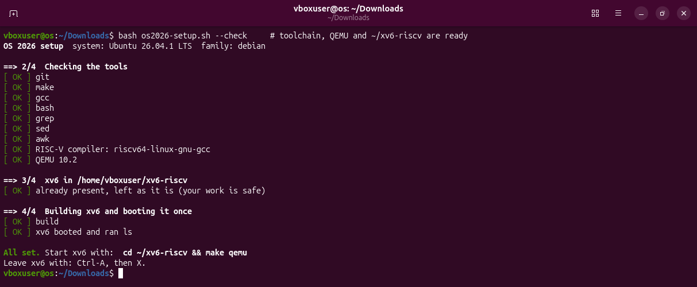

With `--check` the course script installs nothing: it checks the tools (git, make, gcc, the RISC-V compiler, QEMU 10.2), sees that `~/xv6-riscv` exists and leaves it alone, builds xv6 and boots it once. The last line is **All set.**

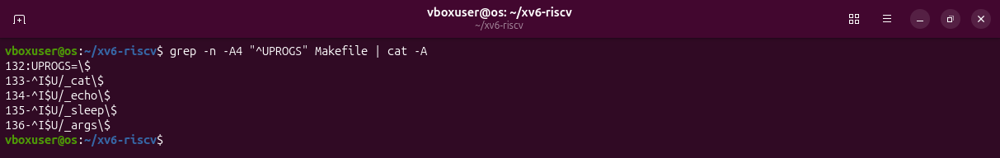

The tree is on branch `lab`, at my Lab 4 commit. `grep -n -A4 "^UPROGS" Makefile` prints the line that starts the list and the four after it; `cat -A` makes the invisible characters visible: `^I` is a TAB and `$` is the end of the line. Every program line must be exactly TAB, `$U/_name`, backslash, end of line. `sleep` and `args` are my programs from Lab 4.

## Part 1 – Read what xv6 shows you

```bash
make clean ; make qemu
```

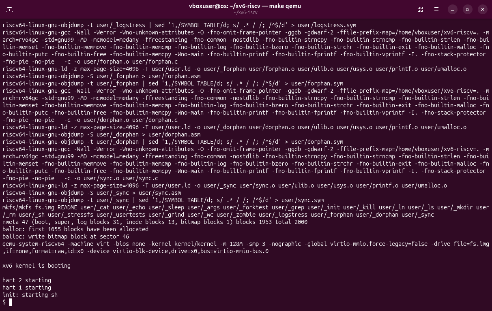

`make clean` deletes everything that was built; `make qemu` compiles the kernel and all the programs again (the long `riscv64-linux-gnu-gcc` lines), then runs `mkfs/mkfs fs.img README user/_cat ...`, which makes the disk. `mkfs` prints the layout of the disk (the `nmeta` line, used in Part 3). Then QEMU starts and xv6 boots: `init: starting sh` and the prompt `$`.

```
$ ls
$ mkdir a
$ ls a
```

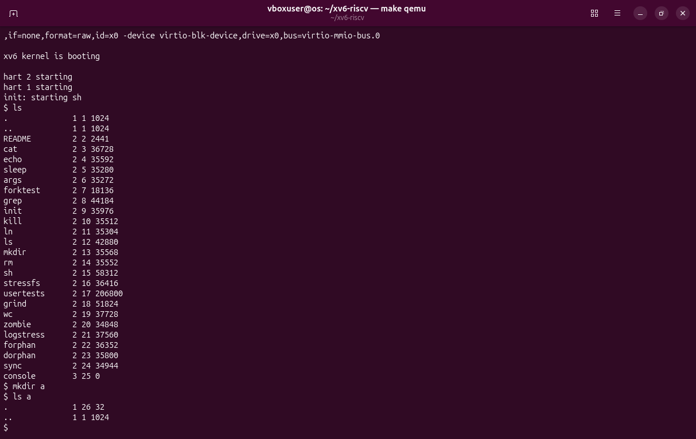

The xv6 `ls` prints four columns: **name, type, inode number, size in bytes**. For example `README 2 2 2441` is a file (type 2), inode 2, 2441 bytes, and `console 3 25 0` is a device (type 3), inode 25, size 0. `.` and `..` of the root are both `1 1 1024`: a directory, inode 1, 1024 bytes (one block). The new directory `a` has `. 1 26 32` (itself, inode 26, 32 bytes) and `.. 1 1 1024` (the root).

```bash
cat kernel/stat.h
grep -n "ROOTINO" kernel/fs.h
sed -n '/struct dirent {/,/^};/p' kernel/fs.h ; grep -n "define DIRSIZ" kernel/fs.h
sed -n 121,132p mkfs/mkfs.c
```

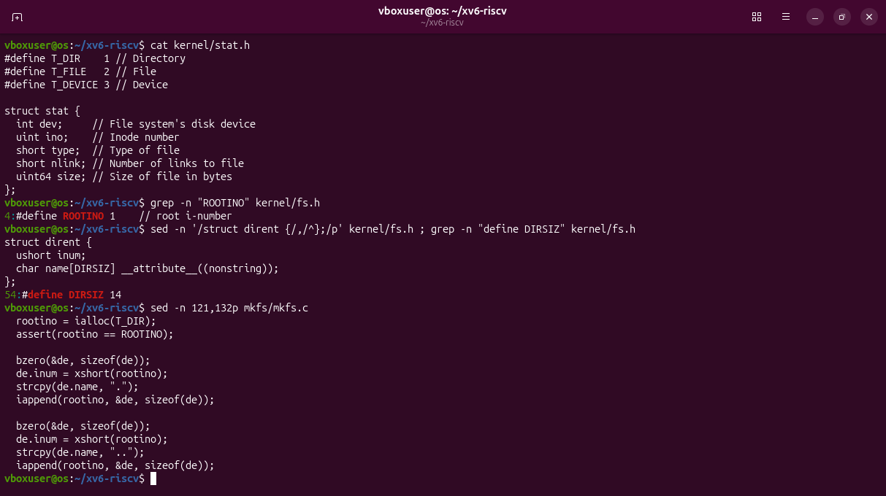

After leaving xv6 (Ctrl-A, then X), I read the files that explain those numbers. `sed -n '/A/,/B/p'` prints the lines from the one matching A to the one matching B; `sed -n 121,132p` prints lines 121 to 132.

- `kernel/stat.h`: `T_DIR 1`, `T_FILE 2`, `T_DEVICE 3`, and `struct stat`, the five fields a program gets from `stat()`.
- `kernel/fs.h`, line 4: `#define ROOTINO 1`, the root directory is inode 1.
- `struct dirent`: a directory entry is a `ushort inum` (2 bytes) and a `char name[DIRSIZ]` with `DIRSIZ 14`: 16 bytes in total.
- `mkfs/mkfs.c` creates the root with `ialloc(T_DIR)`, checks that it got number 1, and appends two entries to it, `.` and `..`, **both with `rootino`**.

### Answers

1. 1 = directory, 2 = regular file, 3 = device.
2. The root is inode 1. It has no parent, so `mkfs` writes `..` with the root's own number, the same as `.`.
3. One entry is 16 bytes (2 for the inode number, 14 for the name). The 32 bytes of `a` are two entries: `.` (inode 26) and `..` (inode 1).

## Part 2 – Write mystat

### The program

The sheet gives the skeleton with three TODOs. My `user/mystat.c`:

```c
#include "kernel/types.h"
#include "kernel/stat.h"
#include "user/user.h"

char *
typename(int t)
{
  switch(t){
  case T_DIR:
    return "directory";
  case T_FILE:
    return "file";
  case T_DEVICE:
    return "device";
  }
  return "?";
}

int
main(int argc, char *argv[])
{
  struct stat st;

  if(argc < 2){
    fprintf(2, "usage: mystat path...\n");
    exit(1);
  }
  for(int i = 1; i < argc; i++){
    if(stat(argv[i], &st) < 0){
      fprintf(2, "mystat: cannot stat %s\n", argv[i]);
      continue;
    }
    printf("%s: %s, inode %d, links %d, size %d bytes\n",
           argv[i], typename(st.type), st.ino, st.nlink, (int)st.size);
  }
  exit(0);
}
```

- `typename` turns the type number into a word, with a `switch` on the three constants of `stat.h`.
- The loop goes over every argument after the program name. `stat(path, &st)` asks the kernel to fill `st` with the inode's data; it returns a negative number if the path does not exist. Then the message goes to **fd 2** (the error output) and `continue` moves on to the next argument, as the TODO asks.
- `printf` prints the line in the format of the sheet. `st.size` is a 64-bit number; `(int)` turns it into the `int` that `%d` expects, as `user/ls.c` does (`%ld` would work too). Nothing is lost, because no xv6 file can be bigger than 268 KiB (Part 3).
- I added one thing to the skeleton: with no argument it prints a usage line instead of doing nothing.

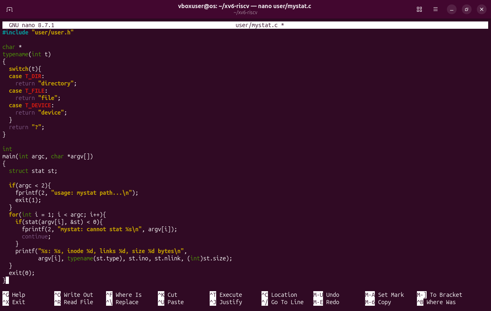

### Into the Makefile

```bash
sed -i 's|^\t$U/_args\\$|&\n\t$U/_mystat\\|' Makefile
grep -n -B1 -A1 "_mystat" Makefile | cat -A
```

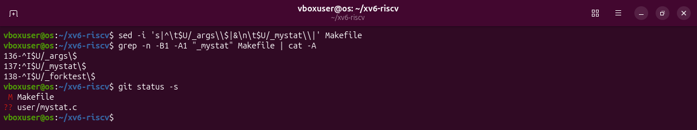

`sed -i` edits the Makefile in place: it finds the line TAB `$U/_args\` and replaces it with itself (`&`) followed by a new line TAB `$U/_mystat\`. `cat -A` proves the format is right (`^I` at the start, `\$` at the end). `git status -s` shows the Makefile modified (`M`) and `user/mystat.c` new (`??`).

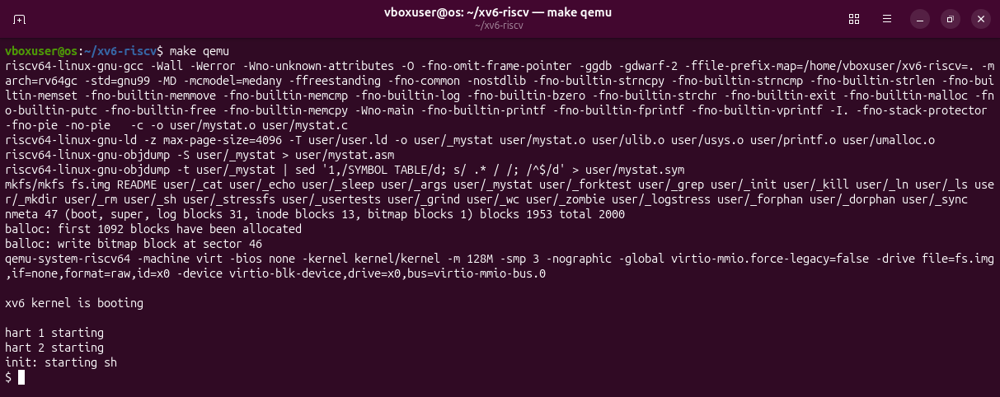

`make qemu` compiles only what changed: `user/mystat.c` into `user/_mystat`. Because the list of programs changed, `fs.img` is made again, so xv6 starts on a fresh disk (the directory `a` from Part 1 is gone).

### Hard links at work

```
$ mystat README . console
$ ln README r2
$ mystat README r2
$ rm README
$ mystat r2
$ cat r2 | wc
```

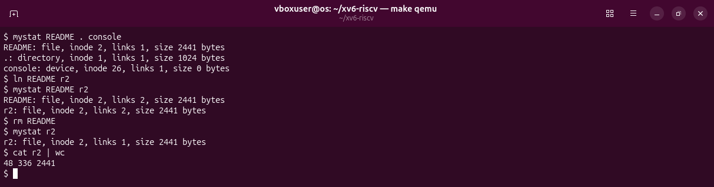

- Before: `README` is a file, inode 2, **1 link**, 2441 bytes. `.` is the root, inode 1. `console` is a device, inode 26 (one more than in Part 1, because `mystat` took a number before it).
- `ln README r2` adds a second name. Now `README` and `r2` are **the same inode 2**, with **2 links**.
- `rm README` removes the first name. `r2` is still inode 2, size 2441, now with **1 link**.
- `cat r2 | wc` counts lines, words and bytes: `48 336 2441`. All the data is still there.

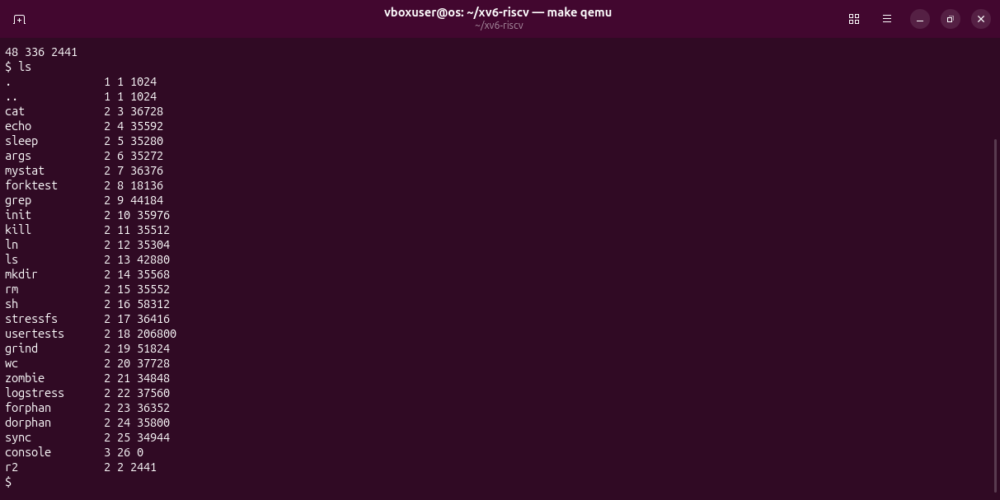

`ls` shows that `README` is gone from the root and `r2` is at the end of the list (its entry was added last), with inode 2.

### More tests (extra)

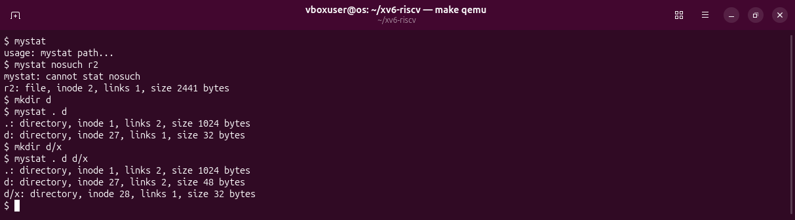

- `mystat` alone prints the usage line; `mystat nosuch r2` prints the error for `nosuch` and still handles `r2`.
- Directory links are counted differently from Linux. A new directory `d` has **1** link, not 2, and the root went from 1 to **2**. After `mkdir d/x`, `d` has 2 links and 48 bytes (three entries). In `create()` (`kernel/sysfile.c`) xv6 does not count the `.` of a directory ("avoid cyclic ref count"), but it adds one to the parent for the child's `..`. On Linux (Lab 5) a new directory has 2.

### Where the link count goes down

```bash
grep -n "nlink--" kernel/sysfile.c
sed -n 235,250p kernel/sysfile.c
```

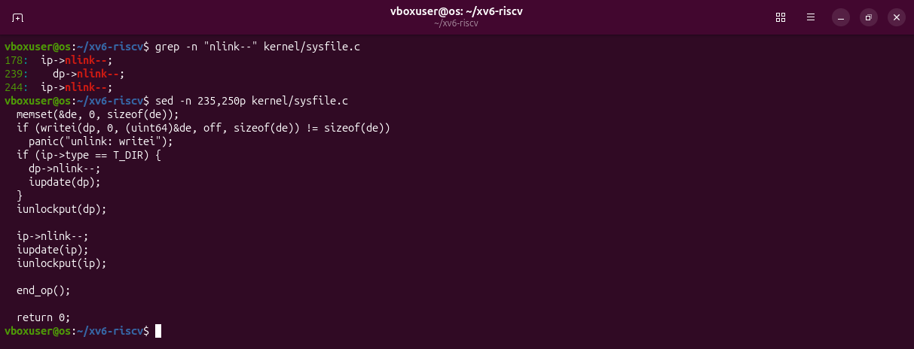

`sys_unlink` is the kernel side of `rm`. It finds the directory entry, overwrites it with zeros (`memset` and `writei`: the slot becomes free, `inum` 0), and then, at **line 244**, `ip->nlink--;` lowers the link count of the inode. Line 239, `dp->nlink--`, runs only when the removed thing is a directory: the parent loses the link that the child's `..` gave it.

```bash
sed -n 342,378p kernel/fs.c
```

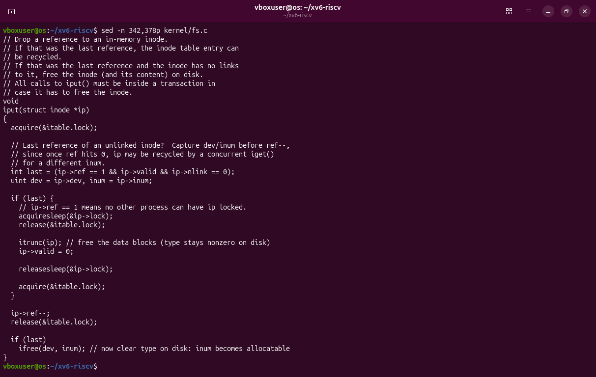

`sys_unlink` does not free anything. That happens in `iput()`, which is called every time someone stops using an inode in memory. If this was the **last** reference (`ip->ref == 1`) **and** the inode has no links left (`ip->nlink == 0`), it calls `itrunc(ip)` (line 365), which frees all the data blocks, and then `ifree()`, which marks the inode itself free. So if a program still has the file open when it is removed, the blocks are freed only when that program closes it: the same rule as on Linux (Lab 5, stretch c).

```bash
sed -n '/struct dinode {/,/^};/p' kernel/fs.h
```

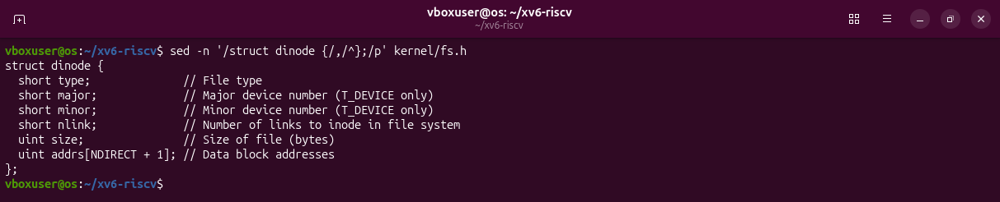

This is everything an xv6 inode stores on the disk: `type`, `major` and `minor` (which device, only for devices), `nlink`, `size`, and `addrs[NDIRECT + 1]`, 12 direct block numbers and one indirect. No owner, no permissions, no times, no link target: xv6 has no users, no permissions and no symbolic links. One `dinode` is 64 bytes, so 16 fit in a block.

### Answers

1. After `ln`: both names inode 2, links 2. After `rm`: `r2` inode 2, links 1, same 2441 bytes. The link count and the names changed; the inode number, the size and the data did not.
2. Line 244 of `kernel/sysfile.c`, `ip->nlink--;`. The blocks are freed in `iput()` (`kernel/fs.c`, `itrunc` at line 365) when the last reference is dropped and `nlink` is 0.
3. `type`, `major`, `minor`, `nlink`, `size`, `addrs[13]`.

## Part 3 – Measure the limits

```bash
grep -n "define BSIZE\|define NDIRECT\|define NINDIRECT\|define DIRSIZ" kernel/fs.h
make clean ; make fs.img 2>&1 | grep nmeta
```

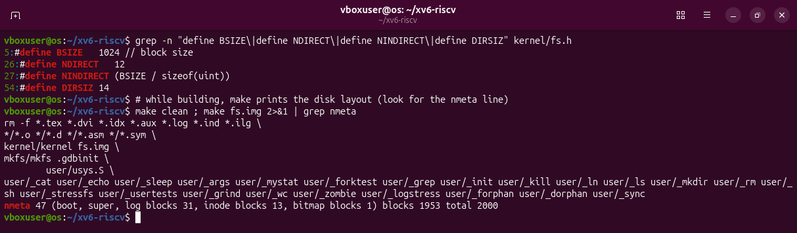

`grep` with `\|` between the patterns finds any of the four lines. `make fs.img` builds only the disk; `2>&1` joins the error output with the normal output so that `grep nmeta` sees `mkfs`'s line (the `rm -f` lines above it are `make clean` printing its command). The result:

```
nmeta 47 (boot, super, log blocks 31, inode blocks 13, bitmap blocks 1) blocks 1953 total 2000
```

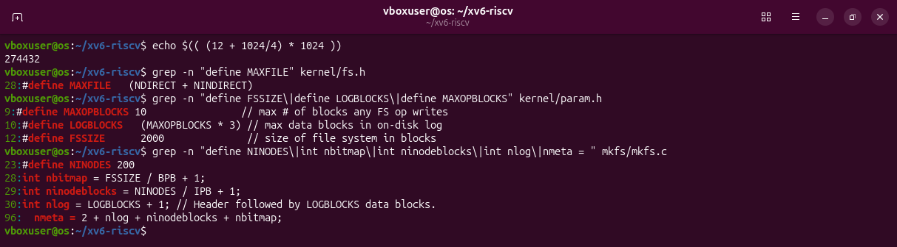

The largest file: an inode has 12 direct block numbers, and one indirect block. The indirect block is 1024 bytes full of 4-byte block numbers, so it holds 1024 / 4 = 256 more. Bash computes it with `$(( ))`:

```
NINDIRECT = BSIZE / sizeof(uint) = 1024 / 4 = 256
MAXFILE   = NDIRECT + NINDIRECT  = 12 + 256 = 268 blocks
largest   = 268 × 1024 = 274,432 bytes = 268 KiB
```

`fs.h` has the same number as `MAXFILE`. The disk layout comes from `kernel/param.h` and `mkfs/mkfs.c`: the disk is `FSSIZE` = 2000 blocks, the log is `LOGBLOCKS` = 30 blocks plus one header block, there are `NINODES` = 200 inodes, 16 per block, so 200 / 16 + 1 = 13 blocks, and one bitmap block (1 bit per block, 8192 bits per block, enough for 2000). Adding the boot block and the superblock: 2 + 31 + 13 + 1 = **47** blocks of metadata, and 2000 − 47 = **1953** blocks for data.

```
block:  0      1       2 ... 32    33 ... 45     46       47 ... 1999
        boot   super   log (31)    inodes (13)   bitmap   data (1953)
```

```
$ mkdir averyveryverylongname
$ ls
```

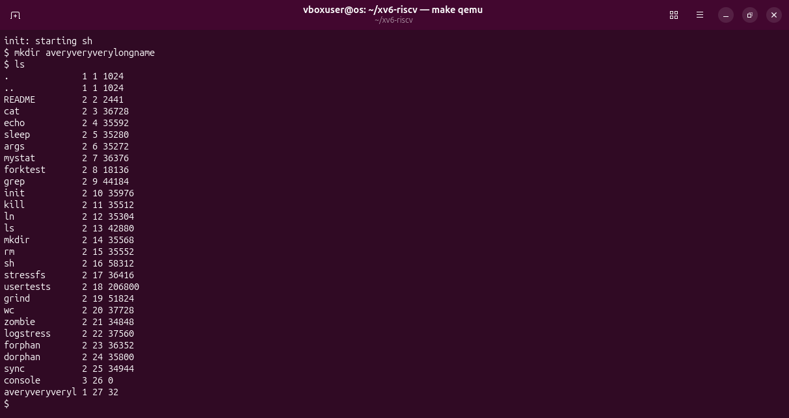

The last line of the listing is `averyveryveryl 1 27 32`: the name was cut to its first **14** characters, `DIRSIZ`, because a directory entry has room for exactly 14 bytes of name.

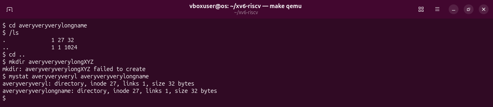

The kernel cuts every name to 14 characters when it looks a path up, too, so `cd averyveryverylongname` works, and `mystat` gives inode 27 for both the long and the short name. For the same reason `mkdir averyveryverylongXYZ` fails: cut to 14 characters it is the same name, which already exists. (Inside the directory I typed `/ls`, not `ls`: the xv6 shell has no `PATH`, as found in Lab 4, and the programs live only in `/`.)

### Answers

1. `averyveryveryl`, the first 14 characters; the constant is `DIRSIZ` (14).
2. (12 + 1024 / 4) × 1024 = 268 × 1024 = 274,432 bytes.
3. 2000 blocks in total: 31 for the log, 13 for the inodes, 1953 for data (plus the boot block, the superblock and 1 bitmap block, 47 metadata blocks in all).

## Part 4 – Write find

### The program

`find <dir> <name>` prints every path under `<dir>` whose last part is `<name>`. My `user/find.c` starts from `user/ls.c`, as the sheet suggests:

```c
#include "kernel/types.h"
#include "kernel/stat.h"
#include "user/user.h"
#include "kernel/fs.h"
#include "kernel/fcntl.h"
#include "kernel/param.h"

int showinum; // set by the optional third argument -n

// Print every path under dir whose last component is name.
void
find(char *dir, char *name)
{
  char buf[MAXPATH], *p; // the kernel refuses longer paths anyway
  int fd;
  struct dirent de;
  struct stat st;

  if ((fd = open(dir, O_RDONLY)) < 0) {
    fprintf(2, "find: cannot open %s\n", dir);
    return;
  }
  if (fstat(fd, &st) < 0) {
    fprintf(2, "find: cannot stat %s\n", dir);
    close(fd);
    return;
  }
  if (st.type != T_DIR) {
    fprintf(2, "find: %s is not a directory\n", dir);
    close(fd);
    return;
  }
  if (strlen(dir) + 1 + DIRSIZ + 1 > sizeof buf) {
    fprintf(2, "find: path too long\n");
    close(fd);
    return;
  }
  strcpy(buf, dir);
  p = buf + strlen(buf);
  *p++ = '/';
  while (read(fd, &de, sizeof(de)) == sizeof(de)) {
    if (de.inum == 0) // free slot
      continue;
    memmove(p, de.name, DIRSIZ);
    p[DIRSIZ] = 0;
    if (strcmp(p, ".") == 0 || strcmp(p, "..") == 0)
      continue;
    if (stat(buf, &st) < 0) {
      fprintf(2, "find: cannot stat %s\n", buf);
      continue;
    }
    if (strcmp(p, name) == 0) {
      if (showinum)
        printf("%s %d\n", buf, st.ino);
      else
        printf("%s\n", buf);
    }
    if (st.type == T_DIR)
      find(buf, name);
  }
  close(fd);
}

int
main(int argc, char *argv[])
{
  if (argc < 3 || argc > 4 || (argc == 4 && strcmp(argv[3], "-n") != 0)) {
    fprintf(2, "usage: find dir name [-n]\n");
    exit(1);
  }
  showinum = (argc == 4);
  find(argv[1], argv[2]);
  exit(0);
}
```

How it works:

1. **Open the directory** and check with `fstat` that it really is one.
2. **Prepare the path buffer**: copy the directory path into `buf` and add a `/`. `p` points just after the slash, where each entry's name will be written. The check before it makes sure that a path plus a 14-character name still fits.
3. **Read the entries one by one.** A directory is a file of 16-byte `struct dirent` records, so `read(fd, &de, sizeof(de))` gets one record at a time, until there are no more.
4. **Skip** free slots (`inum == 0`, left by removed files) and the entries `.` and `..`. Without that, the program would go into `.` forever, or climb back up through `..`.
5. **Build the full path**: copy the name (up to 14 bytes, which may have no zero at the end) after the slash, and add the zero (`p[DIRSIZ] = 0`).
6. **Compare the name** with `strcmp`; if it is equal, print the path (and with `-n`, the inode number).
7. **Recurse**: if the entry is a directory, call `find` on its full path. The function calls itself, one level deeper each time.
8. **Close** the directory at the end. A process may have only 16 files open (`NOFILE`), and every level of the recursion keeps one directory open, so forgetting `close` would make deep trees fail.

The path buffer has `MAXPATH` (128) bytes instead of the 512 of `ls.c`: the kernel refuses longer paths anyway, and a smaller buffer leaves more of the one-page user stack for the recursion.

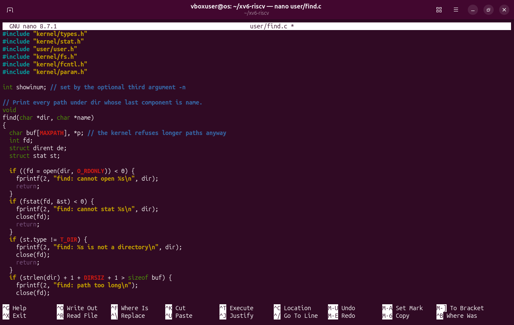

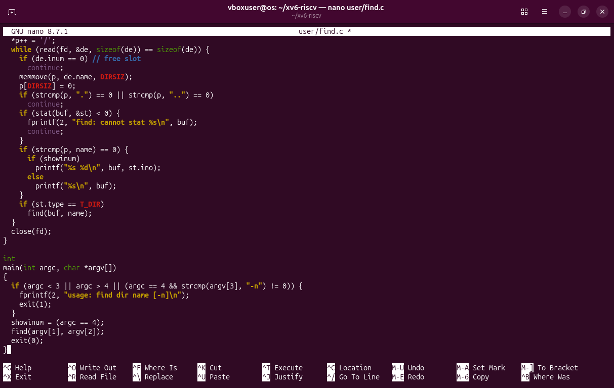

```bash
sed -i 's|^\t$U/_mystat\\$|&\n\t$U/_find\\|' Makefile
git diff Makefile | cat -A
```

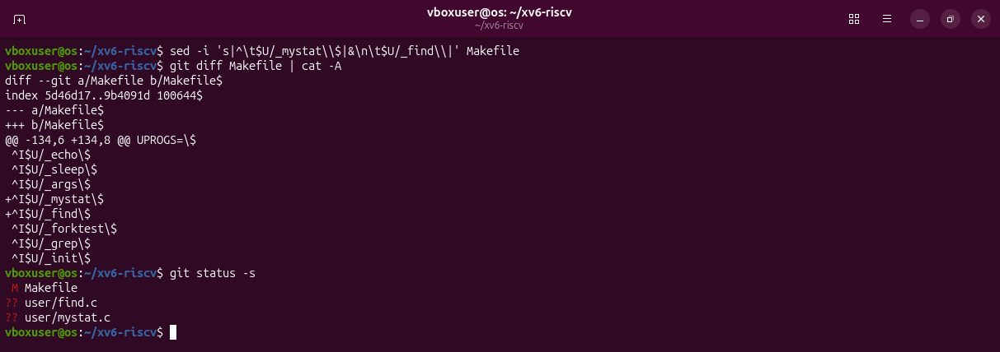

`git diff` shows exactly what changed in the Makefile since the Lab 4 commit: two added lines (`+`), `$U/_mystat\` and `$U/_find\`, each starting with a TAB.

### The test of the sheet, on a fresh disk

```bash
make clean ; make qemu
```

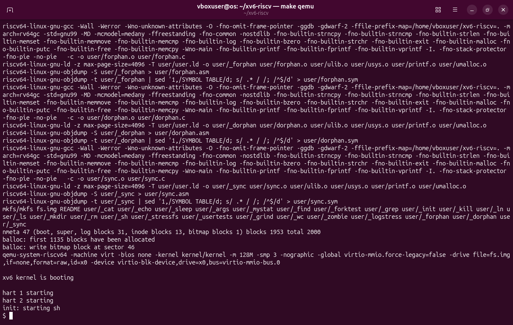

```
$ mkdir a
$ mkdir a/b
$ echo x > a/b/r2
$ echo y > a/r2
$ ln cat r2
$ find . r2
$ find a b
```

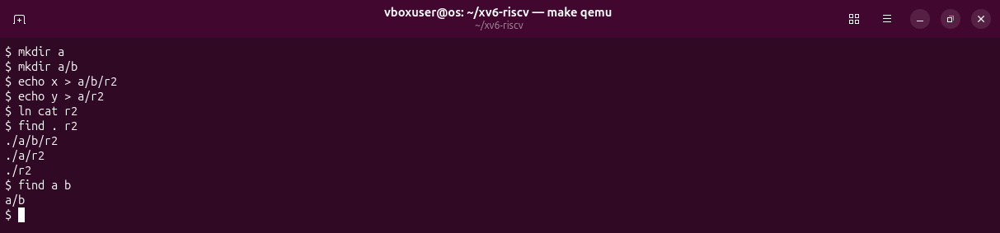

`find . r2` prints the three paths `./a/b/r2`, `./a/r2`, `./r2`, the same as the sheet. `find a b` prints `a/b`: the match can be a directory too. The order is the order of the entries inside each directory: in the root `a` was created before `r2`, and inside `a`, `b` before `r2`; `find` goes into `b` as soon as it meets it.

### Stretch: find . r2 -n

```
$ find . r2 -n
$ ls cat
$ mystat cat r2 a/r2 a/b/r2
```

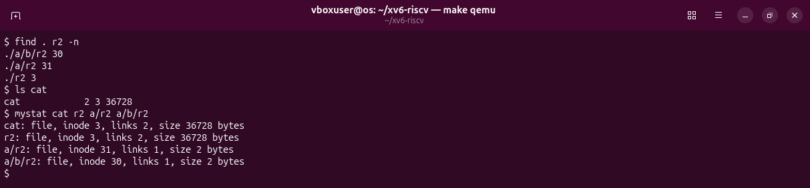

With a third argument `-n`, `find` prints the inode number after each path. `./r2` is inode **3**, and `ls cat` shows that `cat` is inode 3 too: `ln cat r2` gave the `cat` program a second name, so `./r2` **is** `cat` (both have 2 links and 36728 bytes). `./a/r2` (31) and `./a/b/r2` (30) are separate 2-byte files made by `echo`.

### More tests (extra)

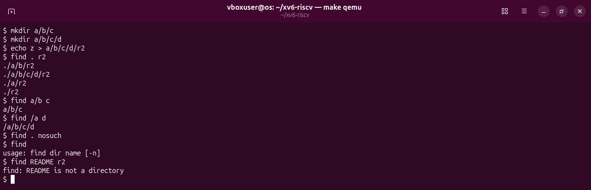

- A deeper tree: `a/b/c/d/r2` is found too, four levels down.
- `find a/b c` and `find /a d` work from any starting directory, relative or absolute.
- `find . nosuch` prints nothing: no match is not an error.
- `find` alone prints the usage line, and `find README r2` says README is not a directory.

## The xv6 tree at the end

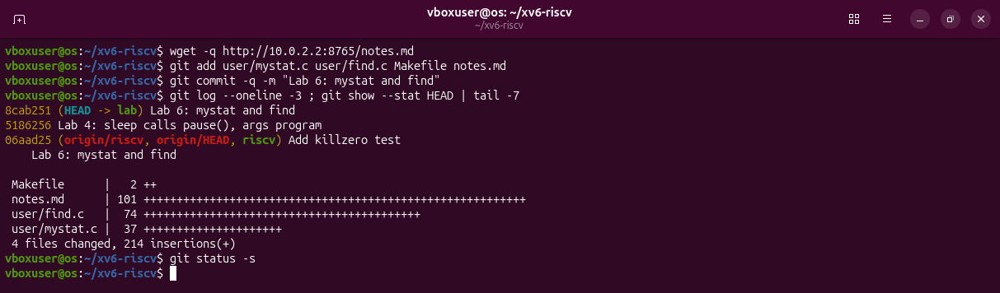

The work is saved in the VM as one commit on branch `lab`, on top of the Lab 4 commit: `user/mystat.c` (37 lines), `user/find.c` (74 lines), the two Makefile lines and `notes.md`. `git status -s` prints nothing: everything is committed. The files in this folder are byte-for-byte copies of the ones in the VM.

## What I learned

- The xv6 file system is ext4 in miniature: inodes with a link count and a list of blocks, directories made of fixed 16-byte entries, the root at inode 1 with `..` pointing to itself.
- A hard link is just one more entry with the same inode number. `unlink` lowers the count, and the blocks are freed only in `iput()`, when no link and no reference is left.
- The limits are plain constants anyone can read: 14-character names (`DIRSIZ`), 268 KiB files (`NDIRECT` + `NINDIRECT`), a 2000-block disk (`FSSIZE`) of which 47 blocks are metadata.
- Walking a tree is reading directories as files of entries, skipping `.` and `..`, and recursing, while closing every directory, because a process may hold only 16 files open.
