# Lab 7 – Three Small Programs: Processes, Redirection, a Pipe

Course: Operating Systems, FCIM / FAF, UTM, 2026-2027. Track A: the real OS, from the outside (Linux).

This page explains everything that was done in the lab, step by step: every command, what it printed, and why. The figure numbers are the same as in the Word report, so the two can be read side by side.

## What is in this folder

| File | What it is |
|---|---|
| `Lab7_EftodeAndrei_FAF-242.docx` | The report: title page, 23 screenshots, the answers to every Observe box and the optional part |
| `run.c` | fork + exec + wait: the three steps of the shell for `ls -l` (exactly the code of the sheet) |
| `zombie.c` | `run.c` with one more line, `sleep(20);`, so the child stays a zombie for 20 seconds |
| `redirect.c` | Does what the shell does for `ls -l > out.txt` |
| `pipeline.c` | Does what the shell does for `ls /etc \| wc -l` |
| `pipeline3.c` | Optional part, written by me: `ls /usr/bin \| grep x \| wc -l` with two pipes and three children |
| `report.md` | The answers the sheet asks to write "in report.md" |
| `full_explanations.md` | The slow version of this page: every line of the five programs, what the kernel does behind each call, worked examples and a self-test |
| `screenshots/` | The terminal screenshots shown on this page (`fig-1-1.png` is Figure 1.1, and so on) |

The files `run.c` and `pipeline.c` are handed in as the sheet gives them. The changes the sheet asks for along the way (`date`, `nosuchprog`, the missing `close(p[1])`) were made, run and then undone; they are shown below.

## How to run it

```bash
mkdir -p ~/os-lab7 && cd ~/os-lab7          # copy the .c files here
gcc -Wall -Wextra -o run run.c && ./run
gcc -Wall -Wextra -o zombie zombie.c
./zombie > /dev/null &
sleep 2; ps -o pid,ppid,stat,cmd            # the [ls] <defunct> line
gcc -Wall -Wextra -o redirect redirect.c && ./redirect && head -3 out.txt
gcc -Wall -Wextra -o pipeline pipeline.c && ./pipeline ; ls /etc | wc -l
gcc -Wall -Wextra -o pipeline3 pipeline3.c && ./pipeline3 ; ls /usr/bin | grep x | wc -l
```

## Words used on this page

- **Process**: a program that is running. Every process has a number, its **PID**, like the PID column of the Windows Task Manager.
- **Parent and child**: the process that creates another one is its parent. Each process knows the PID of its parent (**PPID**).
- **`fork()`**: makes a copy of the running process. After it, there are two processes running the same code; `fork` returns 0 in the copy (the child) and the child's PID in the original (the parent).
- **`exec`** (here `execlp`): replaces the program inside a process by another program, for example `ls`. The PID stays the same. If it works, it never comes back.
- **`wait`** (here `waitpid`): the parent sleeps until its child ends, and receives the child's **exit status**, the number the child gave to `exit()`. 0 means success.
- **Zombie**: a child that has ended but whose parent has not called `wait` yet. Only its PID and exit status are left, waiting to be collected.
- **File descriptor**: a small number that stands for an open file, like a numbered ticket. Every process starts with three: **0** = input (the keyboard), **1** = output (the screen), **2** = errors (the screen). `open` returns a new descriptor, `close` frees one, `dup` copies one.
- **Pipe**: a small buffer inside the kernel with two descriptors: what is written into one end (`p[1]`) can be read from the other (`p[0]`). The `|` of the shell is a pipe.
- **`gcc`**: the C compiler. `-Wall -Wextra` turns on the warnings, `-o run` names the program that comes out.
- **`strace`**: a Linux tool that prints every system call a program makes. It shows what the kernel is asked to do.

## Before the lab

```bash
mkdir -p ~/os-lab7 && cd ~/os-lab7
gcc --version | head -1
whoami ; uname -r ; pwd ; ls -la
```

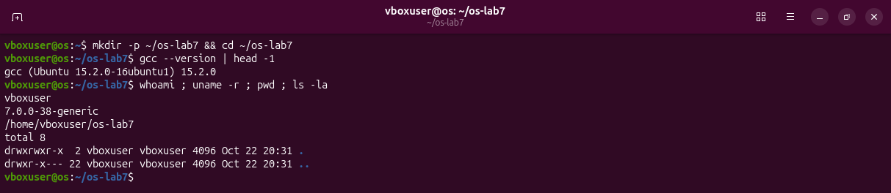

The folder `~/os-lab7` is created and is empty (only `.` and `..`). The compiler is `gcc` 15.2.0. I work as the normal user `vboxuser`, on the Linux kernel 7.0.0-38.

## Part 1 – fork + exec + wait

### The program

The sheet gives the whole program. It does the three steps the shell does when I type `ls -l`:

```c
int main(void)
{
    printf("parent: my PID is %d\n", getpid());
    fflush(stdout);

    pid_t pid = fork();                          /* step 1: copy myself */
    if (pid < 0) { perror("fork"); return 1; }

    if (pid == 0) {                              /* only the child runs this */
        printf("child:  my PID is %d, my parent is %d\n", getpid(), getppid());
        fflush(stdout);
        execlp("ls", "ls", "-l", (char *)NULL);  /* step 2: become ls */
        perror("exec");                          /* runs only if exec failed */
        exit(127);
    }

    int status;
    waitpid(pid, &status, 0);                    /* step 3: wait for the child */
    printf("parent: child %d ended with status %d\n", pid, WEXITSTATUS(status));
    return 0;
}
```

- `getpid()` gives the process its own PID; `getppid()` gives the PID of its parent.
- `fflush(stdout)` pushes out at once what `printf` keeps in its buffer. Without it, the text still waiting in the buffer would be copied by `fork` and could be printed twice.
- After `fork()` both processes continue from the same line. The `if (pid == 0)` block runs only in the child.
- `execlp("ls", "ls", "-l", (char *)NULL)`: the first `"ls"` is the program to look for in the folders of `PATH`; then come the words the program receives (`argv[0]` = `"ls"`, `argv[1]` = `"-l"`); `NULL` marks the end of the list.
- `waitpid(pid, &status, 0)` waits for that one child. `WEXITSTATUS(status)` takes the exit code out of `status`.

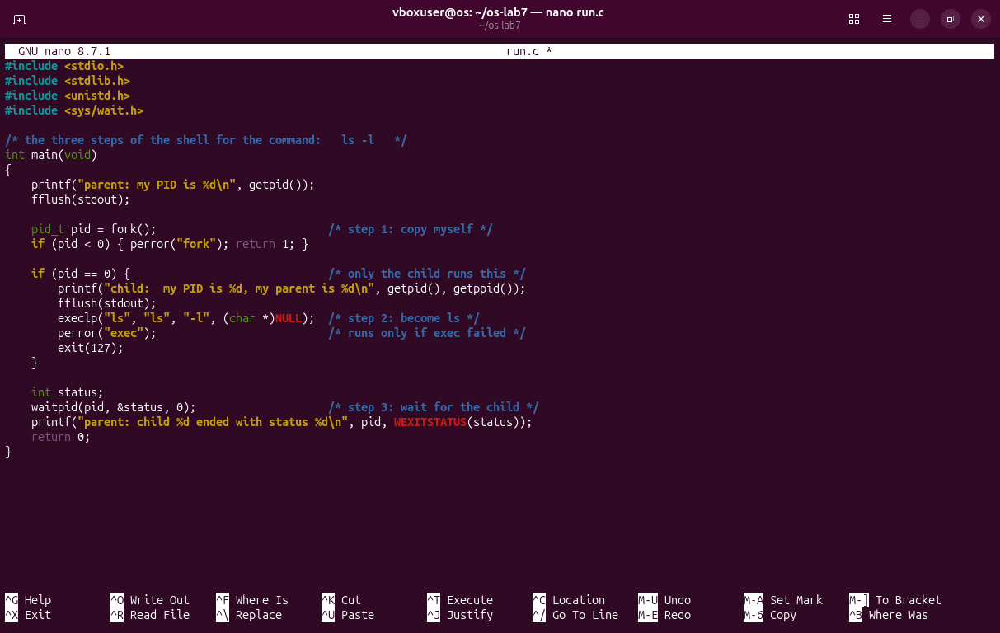

```bash
gcc -Wall -Wextra -o run run.c && ./run
```

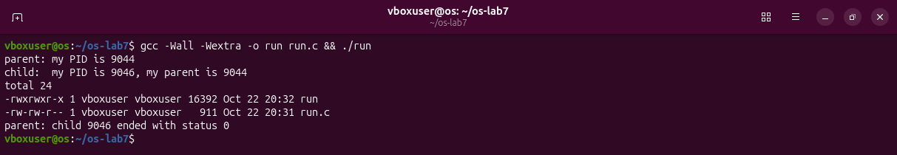

- `gcc` prints nothing: no errors and no warnings. `&&` runs `./run` only if the compilation worked.
- The parent is PID 9044. The child is 9046 and says its parent is **9044**.
- Then the child became `ls -l` and printed the listing of the folder: the program `run` and the file `run.c`, 911 bytes, the same size as on the sheet.
- Last, the parent prints that child 9046 ended with **status 0**.

### Another program: date

The sheet asks to replace the `execlp` line. I kept a copy of the original and changed the line with `sed`:

```bash
cp run.c run.c.orig
sed -i 's|^ *execlp(.*|        execlp("date", "date", (char *)NULL);|' run.c
diff run.c.orig run.c
gcc -Wall -Wextra -o run run.c && ./run
```

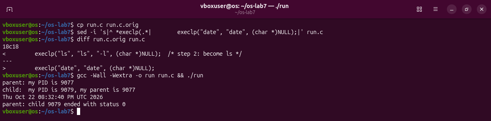

`sed -i 's|A|B|' file` edits the file in place: it replaces what matches `A` by `B`. Here `A` is "spaces, then `execlp(`, then anything", so the whole `execlp` line. `diff` shows the one changed line (`18c18`: line 18 changed). This time the child became `date` and printed the date and time; status 0.

### A program that does not exist

```bash
sed -i 's|^ *execlp(.*|        execlp("nosuchprog", "nosuchprog", (char *)NULL);|' run.c
diff run.c.orig run.c
gcc -Wall -Wextra -o run run.c && ./run ; echo "exit code of ./run: $?"
```

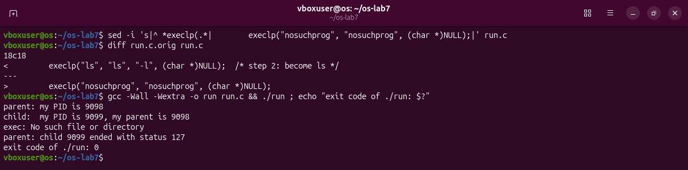

`execlp` fails, so for the first time the two lines after it run: `perror("exec")` prints `exec: No such file or directory` and `exit(127)` ends the child. The parent sees **status 127**. The exit code of `./run` itself (`$?`) is 0, because the parent ends with `return 0` whatever happened to the child.

### What strace shows

```bash
strace -f -e trace=execve,clone,clone3,wait4,exit_group ./run
```

`-f` follows the child too, `-e trace=...` keeps only the calls that matter here.

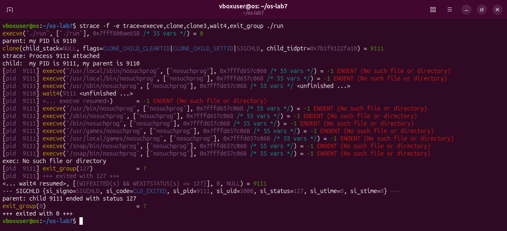

- `clone(...) = 9111`: this is `fork`. On Linux, `fork()` asks the kernel with the system call `clone`, which returns the child's PID to the parent.
- `[pid 9111] execve("/usr/local/sbin/nosuchprog", ...) = -1 ENOENT`: `execlp` tries the folders of `PATH` one by one. Every try ends with `ENOENT`, "no such file". Only after the last one does `execlp` give up and return.
- `exit_group(127)` is the child's `exit(127)`. `wait4(...)` is the parent's `waitpid`, which gets `WEXITSTATUS(s) == 127`. The kernel also sends the parent the signal `SIGCHLD`, "a child ended".

```bash
cp run.c.orig run.c && gcc -Wall -Wextra -o run run.c
echo "my shell has PID $$"
strace -f -e trace=execve,clone,clone3,wait4,exit_group ./run > /dev/null
```

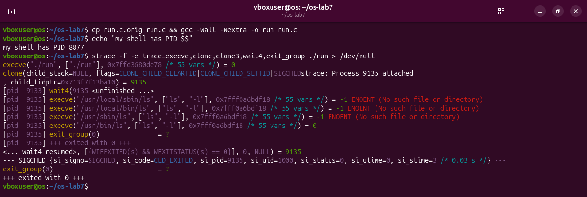

With the original `run.c`, the fourth try, `/usr/bin/ls`, returns 0: the program is replaced, and nothing after `execlp` runs. (`> /dev/null` throws away the normal output, so only the lines of `strace` are left.)

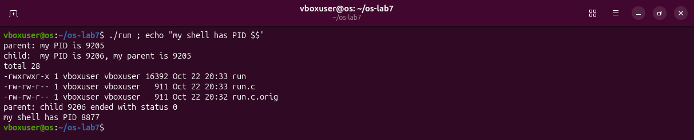

`$$` is the PID of the shell itself: 8877. The child says its parent is 9205, the PID of `./run`, not the shell.

### Answers

1. `perror` runs only when `execlp` fails. When `execlp` works, the child's program is replaced by `ls`, so the lines after it no longer exist. With `nosuchprog` every `execve` failed (Figure 1.5) and `execlp` came back.
2. The child prints the PID of the `./run` process (9044 in Figure 1.2, the same number as "parent: my PID is"). It is not my shell (8877).
3. Status 0 with `ls`. Status 127 with `nosuchprog`, the number the child gave to `exit(127)`.

## Part 2 – A zombie, on purpose

`zombie.c` is the original `run.c` with one more line, `sleep(20);`, just before `waitpid`. The parent sleeps 20 seconds before it collects its child.

```bash
cp run.c zombie.c
sed -i 's|^    waitpid(pid, &status, 0);|    sleep(20);                                   /* the new line */\n&|' zombie.c
diff run.c zombie.c
gcc -Wall -Wextra -o zombie zombie.c
./zombie > /dev/null &
sleep 2; ps -o pid,ppid,stat,cmd
grep State /proc/$(pgrep -n -x ls)/status
```

- In `sed`, `&` means "what was found" and `\n` a new line, so the `sleep` line is put before the `waitpid` line. `diff` shows the one added line (`23a24`).
- `&` at the end of a command starts it in the background: the prompt comes back at once, and bash prints `[1] 9646`, the job number and the PID. `> /dev/null` hides the output of `ls`.
- `ps -o pid,ppid,stat,cmd` lists the processes of this terminal with four columns: PID, parent PID, state, command.
- `pgrep -n -x ls` finds the newest process named exactly `ls`; `/proc/<PID>/status` is what the kernel knows about it.

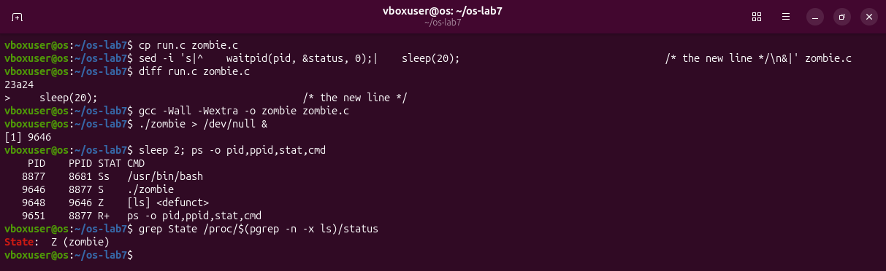

| PID | PPID | STAT | CMD | Meaning |
|---|---|---|---|---|
| 8877 | 8681 | Ss | `/usr/bin/bash` | my shell (`S` sleeping, `s` session leader) |
| 9646 | 8877 | S | `./zombie` | the parent, asleep in `sleep(20)`; its parent is the shell |
| 9648 | 9646 | **Z** | `[ls] <defunct>` | the child: `ls` has ended, but nobody has collected it |
| 9651 | 8877 | R+ | `ps ...` | `ps` itself (`R` running, `+` in the foreground) |

The kernel confirms: `State: Z (zombie)`.

After 20 seconds:

```bash
ps -o pid,ppid,stat,cmd
```

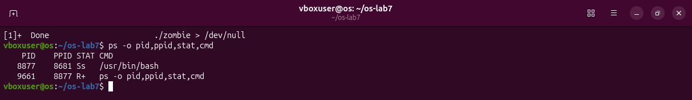

bash says `[1]+ Done ./zombie > /dev/null`, and the lines of `./zombie` and `[ls] <defunct>` are gone.

### Answers

1. `Z`: zombie, also written `<defunct>`. The child has finished and its memory is freed, but its entry (PID and exit status) is kept for the parent.
2. It is gone. The line `waitpid(pid, &status, 0);` collected the status, and then the kernel removed the entry.

## Part 3 – Redirection: ls -l > out.txt

```c
    pid_t pid = fork();
    if (pid == 0) {
        close(1);                                /* descriptor 1 is now free */
        int fd = open("out.txt", O_WRONLY | O_CREAT | O_TRUNC, 0644);
        if (fd < 0) { perror("open"); exit(1); }
        fprintf(stderr, "open gave descriptor %d\n", fd);
        execlp("ls", "ls", "-l", (char *)NULL);  /* ls writes to 1, as always */
        perror("exec");
        exit(127);
    }
    waitpid(pid, NULL, 0);
    printf("done: the listing is in out.txt\n");
```

- `close(1)`: the child closes its screen output. Descriptor 1 is free now.
- `open(...)`: open `out.txt` for writing (`O_WRONLY`), create it if needed (`O_CREAT`), empty it if it exists (`O_TRUNC`), with permissions `0644` (rw-r--r--). The kernel gives the **smallest free number**, which is 1.
- `fprintf(stderr, ...)` writes on descriptor 2, which is still the screen.
- `ls` is not changed at all: it writes to descriptor 1 as always, and descriptor 1 is now the file.

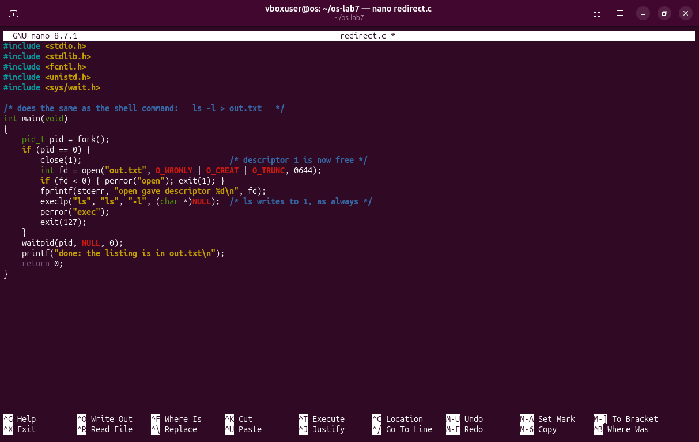

```bash
gcc -Wall -Wextra -o redirect redirect.c && ./redirect
head -3 out.txt
```

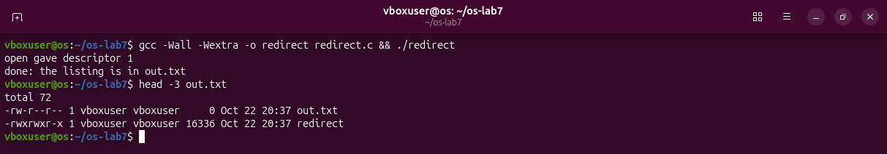

`open gave descriptor 1`, then the parent's line. The listing is not on the screen: it is in `out.txt`, and `head -3` shows its first three lines. In its own listing `out.txt` has 0 bytes: `open` had just created it empty, and `ls` looked at the folder before it wrote anything.

### Extra: redirect the errors

To check the third question, I made a copy of `redirect.c` in `/tmp` that closes **2** instead of 1, writes to `err.txt` and asks `ls` for a file that does not exist:

```bash
sed 's/close(1)/close(2)/; s/descriptor 1 is now free/descriptor 2 is now free/; s/ls -l > out\.txt/ls nosuchfile 2> err.txt/; s/"out\.txt"/"err.txt"/; s/the listing is in out\.txt/the errors are in err.txt/; s/"ls", "-l"/"ls", "nosuchfile"/' redirect.c > /tmp/redirect2.c
diff redirect.c /tmp/redirect2.c
gcc -Wall -Wextra -o /tmp/redirect2 /tmp/redirect2.c && /tmp/redirect2
cat err.txt
```

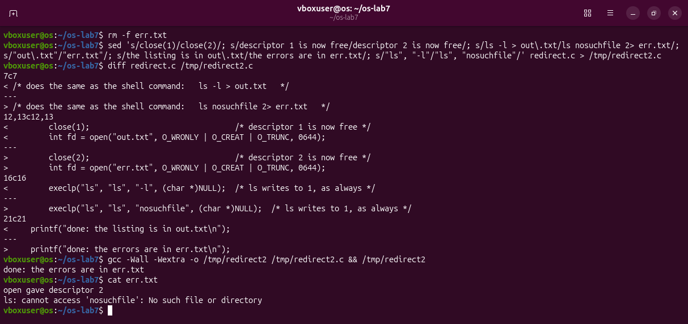

This time `open` gave **2**, and both the message of the program and the error of `ls` went into `err.txt`. Only the parent's line is on the screen. This is what the shell does for `ls nosuchfile 2> err.txt`.

### Answers

1. 1, because the kernel always gives the smallest free descriptor: 0 was still open and 1 had just been closed.
2. `ls` writes to descriptor 1, and in this child descriptor 1 is the file `out.txt`. `exec` changes the program but keeps the open descriptors.
3. Descriptor 2 (Figure 3.3).

## Part 4 – A pipe: ls /etc | wc -l

```c
    int p[2];
    if (pipe(p) < 0) { perror("pipe"); return 1; }

    if (fork() == 0) {                           /* ls: its 1 becomes p[1] */
        close(1);
        dup(p[1]);                               /* smallest free number: 1 */
        close(p[0]);
        close(p[1]);
        execlp("ls", "ls", "/etc", (char *)NULL);
        ...
    }

    if (fork() == 0) {                           /* wc: its 0 becomes p[0] */
        close(0);
        dup(p[0]);                               /* smallest free number: 0 */
        close(p[0]);
        close(p[1]);
        execlp("wc", "wc", "-l", (char *)NULL);
        ...
    }

    close(p[0]);                                 /* the parent uses neither end */
    close(p[1]);
    wait(NULL);
    wait(NULL);
```

- `pipe(p)` creates the pipe: `p[0]` is the end to read from, `p[1]` the end to write into.
- First child: `close(1)` then `dup(p[1])`. `dup` copies a descriptor into the smallest free number, which is 1. So the output of `ls` goes into the pipe. Then it closes the two original numbers, which it does not need any more.
- Second child: the same with 0 and `p[0]`, so `wc` reads from the pipe.
- The parent closes both ends and waits for the two children.

```
           ls /etc                                wc -l
   descriptor 1 = p[1]  ===>  [ pipe ]  ===>  descriptor 0 = p[0]
```

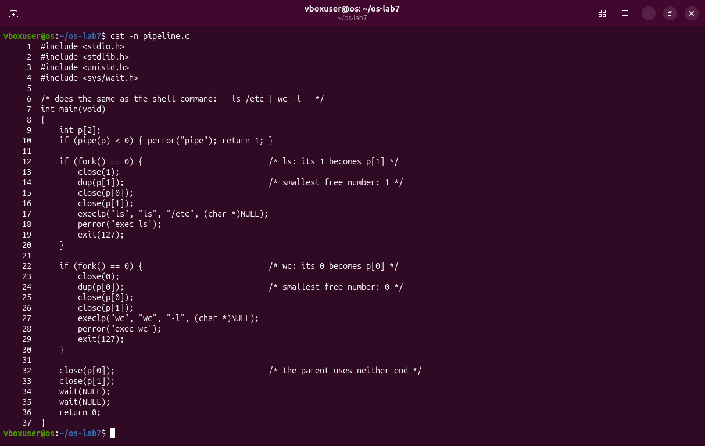

```bash
gcc -Wall -Wextra -o pipeline pipeline.c && ./pipeline
ls /etc | wc -l
```


Both print **237**: there are 237 names in `/etc`.

### Break it on purpose

The sheet asks to turn the parent's `close(p[1]);` into a comment:

```bash
cp pipeline.c pipeline.c.orig
sed -i 's|^    close(p\[1\]);$|    /* close(p[1]); */|' pipeline.c
diff pipeline.c.orig pipeline.c
gcc -Wall -Wextra -o pipeline pipeline.c && time ./pipeline
```

The pattern starts with exactly four spaces, so only the parent's line (line 33) changes; the two `close(p[1]);` of the children have eight spaces. `time` measures how long the program ran.

![Figure 4.3 – With close(p[1]) commented out in the parent, nothing is printed; stopped with Ctrl-C after 9 s](screenshots/fig-4-3.png)

Nothing is printed. After about 9 seconds I pressed Ctrl-C (`^C`).

To see which child is stuck, I ran it again in the background:

```bash
./pipeline &
sleep 1; ps -o pid,ppid,stat,cmd
ls -l /proc/$(pgrep -n -x wc)/fd
kill $! ; sleep 1
```

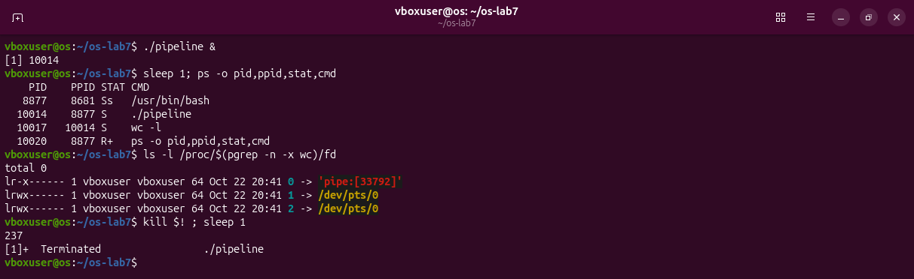

- `ps` shows `./pipeline` and `wc -l`, both `S` (asleep). `ls` is not there any more: it wrote its 237 lines, ended, and the parent's first `wait` collected it.
- `/proc/<PID>/fd` lists the open descriptors of `wc`: **0 is a pipe** (`pipe:[33792]`), 1 and 2 are the terminal (`/dev/pts/0`).
- `$!` is the PID of the last program started with `&`, the parent. When only the parent is killed, its `p[1]` is closed, `wc` at last gets end of file, and prints **237** at once.

```bash
cp pipeline.c.orig pipeline.c && rm pipeline.c.orig
grep -n "close(p\[1\])" pipeline.c
gcc -Wall -Wextra -o pipeline pipeline.c && ./pipeline
```

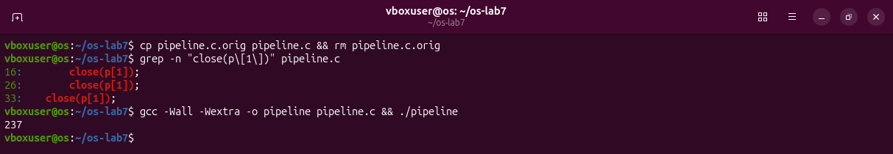

The three `close(p[1]);` lines are back (16, 26, 33) and the program prints 237 again.

### Answers

1. Yes, both printed 237.
2. `wc` never ends. `ls` finishes normally.
3. `wc` reads until end of file, and a pipe gives end of file only when every write end is closed. The parent still had `p[1]` open, and the parent itself was waiting for `wc`: each waited for the other.

## Optional – three stages: ls /usr/bin | grep x | wc -l

I wrote `pipeline3.c`: two pipes, three children. `p` connects `ls` to `grep`, `q` connects `grep` to `wc`. After its `dup`, every child closes all four pipe ends with a small function `close_all()`, and the parent closes all four too.

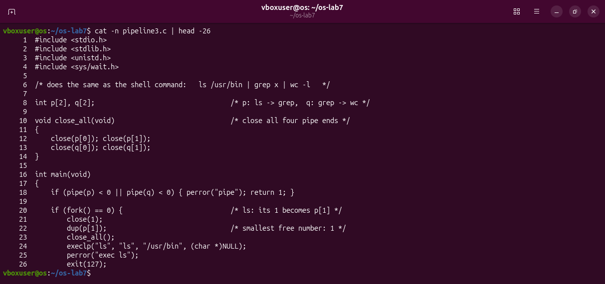

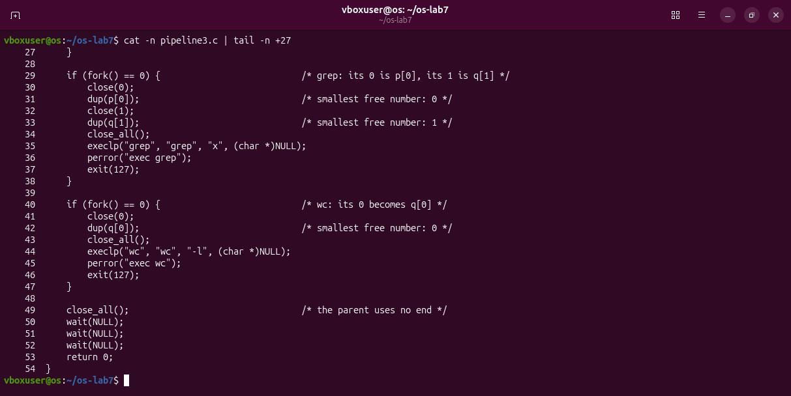

| Child | Descriptor 0 (input) | Descriptor 1 (output) |
|---|---|---|
| `ls /usr/bin` | the keyboard | `p[1]` |
| `grep x` | `p[0]` | `q[1]` |
| `wc -l` | `q[0]` | the screen |

```bash
gcc -Wall -Wextra -o pipeline3 pipeline3.c && ./pipeline3
ls /usr/bin | grep x | wc -l
strace -f -e trace=pipe2,dup,execve -e signal=none ./pipeline3 2>&1 | grep -v ENOENT
```

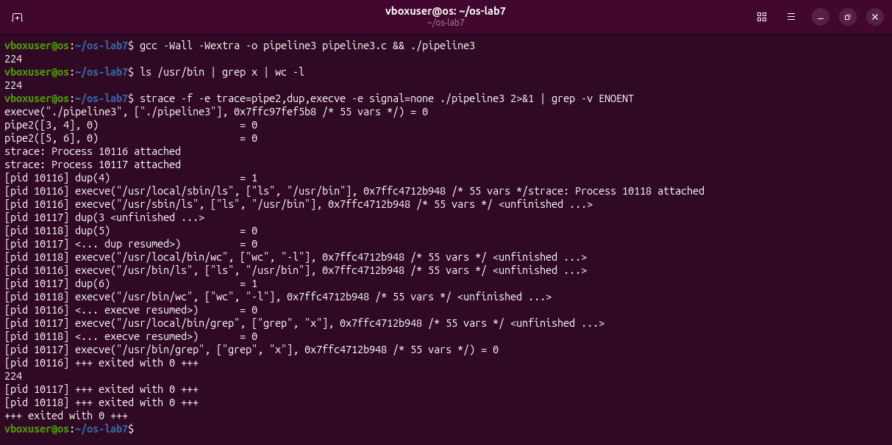

- Both print **224**: 224 programs in `/usr/bin` have an `x` in their name.
- `strace` shows the two pipes: `pipe2([3, 4])` is `p` (3 to read, 4 to write) and `pipe2([5, 6])` is `q`. Then `ls` does `dup(4) = 1`, `grep` does `dup(3) = 0` and `dup(6) = 1`, and `wc` does `dup(5) = 0`: every end lands on 0 or 1, as in the table. (`grep -v ENOENT` hides the failed tries of `execlp` in `PATH`.)

If one process forgot to close `q[1]`, `wc` would wait forever, as in Figure 4.3.

## The folder at the end

```bash
wget -q http://10.0.2.2:8765/report.md && ls -l report.md
head -36 report.md
```

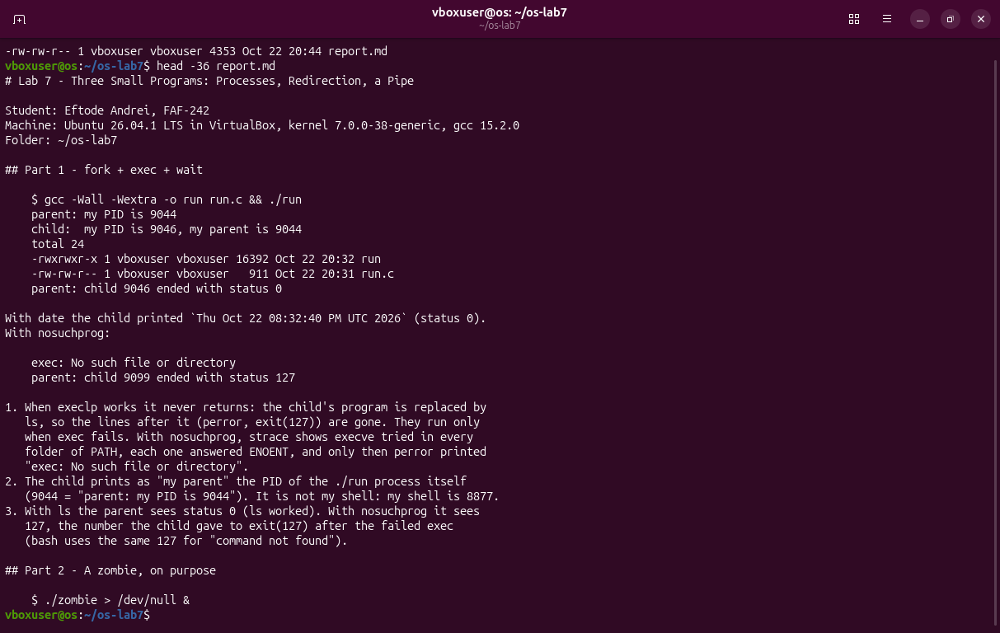

`report.md` holds the answers, as the sheet asks. I wrote it on Windows and copied it into the VM with `wget` from a small file server on the host (10.0.2.2 is how the VM reaches Windows).

```bash
rm -f err.txt /tmp/redirect2 /tmp/redirect2.c
ls -l
md5sum *.c report.md
```

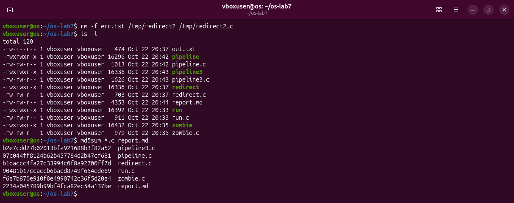

The five programs, their sources, `out.txt` from Part 3 (474 bytes now, the full listing) and `report.md`. The `md5sum` values are fingerprints of the files; the files in this folder of the repository have exactly the same ones.

## What I learned

- The shell runs every command with three system calls: `fork` makes a copy, `exec` turns the copy into the program, `wait` collects the exit status. A child that nobody waits for stays a zombie.
- `exec` returns only when it fails, which is why the line after it is the error handler.
- Redirection needs no change in the program: before `exec` the child puts a file on descriptor 1 (or 2), because `open` and `dup` always take the smallest free number.
- A pipe gives end of file only when every write end is closed. One forgotten `close` and the reader waits forever.
