# Lab 8 – The Same Calls, Inside Your Own OS

Course: Operating Systems, FCIM / FAF, UTM, 2026-2027. Track B: build your own small OS (xv6).

This page explains everything that was done in the lab, step by step: every command, what it printed, and why. The figure numbers are the same as in the Word report, so the two can be read side by side.

## What is in this folder

| File | What it is |
|---|---|
| `Lab8_EftodeAndrei_FAF-242.docx` | The report: title page, 18 screenshots, the answers to every Observe box and the optional part |
| `run.c` | fork + exec + wait inside xv6; the child becomes `echo` (exactly the code of the sheet). In xv6 it lives in `user/run.c` |
| `pingpong.c` | The sheet's skeleton with the TODO lines written: one byte goes to the child and back through two pipes. In xv6: `user/pingpong.c` |
| `primes.c` | Optional part, written by me: the primes from 2 to 35 with a chain of processes. In xv6: `user/primes.c` |
| `Makefile` | The xv6 Makefile with my lines in `UPROGS`: `$U/_run\`, `$U/_pingpong\` and `$U/_primes\` from this lab, plus the ones of Labs 4 and 6 |
| `notes.md` | The answers the sheet asks to write "in notes.md" |
| `full_explanations.md` | The slow version of this page: every line of the three programs, the kernel code behind `fork`, `exec`, `wait` and pipes in xv6, worked examples and a self-test |
| `screenshots/` | The terminal screenshots shown on this page (`fig-1-1.png` is Figure 1.1, and so on) |

`run.c` is handed in as the sheet gives it. The two changes the sheet asks for along the way (`ls`, `nosuchprog`) were made, run and then undone; they are shown below.

## How to run it

```bash
# put the files into an xv6 tree at revision 06aad25
cp run.c pingpong.c primes.c ~/xv6-riscv/user/
cp Makefile ~/xv6-riscv/
cp ../lab4/sleep.c ../lab4/args.c ../lab6/mystat.c ../lab6/find.c ~/xv6-riscv/user/   # the Makefile also builds these
cd ~/xv6-riscv && make clean && make qemu
# at the xv6 prompt:
#   run          pingpong          primes
# leave xv6: press Ctrl-A, release, then press X
```

## Words used on this page

- **xv6**: a very small teaching operating system from MIT, running inside **QEMU**, a program that pretends to be a RISC-V computer. `make qemu` builds xv6 and starts it.
- **Two prompts.** `vboxuser@os:~/xv6-riscv$` is bash on Linux. A lonely `$` is the xv6 shell.
- **`UPROGS`**: a list in the xv6 Makefile. Only the programs named there are built and copied onto the xv6 disk.
- **`fork`, `exec`, `wait`**: the same three steps as in Lab 7. `fork` copies the process, `exec` replaces its program, `wait` waits for a child and gets its exit status.
- **Pipe**: a small buffer in the kernel with a write end and a read end. A `read` on an empty pipe waits until someone writes.
- **No glibc**: xv6 programs cannot use the Linux C library. They include `user/user.h`, which lists the xv6 system calls and a few small helpers (`printf`, `strlen`...).

## Before the lab

```bash
cd ~/xv6-riscv
git status -s ; git branch --show-current ; git log --oneline -3
ls user/run.c user/pingpong.c user/primes.c
sed -n '/^UPROGS/,/^$/p' Makefile | cat -A
```

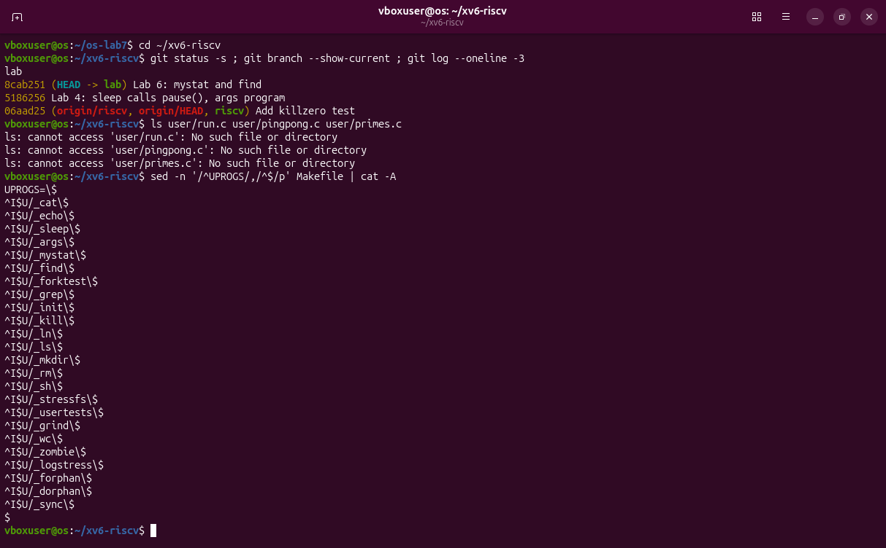

- The tree is clean and on branch `lab`, at my Lab 6 commit, on top of the Lab 4 commit and the course revision `06aad25`.
- None of the three files of this lab exists yet.
- `sed -n '/^UPROGS/,/^$/p'` prints the lines from `UPROGS=` to the first empty line: the whole list. `cat -A` shows the invisible characters: `^I` is a TAB and `$` is the end of the line. `sleep`, `args`, `mystat` and `find` are mine from Labs 4 and 6; `zombie` comes with xv6.

## Part 1 – run, inside xv6

### The program

The sheet gives the whole program, the xv6 twin of `run.c` from Lab 7:

```c
#include "kernel/types.h"
#include "user/user.h"

// the three steps of the shell, inside xv6:  echo hello from the child
int
main(int argc, char *argv[])
{
  printf("parent: my pid is %d\n", getpid());

  int pid = fork();                     // step 1: copy myself
  if(pid < 0){
    printf("fork failed\n");
    exit(1);
  }

  if(pid == 0){                         // only the child runs this
    printf("child: my pid is %d\n", getpid());
    char *args[] = { "echo", "hello", "from", "the", "child", 0 };
    exec("echo", args);                 // step 2: become echo
    printf("exec failed\n");            // runs only if exec failed
    exit(1);
  }

  int status;
  wait(&status);                        // step 3: wait for the child
  printf("parent: child %d ended with status %d\n", pid, status);
  exit(0);
}
```

- `kernel/types.h` and `user/user.h` replace the Linux headers: they declare `fork`, `exec`, `wait`, `exit`, `getpid` and `printf` for xv6.
- `args` is the list of words `echo` will receive, ending with 0. `exec("echo", args)` loads the program file `echo` and starts it with these words.
- `wait(&status)` waits for **any** child and writes its exit status into `status`.
- The program ends with `exit(0)`, the xv6 custom. (In this revision `return 0` would work too: `start()` in `user/ulib.c` calls `main` and then `exit` with its result.)

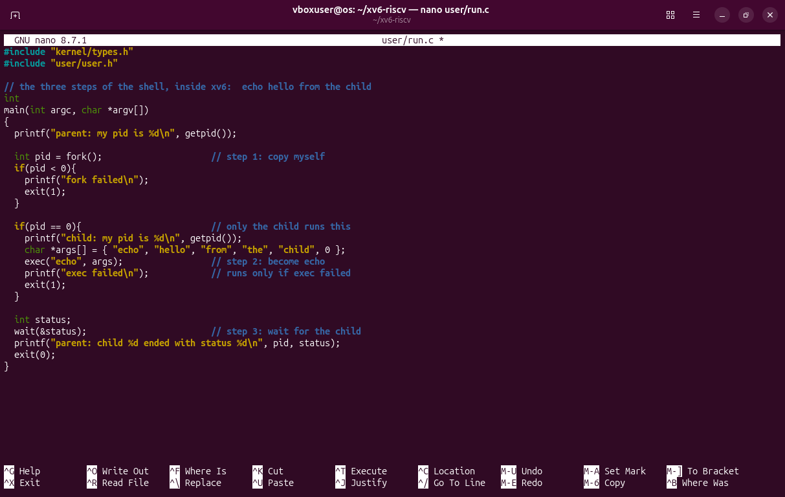

### Into the Makefile

```bash
sed -i 's|^\t$U/_zombie\\$|&\n\t$U/_run\\|' Makefile
grep -n -B1 -A1 "_run" Makefile | cat -A
git status -s
```

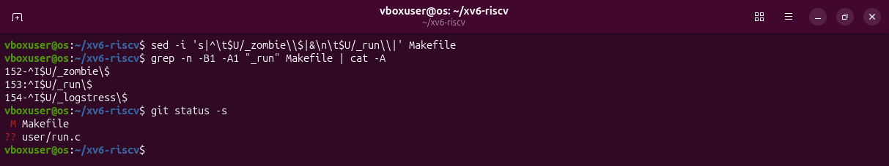

`sed -i` edits the Makefile in place: it finds the line TAB `$U/_zombie\` and replaces it with itself (`&`) followed by a new line (`\n`) TAB `$U/_run\`. That is where the sheet puts the new lines. `cat -A` proves the format: `^I` at the start, `\$` at the end, nothing after the backslash. `git status -s` shows the Makefile modified (`M`) and `user/run.c` new (`??`).

```bash
make qemu
```

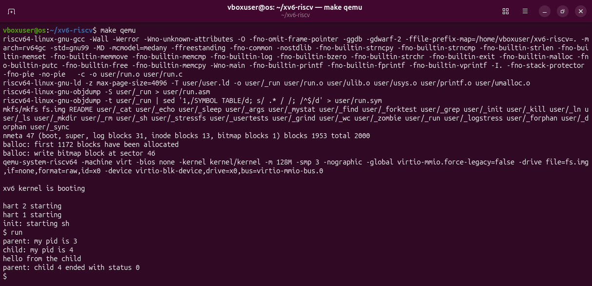

- `make` compiles only what is new: `user/run.c` into `user/_run`. Then `mkfs` builds the disk `fs.img` with all the programs of `UPROGS`, `user/_run` among them, and QEMU boots xv6.
- At the xv6 prompt, `run` prints exactly the lines of the sheet: the parent is pid **3**, the child pid **4**, then `hello from the child`, and the parent sees **status 0**.
- Why 3 and 4: in xv6, `init` is pid 1 and the shell `sh` is pid 2. The shell forked pid 3 for `run`, and `run` forked pid 4.

### The child runs ls

```bash
cp user/run.c /tmp/run.c.orig
sed -i 's|^    char \*args\[\] = .*|    char *args[] = { "ls", 0 };|; s|^    exec(.*|    exec("ls", args);                 // step 2: become ls|' user/run.c
diff /tmp/run.c.orig user/run.c
```

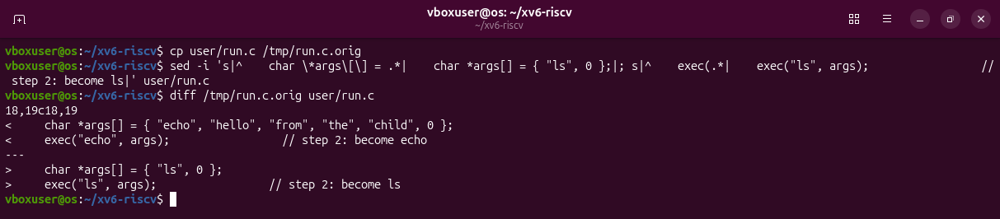

One `sed` with two replacements (separated by `;`) changes the two lines the sheet gives. In the pattern, `\*`, `\[` and `\]` mean the plain characters `*`, `[`, `]`. `diff` shows lines 18 and 19 before (`<`) and after (`>`).

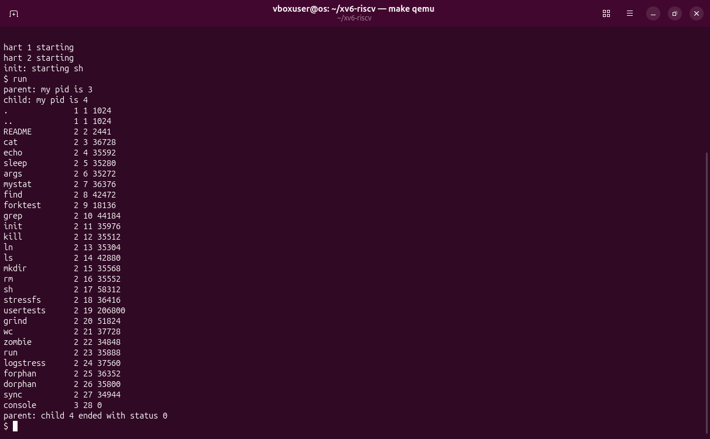

After `make qemu`, `run` prints the parent and child lines, then the listing of `ls`: every file of the xv6 disk, with type, inode number and size. `run` itself is there (inode 23). The parent sees status 0.

### A program that does not exist

```bash
sed -i 's|^    exec(.*|    exec("nosuchprog", args);|' user/run.c
diff /tmp/run.c.orig user/run.c
make qemu
```

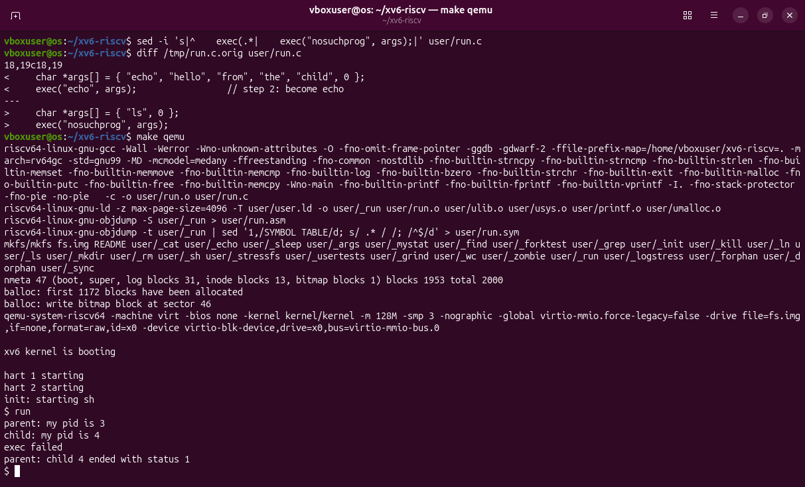

`exec` fails, so the two lines after it run: `exec failed`, then `exit(1)`. The parent prints **status 1**, as the sheet expects.

### The same calls as on Linux

```bash
cp /tmp/run.c.orig user/run.c && diff /tmp/run.c.orig user/run.c && echo "user/run.c is the original again"
grep -n "fork\|exec\|wait\|exit(" user/run.c
grep -n "fork\|exec\|wait\|exit(" ~/os-lab7/run.c
```

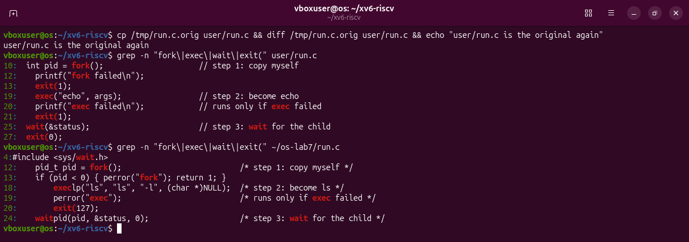

`run.c` is the original again (`diff` prints nothing, so the `echo` runs). The two `grep`s put the calls of both programs side by side:

| Step | xv6 (`user/run.c`) | Linux (`~/os-lab7/run.c`) |
|---|---|---|
| copy myself | `fork()` | `fork()` |
| become another program | `exec("echo", args)` | `execlp("ls", "ls", "-l", NULL)` |
| after a failed exec | `exit(1)` | `exit(127)` |
| wait for the child | `wait(&status)` | `waitpid(pid, &status, 0)` |

```bash
cat -n user/echo.c
grep -n "int wait\|int exit\|int exec\|int fork" user/user.h
grep -n "xstate" kernel/proc.c
```

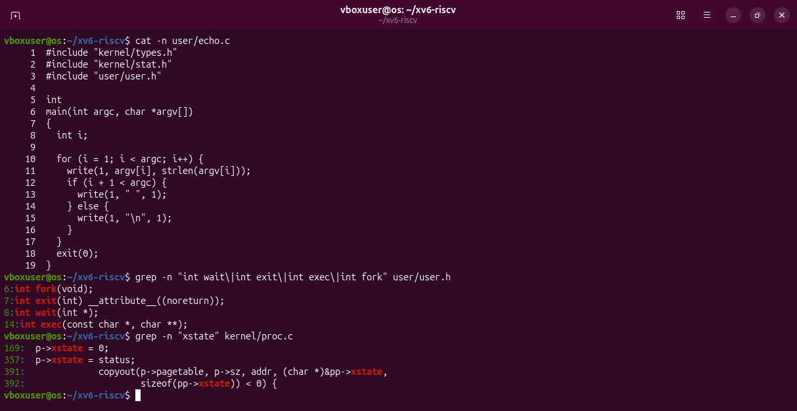

- `user/echo.c` is 19 lines: it writes every argument after its name with `write(1, ...)`, a space between them and a new line at the end. That is who printed "hello from the child".
- `user/user.h` declares the four calls: `int fork(void)`, `int exit(int)`, `int wait(int *)`, `int exec(const char *, char **)`.
- In `kernel/proc.c`, `exit` stores the status in the process: `p->xstate = status;` (line 357), and `wait` copies it to the parent with `copyout(... &pp->xstate ...)` (line 391), as it is.

### Answers

1. xv6: `fork()`, `exec("echo", args)`, `wait(&status)`. Linux: `fork()`, `execlp("ls", "ls", "-l", NULL)`, `waitpid(pid, &status, 0)`. The same three steps in the same order; only the library around them differs (`execlp` searches `PATH`, `waitpid` waits for one given child, xv6 `wait` for any child).
2. `echo` prints it. After `exec` the child is the program `user/echo.c`; the code of `run` after `exec` never runs.
3. The status is the number the child gives to `exit`. The line after `exec` is `exit(1)` in the xv6 `run.c` and `exit(127)` in the Linux one.

## Part 2 – pingpong

### The program

The sheet gives a skeleton with four TODO lines. Mine, with the TODOs written:

```c
int
main(int argc, char *argv[])
{
  int p2c[2], c2p[2];     // parent-to-child, child-to-parent
  char b;

  pipe(p2c);
  pipe(c2p);
  if(fork() == 0){
    close(p2c[1]); close(c2p[0]);       // the ends the child does not use
    read(p2c[0], &b, 1);                // read 1 byte from p2c[0] into b
    printf("%d: received ping\n", getpid());
    write(c2p[1], &b, 1);               // write the byte b into c2p[1]
    exit(0);
  }
  close(p2c[0]); close(c2p[1]);         // the ends the parent does not use
  b = 'x';
  write(p2c[1], &b, 1);                 // write 1 byte into p2c[1]
  read(c2p[0], &b, 1);                  // read 1 byte from c2p[0] into b
  printf("%d: received pong\n", getpid());
  wait(0);
  exit(0);
}
```

- Two pipes: `p2c` carries the ping from parent to child, `c2p` carries the pong back.
- `read(fd, &b, 1)` reads one byte into `b`; `write(fd, &b, 1)` sends the byte in `b`.
- I added `b = 'x';` so that the parent sends a byte with a known value, not whatever was in memory.

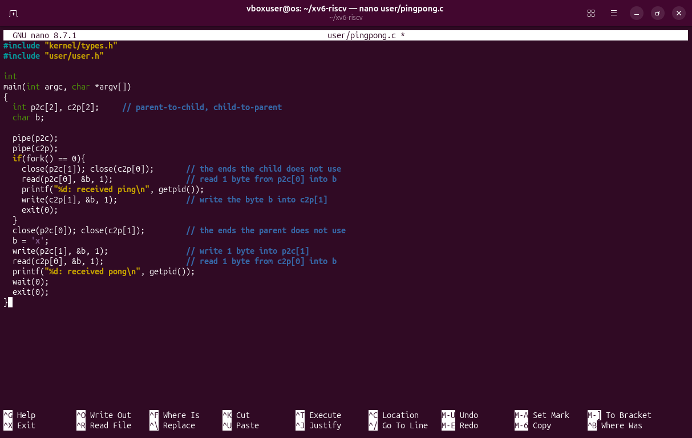

```bash
sed -i 's|^\t$U/_run\\$|&\n\t$U/_pingpong\\|' Makefile
make qemu
```

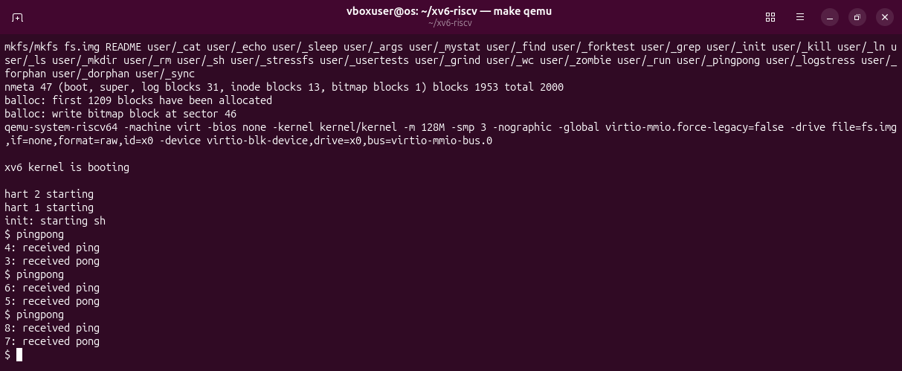

Three runs: `4: received ping` / `3: received pong`, then 6 / 5, then 8 / 7. Each time the shell forks a new process for `pingpong` (3, 5, 7), and that one forks its child (4, 6, 8). The child, with the higher number, always prints first.

The order is forced by the pipes:

| Step | Parent | Child |
|---|---|---|
| 1 | `write(p2c[1])`: sends the ping | `read(p2c[0])`: waits, the pipe is empty |
| 2 | `read(c2p[0])`: waits, the pipe is empty | gets the byte, prints "received ping" |
| 3 | still waiting | `write(c2p[1])`: sends the byte back, exits |
| 4 | gets the byte, prints "received pong", `wait(0)` | |

### Answers

1. A pipe carries bytes in one direction and does not know who reads them. With one pipe for both directions, the parent could read back its own ping before the child takes it, and the child would wait forever. With two pipes, each direction has its own.
2. `read(c2p[0], &b, 1)`. A read on an empty pipe blocks until someone writes into it, so the parent sleeps until the child has replied.

## Optional – primes

`primes` prints the primes from 2 to 35 with a chain of processes: each stage takes the first number that reaches it (always a prime), prints it, and passes on only the numbers that this prime does not divide.

```
main ─2..35─► [2] ─3,5,7,9,..─► [3] ─5,7,11,13,..─► [5] ─► ... ─► [31] ─► (nothing: the last stage ends)
```

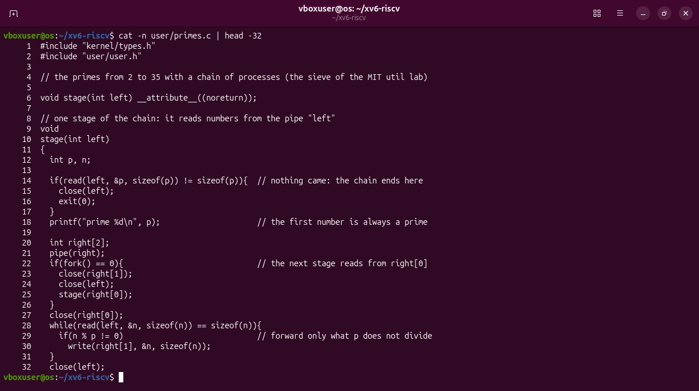

`stage(left)` is one stage:

- it reads its first number `p` from the pipe `left`; if nothing comes (the pipe is closed and empty), the chain ends here;
- it prints `prime p`;
- it makes a new pipe `right` and a child, which becomes the next stage, reading from `right[0]`;
- it reads every remaining number and writes into `right[1]` only the ones `p` does not divide;
- at the end it closes its ends, so the next stage gets end of file, and waits for its child.

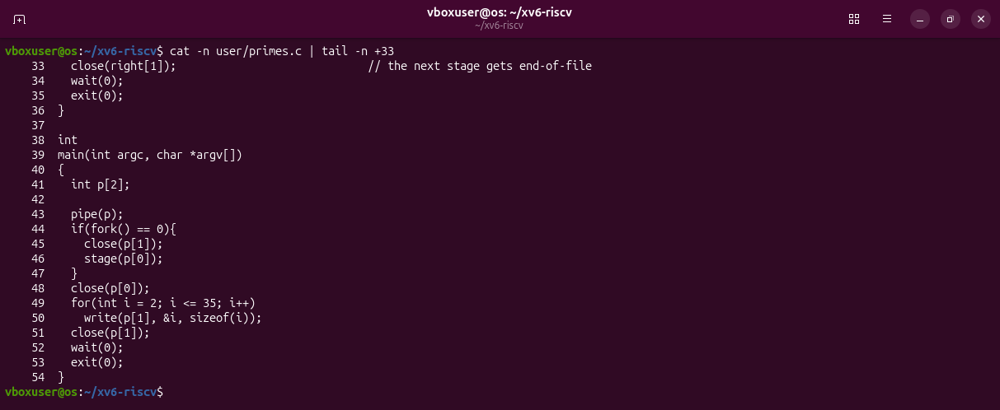

`main` makes the first pipe and the first stage, writes the numbers 2 to 35 (each one an `int`, 4 bytes), closes the pipe and waits. Every process closes the pipe ends it does not use; xv6 allows only 16 open files per process, and a forgotten write end would make a stage wait forever.

```bash
sed -i 's|^\t$U/_pingpong\\$|&\n\t$U/_primes\\|' Makefile
grep -n -B1 -A4 "_zombie" Makefile | cat -A
git status -s
```

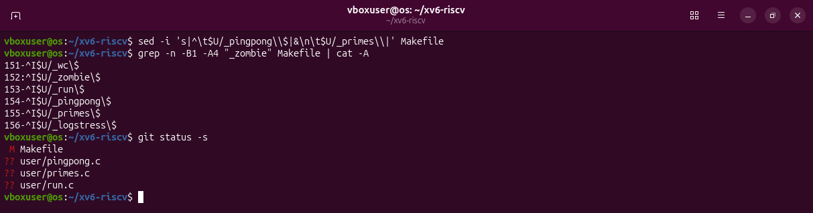

The three new lines are together, right after `$U/_zombie\` (lines 153-155). Git sees the modified Makefile and the three new files.

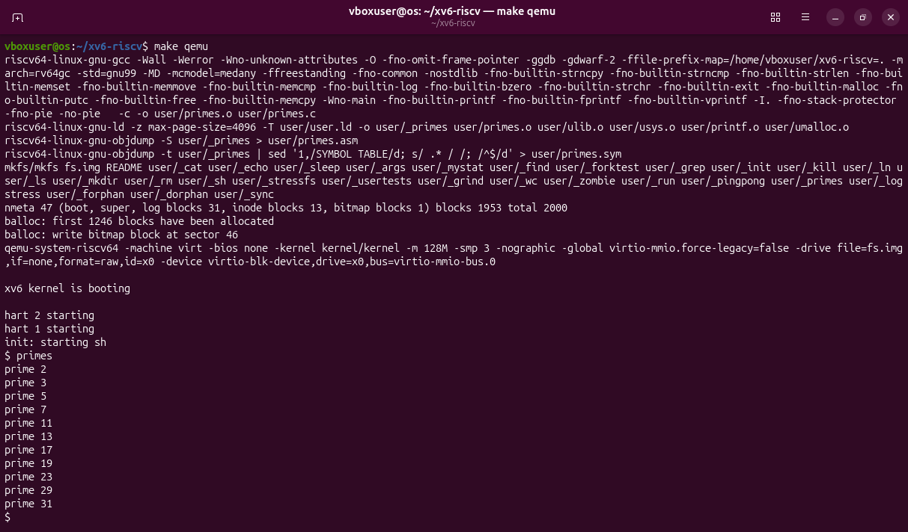

`prime 2` to `prime 31`: the 11 primes up to 35.

## Deliverables

```bash
make clean ; make qemu
```

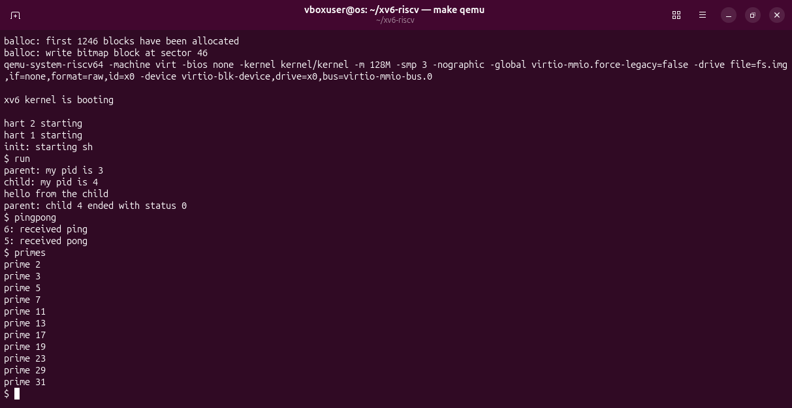

From a clean tree, xv6 builds and boots, and `run`, `pingpong` and `primes` all work, one after the other.

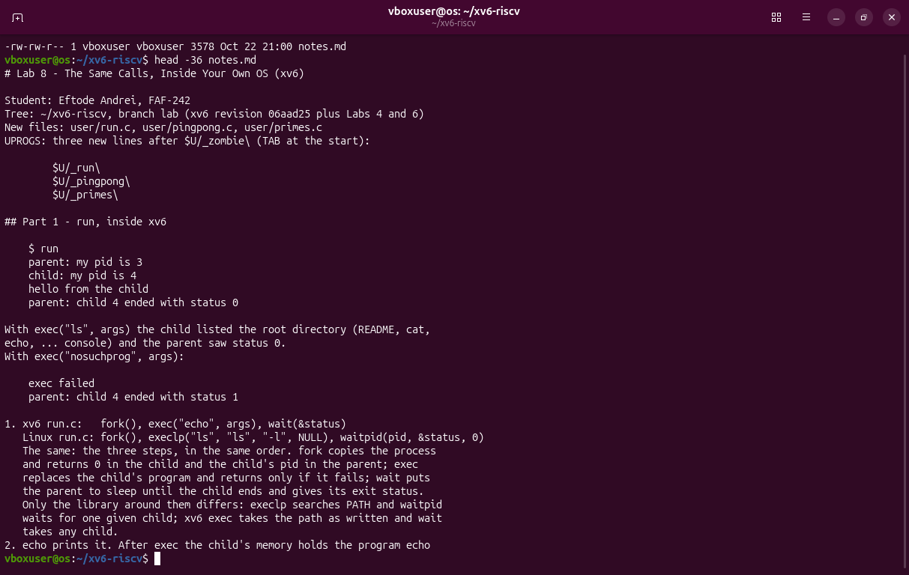

`notes.md` holds the answers, as the sheet asks. I wrote it on Windows and copied it into the VM with `wget`. It replaces the `notes.md` of Lab 6 in the tree; the old one stays in the Lab 6 commit and in [`../lab6/notes.md`](../lab6/notes.md).

```bash
git add user/run.c user/pingpong.c user/primes.c Makefile notes.md
git commit -q -m "Lab 8: run, pingpong and primes"
git log --oneline -4 ; git show --stat HEAD | tail -7
git status -s
```

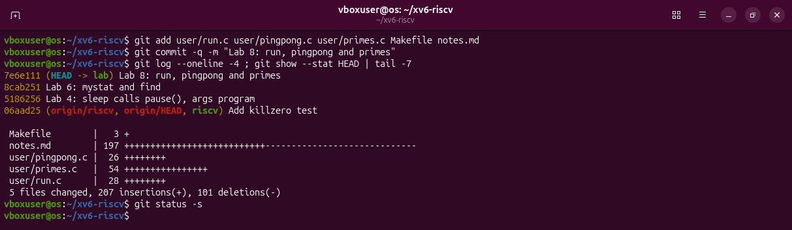

The work is saved in the VM as one commit on branch `lab`, on top of Lab 6: the three programs, the three Makefile lines and `notes.md`. `git status -s` prints nothing: everything is committed. The files in this folder are byte-for-byte copies of the ones in the VM.

## What I learned

- The calls of Lab 7 exist in xv6 with the same names and the same meaning: `fork`, `exec`, `wait`, `exit`, `pipe`, `read`, `write`, `close`. Linux only adds library comfort around them (`execlp` searching `PATH`, `waitpid`, `WEXITSTATUS`).
- The exit status is just the number given to `exit`; the parent receives it through `wait`.
- A pipe is one-way, and a `read` on an empty pipe sleeps. That alone puts the ping before the pong, with no other code.
- A chain of processes connected by pipes can compute something (the primes) as long as every process closes the pipe ends it does not use.
